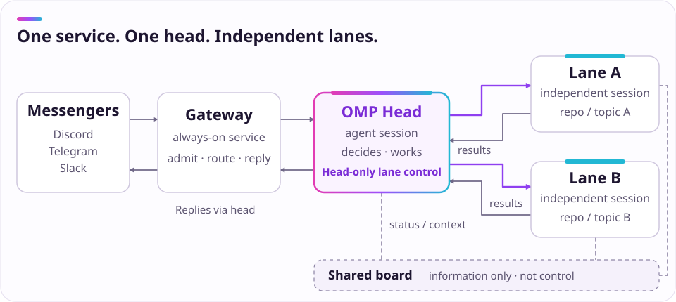

# omp-superagent architecture

Superagent connects one OMP head to Discord, Telegram, and Slack. The head can
work directly or delegate to independent native OMP sessions called **lanes**.
The Gateway keeps the messenger connection and durable intake alive without
running a model. All configured messenger owners are the **same trusted operator**.
Ordinary owner work stays in the native session bound to its topic. Separately,
[restricted group rooms](docs/design/messaging.md#restricted-group-rooms) opt
specific members into explicit group actions without access to the owner head
or lanes. This is not a multitenant service or an OS sandbox.

- [Messaging and authority](docs/design/messaging.md): ingress, routing, controls,
  approvals, recovery, delivery, and Discord voice.
- [Execution and coordination](docs/design/execution.md): lanes, native Host lifecycle,
  models, workflows, managed integration, monitoring, and the board.
- [Setup and operations](docs/OPERATIONS.md): configuration, commands, and recovery procedures.
- [Release records](docs/releases/0.1.0.md#verification-records): dated evidence and its limits.

<picture>
  <source media="(prefers-color-scheme: dark)" srcset="assets/architecture-dark.svg">
  <source media="(prefers-color-scheme: light)" srcset="assets/architecture.svg">
  
</picture>

[Mermaid source](assets/architecture.mmd)

## Ownership and source map

| Component | Responsibility | Entry points |
| --- | --- | --- |
| CLI and setup | Configuration, credentials, doctor, start/status/stop and one-shot macOS registration. | [CLI](src/cli.ts), [config](src/config.ts), [setup](src/setup.ts), [credentials](src/credentials.ts), [autostart](src/autostart.ts) |
| Gateway | One Rust process authenticates the configured adapters, admits intake durably, proxies scoped messenger effects and supervises exactly one head. It never connects to lane RPC or decides work. | [Gateway](gateway/src/main.rs), [server](gateway/src/server.rs), [ingress ledger](gateway/src/store.rs), [client](src/gateway-client.ts), [adapter hub](gateway/src/adapter.rs) |
| Head | Its controller owns intake, placement, approvals and delivery. The shared model handles explicit `/head` work and manager coordination, not ordinary topic prompts or their answers. | [Head extension](src/extension.ts), [runtime](src/runtime.ts), [coordination store](src/store.ts) |
| Lane | Runs its assigned work in its own native session with its own cwd, model and context; reports to the head, not directly to a messenger. | [Lane extension](src/lane-extension.ts), [lane reporting](src/lane-report.ts), [role instructions](skills/lane/SKILL.md) |
| Host | One installed OMP process owns each managed root session. A detached Rust process owns its stdin/stdout and private reconnectable socket; it does not run inference, tools, or supervision policy. | [Host client](src/host.ts), [stdio owner](host-owner/src/main.rs), [SDK helper](src/host-sdk-helper.ts), [native lifecycle extension](src/host-extension.ts) |
| Board | An informational log in `coordination.sqlite` shared by registered head/lane sessions in the same instance. Not a command, approval, or delivery bus. | [Board](src/board.ts), [board extension](src/board-extension.ts) |

OMP owns transcripts, tool history, goals, child tasks, provider auth, and native
execution records. Superagent stores the coordination facts needed to recover work:
intake and receipts, topic bindings, requests and lanes, approvals and delivery
outcomes. `coordination.sqlite` is shared by Gateway and head with independent
connections. It is not a second OMP transcript. The private Unix sockets under the
canonical `stateDir` are instance-owned, not arbitrary URLs or a general RPC proxy.
Native children get neither the manager nor the board. Managed extensions are not
installed globally into ordinary OMP.

The operator CLI is still Bun, not a second resident Gateway. `start` invokes
the packaged native launcher; the daemon constructs only the configured
transports. The short-lived config reader reuses the CLI parser without
importing OMP or messenger SDKs. Session recovery and named preset validation
use their public OMP interfaces on demand; no OMP source or core patch is
part of the native build.

## Startup, readiness, and shutdown

1. Package installation prepares dependencies and the managed integration without
   needing OMP. To run, configure the executable of a separately installed, unmodified
   OMP. `doctor` checks local prerequisites and reports credential presence without
   authenticating bots or starting models. Interactive `setup` does not start bots or
   models; its confirmed final save can update Discord/Telegram avatars, and changing
   the global memory backend requires its own explicit consent.
2. `start` requires a valid active managed integration and starts or reuses one
   detached Gateway. A lifetime lock establishes single ownership. The Gateway starts
   or reconnects to the designated head through private local transport; the root
   head loads the manager and board extensions, a root lane loads the lane and board
   extensions. The Gateway owns configured messenger secrets and removes their
   environment variables from the managed Hosts; this is not isolation from the OS user.
3. Adapter authentication, initial native approval reconciliation, controller
   connection, head initialization, and eligibility to dispatch work are separate
   facts. `gateway.ready` describes transport readiness; `gateway.admissionReady`
   tracks the initial approval barrier. After that barrier, the Gateway can keep
   admitting authorized input while the head is absent. `head.connected` is not
   `head.ready`: readiness also requires a live head, a ready controller, and
   completed preset initialization. Check `gateway.unresolvedEvents` for held ingress.
4. Automatic recovery reconnects only after verifying native PID, session ID/file,
   and socket ownership. Start a replacement only after confirming the old process
   and its stdio owner are gone; remove a stale socket only if its inode is the owned
   one. Uncertain ownership or unresolved admission holds readiness instead of
   creating a second writer or dropping queued work. A reconnect can re-deliver
   ingress to the head, not blindly re-execute native work or remote effects.
5. Client detach is not stop. `stop main` requests safe shutdown of Gateway and head,
   not a bulk stop of lanes. An unsafe/busy Host can refuse, and explicit stop fences
   older restart attempts even when shutdown cannot proceed. `install` on macOS
   registers a per-instance one-shot next-login invocation of the same `start`;
   no `KeepAlive`, immediate activation, or second supervisor. `uninstall` removes
   only future startup. There is no Linux service installer or Windows support.

### Idle head rotation

The Gateway may replace only the designated head after the runtime attests at
least 30 continuous minutes of native head idle and known native context usage
of at least 50%. Pending Gateway ingress, head-dependent work, native approvals,
goals, children, unresolved deliveries and scheduled or placement activity
can make a head ineligible. The stock Host and runtime both recheck their
guards immediately before graceful shutdown. Rotation does not abort work,
cancel approvals, or force-kill a process.

An atomic intake fence leaves new events durably queued in their original
order. The Gateway waits for the exact old native exit and persistence receipt
and the stdio owner's exit before reserving a new head generation. The new
native journal has a different session ID and path; it has no copied transcript
or replayed prompt. The replacement preserves the selected model and configured
effort (including automatic effort) and verifies native readback. Resident
lanes retain their Host, topic binding and generation; the replacement
reconciles already-admitted independent work by its original lane identity
and native journal, not by submitting it again.

Inspect `head.rotation.stage` in `omp-sa status` for the latest rotation.
An ambiguous shutdown never authorizes another shutdown request or early
replacement; a verified exit can continue the existing transition. Explicit
operator stop supersedes an in-flight rotation. `/restart` remains a separate
control and restores the exact current native session, including one created
by rotation.

### Explicit restart

Messenger `/restart` (Slack `!restart` or `/superagent-restart`) replaces **both**
Gateway and its designated head, not the lane Hosts. This is an authenticated
lifecycle control, not a model turn. It can be admitted while the head is busy:

- Durably fence new dispatch and confirm a `sent` acknowledgement on the original
  route before handing off the restart. Checkpoint with native APIs: cancel the
  head's pending cards by their original IDs, abort/clear queued native work and
  pause the active head goal as appropriate. Require actual quiescence before
  normal shutdown; do not force-kill when effects or ownership remain unclear.
- Bind one durable lifecycle request to the original owner input, acknowledgement
  and current process identity. Duplicate delivery does not start another replacement.
  The Gateway's one-shot successor waits for the old lifetime lock to release.
  A later operator stop invalidates the restart and prevents successor revival.
- Restore the exact head native session and saved model/effort and reconcile approvals.
  If the checkpoint recorded `auto`, verify the restored configured selector
  rather than requiring OMP to choose the same effective level again.
  For the same model identified as non-reasoning by both Hosts, stock OMP can
  represent inactive effort as either absent or `off`. Any other effort mismatch
  keeps intake held; a configured default is not evidence of active effort.
  Reconnect to resident lanes within the Host budget only when ownership and
  generation match. Leave out-of-budget Hosts untouched and unloaded lanes unloaded.
  Restore native admission and outcomes from matching journal evidence, not receipts
  from another run. Held submissions are not replayed. Only a goal active before the
  restart with a verified original source can resume through native goal resume;
  previously paused/cancelled goals and interrupted turns without a goal do not
  automatically resume. Preserve undispatched inputs in durable order and report
  readiness to the original route separately from acknowledgement.

## Stock OMP and verification scope

The [package manifest](package.json) pins the published SDK to **19.0.0**, with
upstream [v19.0.0 source](https://github.com/can1357/oh-my-pi/commit/57771ae562b9345e0579bceb2d68d585e3e6927e).
That pin is not a CLI version allowlist. [CLI inspection](src/installed-omp.ts)
checks CLI identity, public `rpc-ui`, resume, extension and model flags, and the
advertised process interface. Host initialization checks the real RPC/extension
surface. Do not patch or build OMP, use the in-tree SDK as the CLI, or use a
runtime wrapper in place of the native CLI.

[CI](https://github.com/dbc-hbin/omp-superagent/actions/workflows/ci.yml)
runs the SDK-matched official CLI and OMP **18.22.2**
on Linux and macOS, plus **18.20.3** on Ubuntu. `bun run test:ci` uses the installed
CLI; `bun run test:baseline` downloads and verifies the SDK-matched official binary.
The [weekly/manual compatibility workflow](https://github.com/dbc-hbin/omp-superagent/actions/workflows/omp-compatibility.yml)
checks the latest upstream release without falling back or changing SDK pins.
These local fixtures cover native RPC/Host, Gateway and setup surfaces; they do not
prove live messenger accounts, provider requests or costs, or login/reboot behavior.
Treat CI configuration as a test matrix, not a test result. For example, the
[v0.1.3 tag run](https://github.com/dbc-hbin/omp-superagent/actions/runs/44695941397)
passed the configured stock CLI checks for that release. See the [release
notes](docs/releases/0.1.3.md) and historical records for their respective scopes.

Same-process native TUI/herdr attachment to managed RPC Hosts is **unsupported**.
Native session discovery and ordinary resume are not attachment or a grant of
managed authority. Historical patched OMP 18.20.0/PTY evidence is kept only in the
[legacy verification record](docs/releases/0.1.0.md#legacy-patched-baseline).

## Upstream references

Inspect current public APIs before adding a subsystem. These are revisions inspected
for design ideas, not a promise of compatibility or permission to copy code. The
[third-party notices](THIRD_PARTY_NOTICES.md) record actual reuse and licensing.

| Reference | Reuse boundary |
| --- | --- |
| [OMP prior review](https://github.com/can1357/oh-my-pi/tree/aece16f78fad7e9e777b4aeaa1ca583544a17723) | Native sessions, tools, approvals, tasks, goals and discovery; inspected Collab hosting was TUI-coupled. |
| [omp-dori](https://github.com/vntrevx/omp-dori/tree/3b5487df12540cdd428ebcf7455375d72921e2dc) and its [receiver/lifecycle review](https://github.com/vntrevx/omp-dori/tree/93bff33007af9da4ea8479bfad4ea7cc9f658a17) | Delegation, reporting and receiver separation are references. No mandatory delegation, duty model, or herdr execution backend. Do not treat SUL-derived code as MIT. |
| [ompbot](https://github.com/gimso2x/ompbot/tree/ddd0f854e8e8d395b7ed43104ec541f909a52ad4) | Head tools and independent lanes: `ompbot_work_start` is distinct from herdr-dependent `ompbot_dispatch` (`taskSpec`/`[TASK]`). Do not assume an installed private RPC module. |
| [TerrifiedBug](https://github.com/TerrifiedBug/omp-telegram/tree/4f9f288f44dfa5dc8afed4f245edceb926d4a54a), [tickernelz](https://github.com/tickernelz/omp-telegram/tree/852938e32aeecf0ef2727230aecc2b3d35e8e1de), [fcying](https://github.com/fcying/omp-telegram/tree/eb693c89d29310c277a9947e36f6e8fe30cc4b88) Telegram bridges | Topic, journal, UI and outbox patterns; neither terminal keystroke simulation nor another per-conversation execution backend. Verify licenses before reuse. |
| [agentix](https://github.com/tenfyzhong/agentix/tree/d0fcc56685fae638a20c46514b4a10b7c8650b69) and [DSH prototype](https://github.com/deepseek-ai/dsh-superagent-prototype/tree/8c32a9dc5d72c033816c6a8110b37f40cf94fba4) | Local ownership, execution slots and durable effects, not headless TUI attach or a replacement agent engine. |

[OpenClaw](https://docs.openclaw.ai/concepts/architecture) and
[Hermes](https://github.com/NousResearch/hermes-agent/blob/main/gateway/session_execution.py)
were compared at branch snapshots on 2026-11-13 (exact revisions not recorded).
Their embedded agent paths do not establish the separate native Host failure
boundary described here.

Restricted group design was compared against
[OpenClaw `6978b40e`](https://github.com/openclaw/openclaw/tree/6978b40e9d3812083064c97e24de00454d6bf868/docs/gateway/security)
and [Hermes `242315ce`](https://github.com/NousResearch/hermes-agent/blob/242315ce571cde721e717a544cf8ae6c343315cf/gateway/authz_mixin.py)
([published docs source `aeb5a071`](https://github.com/NousResearch/hermes-agent/tree/aeb5a071069dbd85d85f2c8d44337f16df29d475/website/docs/user-guide)).
We use separate channel, sender and capability gates without dynamic role
names, wildcard grants, mention bypasses, or a command-only admin check.
[Gajae Way `31fa12d`](https://github.com/Yeachan-Heo/gajae-way/tree/31fa12d829ee68a34b6420c451462bf45168bb54)
is an AGPL-3.0 behavioral reference for result attachments only; no upstream
code is reused.
