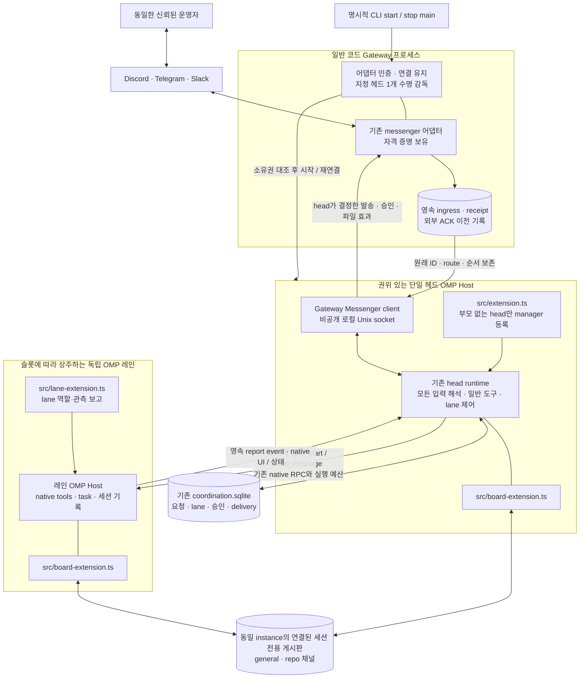
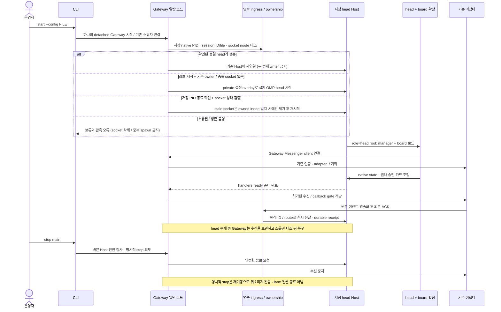
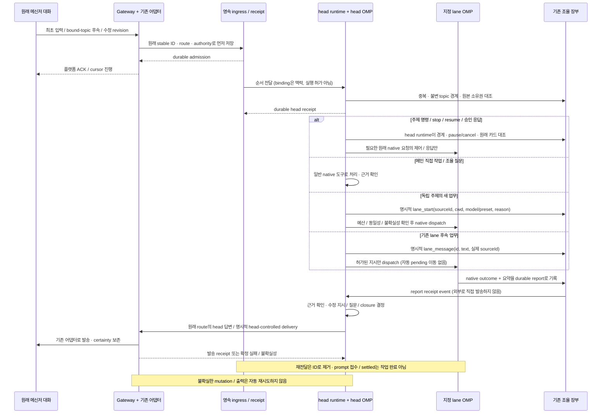
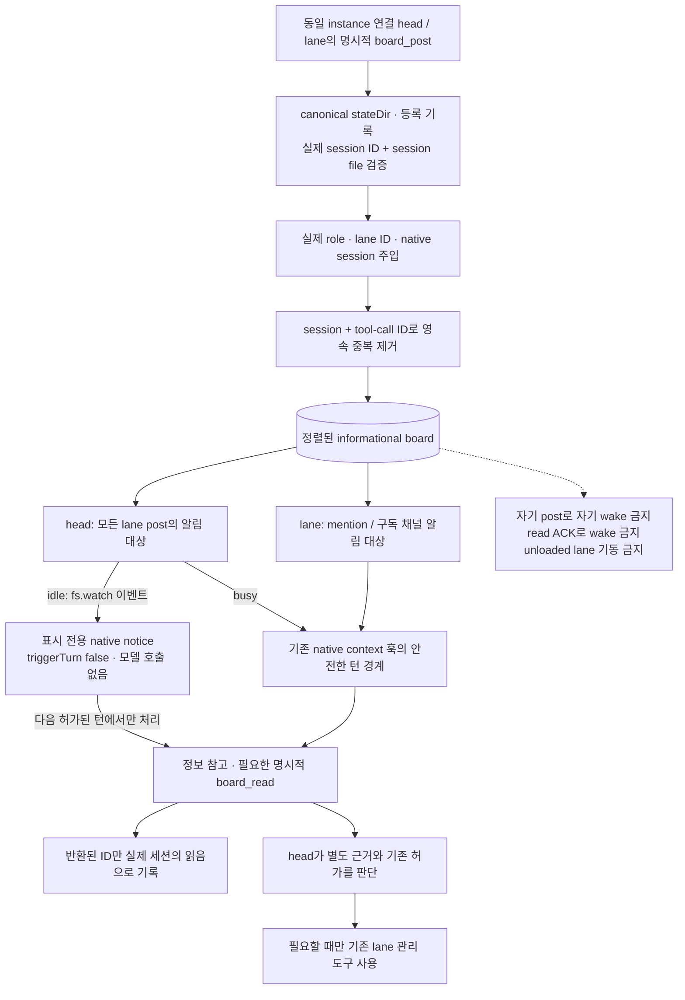

# omp-superagent 설계

이 문서는 **현재 구조와 안전·권한 계약**을 정의한다. 설치에는 OMP가 필요하지 않다.
실행할 때는 별도로 설치한 수정 없는 OMP와 공개 확장/RPC API를 사용하며, OMP 소스 준비·코어
패치·native 빌드는 하지 않는다. 실행 파일은 버전 범위가 아닌 CLI 기능과 실제 RPC/확장 초기화로
확인한다. SDK/API 기준선은 stock OMP 19.0.0이며 upstream `v19.0.0` 커밋은
[`57771ae562b9345e0579bceb2d68d585e3e6927e`](https://github.com/can1357/oh-my-pi/commit/57771ae562b9345e0579bceb2d68d585e3e6927e)이다.
로컬 `test:ci`는 현재 설치된 CLI를 검사한다. PR·릴리스 CI는 SDK와 같은 공식 CLI(`test:baseline`)와
공식 OMP 18.22.2([`e1ae2cc998efd1ca151b46ebefc0e0dab6c23c63`](https://github.com/can1357/oh-my-pi/commit/e1ae2cc998efd1ca151b46ebefc0e0dab6c23c63))
양쪽에서 같은 회귀를 실행한다. Ubuntu CI는 이전 비동기 API를 쓰는 OMP 18.20.3도 검사한다.
주간·수동 호환성 워크플로는 upstream 최신 릴리스를 검사한다.
다운로드 경로는 모두 파일 체크섬과 배포 태그 일치를 확인한다. 새 버전이 호환되지
않으면 호환성 검사만 실패하며, 과거 실행 파일로 우회하거나 SDK lockfile을 자동 변경하지 않는다.
선택된 실행 파일의 `ps --help`로 OMP 18의 프로젝트 브로커와 OMP 19의 사용자 데몬을 구분한다.
둘 다 읽기 전용으로 조회한다. 조회 실패를 다른 백엔드나 빈 목록으로 바꾸지 않으며,
18의 기록에 없는 세대 ID를 만들어 19의 기록과 대조하지 않는다.
비동기 wake 여부는 실행 중인 CLI의 native RPC와 동일하게 읽는다. `wakeSources`가 노출되면
그 값을, OMP 18.20처럼 이전 인터페이스를 제공하면 `hasPendingAsyncWork()`를 사용한다.
소유 서비스·하위 작업·미확인 delivery의 별도 해제 차단은 유지한다.
설치·일상 제어는 [운영 가이드](docs/OPERATIONS.md), 날짜·환경별 실행 결과와 이전 패치된
18.20.0의 제한된 증거는 [릴리즈 검증 기록](docs/releases/0.1.0.md#verification-records)에 둔다.
이전 SDK/API 기준선인 stock OMP 18.22.0의 소스 revision은
`3e8cff3b7ce19a805c11a26a6dd1703066435851`이었다.
이전 기준선의 기록은 OMP 19.0.0 런타임 검증이 아니며, 설계 계약이나 과거 통과 기록을
현재 운영 계정·제공자·attach 지원의 검증으로 해석하지 않는다.

## 1. 목표와 기본 결정

일반 코드 Gateway가 메신저 연결과 헤드 수명을 유지한다. 단일 OMP 메인 헤드가 모든 요청을 받고, 작은 일은 직접 처리하며,
독립 맥락이나 실행이 필요한 일은 OMP 레인에 맡긴다.
기존 OMP·이 저장소의 어댑터/장부/RPC를 재사용하며 공개 구현은 책임 경계의 참고로 삼는다.

- 메인 헤드는 하나다. 별도의 판단용 슈퍼바이저 에이전트를 추가하지 않는다.
- 설정된 Discord·Telegram·Slack을 동시에 연결하되 각 플랫폼 소유자는 **같은 신뢰된 운영자**다.
  모든 소유자의 메인 입력이 동일한 헤드 맥락을 공유하므로 멀티테넌트 사용자 격리로 쓰지 않는다.
  플랫폼별 ID를 검증하며 표시 이름으로 교차 플랫폼 신원이나 권한을 추정하지 않는다.
- 스레드·주제별 맥락과 무관한 저장소의 작업 맥락을 분리한다.
- 레인은 그 대화에서 직접 일하는 OMP 세션이다. 레인마다 감독자와 작업자를 둘씩 만들지 않는다.
- 맡긴 프로젝트 목표 안에서는 헤드·레인이 다음 유용한 일을 선택·우선순위화하고 계획·실행·검증·
  수정을 이어간다. 검증한 중간 결과 뒤에도 남은 허가 작업을 단계별 허락 없이 진행한다.
  완료 기준에 도달하면 멈추며 새 범위·외부 효과·불확실성·승인 경계는 그대로 지킨다.
- 모든 요청을 위임하지 않는다. 메인 헤드와 레인 모두 일반 OMP 작업 능력을 유지한다.
- 저장된 세션 수와 상주 실행 수를 분리한다.
- 실행은 herdr 없이 동작한다. 관리 RPC 세션에 같은 프로세스의 native TUI/herdr를
  붙이는 기능은 지원하지 않는다. 로그 tail·별도 resume 세션을 동일 Host attach로 표시하지 않는다.
- RPC용 실행과 관측용 실행을 별도 AI 백엔드로 만들지 않는다.
- 자체 대시보드, 새로운 모델·인증·컴팩션·서브에이전트 엔진은 만들지 않는다.
- 명시적 `start`가 하나의 detached **Gateway**를 기동하고 Gateway가 정확히 하나의 지정 헤드를
  시작·재연결·감독한다. Gateway는 일반 코드 데몬이지 AI 감독자나 새 실행 백엔드가 아니다.
  macOS에서 명시적으로 `install`한 경우 다음 로그인에 일회성 LaunchAgent가 같은 `start`를
  호출한다. 설치 자체는 봇을 시작하지 않으며 상시 OS 감독자를 추가하지 않는다.
- 실제 메신저 자격 증명·어댑터는 Gateway가 소유한다. 헤드는 로컬 Messenger client로 연결하고,
  **레인 RPC·배정·재시도·결과 판단은 오직 헤드 runtime**이 소유한다. Gateway는 레인 소켓에 연결하지 않는다.
- 최초 입력과 연결된 주제의 모든 후속 입력도 헤드를 거친다. 주제 연결은 맥락 정보이지 자동 dispatch 허가가 아니다.
- 헤드와 관리 레인은 공통 정보 게시판을 사용한다. 게시물은 관측·근거이며 명령·승인·작업 배정이 아니다.

## 2. 구성

| 구성 | 책임 |
| --- | --- |
| Gateway | 실제 메신저 연결·자격 증명, 영속 ingress/receipt, 지정 헤드 1개의 시작·재연결·복구. 레인 제어나 LLM 판단 없음 |
| 메인 헤드 | 모든 입력·후속·주제 명령·승인 처리, 직접 작업, 저장소 조사·선택, 레인 제어·결과 확인, 외부 회신 결정 |
| 레인 | 주어진 주제·작업 범위에서 조사·구현·검증, 필요한 네이티브 task 사용 |
| 헤드 전용 확장 | 기존 runtime과 관리 도구 등록. 부모 없는 head에서만 활성화하고 레인/자식에서는 시작하지 않음 |
| 레인 전용 확장 | 관리 레인 역할 계약 주입. manager registry·메신저 어댑터·헤드 runtime 없음 |
| 공통 게시판 확장 | 동일 instance에 실제 연결·등록된 head/lane만 정보 read/post·구독·알림. 실행·전송·lane RPC 권한 없음 |
| OMP Host | 해당 세션의 실제 추론·도구 실행·기록을 소유하는 단일 실행 주체 |
| native TUI / herdr | 관리 RPC Host의 동일 프로세스 attach는 지원하지 않음 |

Gateway 수신 연결은 헤드/레인의 모델 턴과 프로세스 상주 여부에 귀속되지 않는다. 헤드가
없어도 Gateway는 허가된 수신을 먼저 영속화하고 지정 헤드 복구 뒤 순서대로 전달한다.
Gateway를 모든 lane 실행을 소유하는 별도 manager로 확장하지 않는다.
실행할 허가 작업 없이 이벤트를 기다리기 위해 LLM을 반복 호출하거나 상시 대기 goal을 돌리지 않는다.

### 구현 위치와 시작 경로

| 소스 | 구현 책임 |
| --- | --- |
| `src/cli.ts`, `src/config.ts` | `omp-sa` 실행 이름과 `--config` 필수 CLI, 명시적 start, 설정·소유 경로 검증, doctor/status/stop |
| `src/autostart.ts` | macOS의 인스턴스별 일회성 LaunchAgent install/uninstall·등록 상태 조회. 기존 start를 다음 로그인에 호출하며 별도 Gateway 실행·복구 엔진 없음 |
| `scripts/setup.sh`, `src/setup.ts`, `src/credentials.ts` | controlling-terminal 셋업·토큰 숨김 입력, 기존 config 검증 재사용, owner-only sibling 환경 파일과 start/doctor의 제한된 로딩. 봇 활성화 없음 |
| `src/gateway*.ts` | detached Gateway 기동·소유권·영속 수신/receipt·헤드 감독·로컬 transport 효과 proxy |
| `src/gateway-client.ts` | `createGatewayMessenger(config): Messenger`. 헤드 runtime에 기존 Messenger 계약을 제공하며 stop은 client만 detach |
| `src/extension.ts` | `role=head`인 부모 없는 root에서만 runtime 시작과 관리 도구 등록 |
| `src/lane-extension.ts`, `src/lane-report.ts` | root lane의 역할 지침·근거/대기 관측 보고. 헤드 manager·메신저 권한 없음 |
| `src/board.ts`, `src/board-extension.ts` | 독립 SQLite 정보 게시판과 head/lane 공통 도구·세션별 알림/구독 |
| `src/messengers.ts` | Gateway 안에서 구성된 실제 어댑터·자격 증명을 hub에 연결, 원래 platform으로 발송·승인·첨부 API dispatch |
| `skills/head/`, `skills/lane/` | 해당 root 역할의 `SKILL.md`만 필수 지침으로 주입. 상세 절차는 필요할 때 native `read`로 읽으며, HEAD는 로드된 패키지의 참조 경로를 사용 |
| `src/runtime.ts` | 요청·주제 라우팅, 레인 수명·대기열·예산, 승인·발송·catchup 조율 |
| `src/lane-models.ts` | 허용된 native chat 후보의 안전한 capability/cost 투영과 정확한 provider/id 동일성 |
| `src/contracts.ts`, `src/store.ts` | 명시적 연결/요청/레인 계약과 SQLite 장부. OMP 전체 transcript를 재구현하지 않음 |
| `src/discord.ts` | discord.js 기반 소유자 전용 수신·허용 목적지 검증·대화형 승인·첨부 전송 |
| `src/telegram.ts` | grammY `Api` 기반 getMe/getWebhookInfo/getUpdates long polling·영속 offset·native forum topic·inline 승인·토큰 없는 file 참조 |
| `src/slack.ts` | 공식 SocketModeClient/WebClient 기반 workspace 인증·메시지/Block Kit 수신·history·thread·외부 파일 업로드 |
| `src/host.ts`와 관리 Host 확장 | 설치 OMP의 stdio RPC 시작·재연결·정확한 native identity 확인, 실제 AgentSession의 수명·저널 저장·종료 검사 |
| `src/installed-omp.ts` | 선택한 stock CLI의 경로·버전 보고와 실행 기능 확인. 소스 checkout·빌드·패치 없음 |
| `src/host-services.ts`, `src/host-broker-services.ts` | 선택된 OMP의 서비스 목록을 읽기 전용으로 확인. 시작·교체·인수 없음 |
| `upstream/ulw.json`, `.upstream/ulw/` | 공식 ULW 원격·1시간 갱신 간격과 프로젝트 소유 immutable revision package·원자적 활성 pointer·업데이트 상태 |

설치·준비·doctor는 Gateway나 봇을 활성화하지 않는다. `start`만 Gateway를 백그라운드로
기동하고 세션별 detached 일반 Bun stdio owner가 설치된 `omp --mode rpc-ui`를 시작한다.
owner는 stdio transport와 비공개 재연결 socket만 유지하며 두 번째 AI·실행 backend·supervisor가
아니다. 실제 추론·도구·세션은 OMP가 소유한다. Gateway는 소유권을 확인한 지정 헤드에
재연결하며 자동 작업 재시도를 추가하지 않는다. adapter 표식은 `OMP_SUPERAGENT_HOST_SOCKET`이다.
헤드는 `src/extension.ts`와 공통 게시판
확장, 레인은 `src/lane-extension.ts`와 공통 게시판 확장을 로드한다. 일반 OMP에 전역 설치하지
않는다. 각 관리 Host는 관리형 ULW package도 시작 시 해석한 정확한 revision 경로로 로드한다.
native 자식에는 manager/board 권한이 없고 기존 active-tool 제외와 실행 시 거부를 유지한다.
프로젝트 루트도 `-e` 리소스 경로로 전달한다. 코드 진입점 없는 리소스 패키지이므로 역할
스킬을 native package discovery로 제공하되 봇 확장을 중복 실행하지 않는다. 사용자·프로젝트
스킬 경로를 덮어쓰거나 별도 스킬 레지스트리를 만들지 않는다.

관리형 ULW는 충돌이 없으면 일반 native discovery로 조합한다. 같은 identity의 다른 ULW root가
있으면 공개 stock discovery로 무관한 리소스를 열거하고 명시적으로 선택해 managed factory의
중복 실행을 막는다. 다만 충돌 ULW root와 native TypeScript custom command가 함께 있으면
stock CLI의 `--no-extensions`로 둘을 보존한 구성을 표현할 수 없다. 명시적 선택이 기존
project 리소스 root를 user 범위로 바꾸거나 비활성 모듈을 되살리는 경우도 시작을 거부한다.
정확한 진단을 반환하며 custom command·리소스를 조용히 제거하거나 범위를 바꾸지 않는다.

Gateway는 설정된 메신저 자격 증명을 보유하고 헤드 환경에서는 해당 변수를 제거한다. 이는
같은 OS 사용자의 사고 노출을 줄이는 경계이지 capability framework나 OS 보안 샌드박스가
아니다. 기존 native 모델 제공자 인증·설정·일반 도구는 유지한다. 각 플랫폼 블록은 선택 항목이며
최소 하나가 필수다. Discord-only 설정·동시 어댑터 설정과 기존 신원/권한 검증을 그대로 사용한다.
`doctor`는 설치 CLI의 버전·필요 기능과 `platforms`·환경변수별 `credentials` boolean·
`messengersActivated: false`를 진단하며 봇을 활성화하지 않는다.
소켓은 전용 `stateDir/run`에서 파생하고 임의 URL이나 범용 RPC forwarding을 허용하지 않는다.

### 필수 ULW 설치와 일반 코드 갱신 경계

`omp-ulw`는 선택적 사용자 checkout이 아니라 설치에 항상 포함되는 관리형 의존성이다.
공식 원격은 `https://github.com/dbc-hbin/omp-ulw.git`이며 `upstream/ulw.json`에 기록한다.
OMP 실행 파일과 독립적으로 루트 postinstall 또는 명시적인 `bun run prepare:ulw`로
ULW를 준비한다. Bun pin은 `packageManager: bun@1.4.4`이고
SDK 의존성은 배포된 `@oh-my-pi/pi-coding-agent`, `pi-ai`, `pi-catalog`, `pi-natives`, `pi-tui`, `pi-utils`
19.0.0 패키지다.
0.1.1부터 npm 패키지로 같은 소스·역할 스킬·설치 자원을 배포한다.
`bun add --global --trust omp-superagent@0.1.1` 또는 Bun이 PATH에 있는 환경의
`npm install --global omp-superagent@0.1.1`로 `omp-sa`를 설치한다. 이 고정 버전 예는
OMP >= 18.20.2, < 19를 요구하는 기존 릴리즈를 설치하며 현재 소스를 설치하지 않는다.
Bun의 `--trust`는 패키지의 ULW 준비 lifecycle을 허용하며 별도의 실행 backend를 추가하지 않는다.
설정·자격 증명·세션은 패키지에 포함하지 않고 사용자 지정 경로에 보존한다.
설치 때 원격 기본 브랜치 HEAD를 확인한다. production Gateway 시작에는 이미 유효한
active 설치가 필요하며 검증 뒤 IPC/head를 먼저 시작한다. startup 원격 확인은 백그라운드로
진행하고 이후 `checkIntervalMs: 3600000`에 따라 매시간 확인한다. 느리거나 불가한 upstream이
정상 active를 가진 Gateway 시작을 막지 않는다. 업데이트 확인/준비는 일반 코드이며 새로운
모델 턴·lane 작업·메신저 로그인·별도 supervisor를 만들지 않는다.

확인한 commit의 전체 소스·submodule을 프로젝트 소유
`.upstream/ulw/revisions/<commit>/package`에 materialize한다. 의존성 설치는 임의 lifecycle
script를 무시하고 정해진 materialization과 유한 offline native prompt-composition probe를 거친다.
probe는 배포된 OMP SDK의 실제 system prompt와 ExtensionRunner로 일반 모델 프로필 및 명시적
ULW 활성화의 합성을 각각 검사한다. 프로필·활성화 policy가 비어 있거나 중복되거나 native 역할
교체가 빠지면 활성화하지 않는다. provider 호출·Agent 실행·goal 생성 없이 메모리 세션과
격리된 HOME에서 검사하며, 이미 준비된 revision을 다시 활성화할 때도 같은 검사를 거친다.
SQLite update lock으로 동시 준비를 직렬화하고 완전한 staging/probe 성공 뒤에만 `active.json`을
원자적으로 전환한다. `status.json`에 확인·오류 상태를 기록하며 실패 시 이전 active를 보존한다.
기존 active가 있으면 동일 source repository에서 active commit의 후손인 **fast-forward만**
활성화한다. 기본 브랜치 force-push의 rewind·divergence나 source repository 불일치는 오류로
기록하고 기존 active를 유지한다. 최초 설치는 공식 원격이 광고한 HEAD를 신뢰하며 존재하지 않는
고정 hash를 가정하지 않는다. 이력/source 충돌은 운영자 조정 대상이며 자동 재작성하지 않는다.
이전 revision은 자동 삭제하지 않고 사용자 checkout·전역 OMP 설정·공유 ULW 원본도 수정하지
않는다. 실패를 정상 업데이트로 가정하거나 pointer/lock을 수동 수정해 우회하지 않는다.
첫 staging/probe 실패나 active 설치 누락/무효면 production Gateway는 어댑터 활성화 전에
`bun run prepare:ulw` 선행을 요구하며 실패한다. `start`에서 긴 네트워크 설치를 시도하거나 ULW
없는 실행으로 fallback하지 않는다. 기존 `doctor`는 원격 최신성이나 loader 성공을 검사하지 않는다.

`bun run prepare:ulw -- --status`는 네트워크 없이 영속 상태를 읽는다. Gateway 상태의 `ulw`는
`revision`, `packagePath`, `upstreamRevision`, `checkedAt`, `error`, `updating`을 노출하며
테스트 주입에만 `injected`가 붙는다. `revision`/`packagePath`는 다음 launch의 active package다.
마지막 원격 관측·확인 시각·오류·갱신 중 상태를 분리하며 오래된 성공을 최신성 보증으로 쓰지 않는다.
각 live Host의 정확한 경로는 자기 `OMP_SUPERAGENT_MANAGED_ULW_PATH`에 고정되고 별도 공개
current-Host revision 필드는 없다.

live Host는 로드한 정확한 revision package 경로를 계속 사용한다. 업데이트는 live head/lane을
재시작하거나 hot reload하지 않는다. **각 새 Host launch**가 현재 active pointer를 해석하므로
기존 head가 나중에 새 lane을 시작할 때도 head의 과거 경로를 lane에 전파하지 않는다. 같은
Host의 제어 연결 재접속은 기존 revision을 그대로 사용하며, current Host revision과 다음 launch의
active revision을 구분한다. 설치/업데이트 성공·프로필 로드·선택 SKILL 적용·실제 native mode
활성화·goal 생성·사용자 작업 완료는 서로 별도 사실이다. 절차와 검증 상태는 [운영·설치 가이드](docs/OPERATIONS.md)를 따른다.

### 기동·재기동·명시적 중지

확장은 `session_start`에서 자신의 RPC 큐가 열리기 전 자기 Host 요청을 기다리지 않는다.
초기 승인 조정의 ready gate와 헤드 부재 중 이미 준비된 Gateway의 durable admission은
별도 단계다. 준비 실패/중지 중에는 polling·offset·ACK를 앞당기지 않는다. 헤드의 client stop은
연결 해제일 뿐 실제 어댑터 종료가 아니다. `stop main`은 감독 대상 헤드와 Gateway를 함께
중지하며 즉시 부활시키지 않는다. busy-host 거부, 알 수 없는 socket 보존, 살아 있는 레인의
재연결·보존을 유지한다. macOS 로그인 자동 시작은 아래의 별도 명시적 설치로만 등록한다.
연동 제어 연결 해제는 Host 종료가 아니다. 동일 Host의 native TUI/herdr attach는 지원하지 않는다.

### macOS 로그인 자동 시작

`install --config FILE`은 현재 계정의 `~/Library/LaunchAgents`에 canonical stateDir별
고유 등록을 준비한다. 셸의 임의 `HOME`으로 다른 계정의 서비스 위치를 선택하지 않는다.
등록은 절대 Bun·CLI·config 경로와 argv를 사용하고, 셸 명령 문자열로 해석하지 않는다.
자격 증명은 기존 비공개 `FILE.env`에서 시작 시 읽으며 plist에 토큰·임의 환경을 복사하지 않는다.
설치 시 파일에 필요한 credential 이름이 준비됐는지만 확인하며 계정 인증은 하지 않는다.

`RunAtLoad`로 로그인 시 기존 `start`를 한 번 호출한다. `KeepAlive`는 끄고 launcher 종료가
detached Gateway를 정리하지 않게 한다. Gateway의 HEAD 감독·수명 소유권·메신저 `/restart`
successor 경로는 바꾸지 않는다. 설치 중 즉시 bootstrap·봇 로그인하지 않으며 준비·setup·doctor가
자동으로 설치하지 않는다. macOS 로그인 전 부팅 서비스, Linux/systemd·Windows 서비스,
Gateway crash 자동 재시작은 제공하지 않는다.

`status`의 `autostart`는 파일 등록·launchd 상태를 실제 Gateway/head ready와 구분한다.
`uninstall`은 정확히 소유한 등록만 제거하며 실행 중인 시작 launcher는 강제로 끊지 않는다.
Gateway/head·레인·자격 증명·세션 기록은 보존한다. `stop main`은 현재 실행을 중지하고
즉시 부활하지 않지만 등록을 유지하면 다음 로그인에 다시 시작한다. 영구 해제는 `uninstall`이다.
셸 환경에만 있던 credential은 다음 로그인에 상속되지 않으며 이동한 설치 경로는 재등록해야 한다.

Gateway endpoint는 `stateDir/run/gateway.sock`, 로그는 `stateDir/logs/gateway.log`다. 같은
`coordination.sqlite`의 `gateway_events`/`gateway_effects`와 metadata를 사용하고 별도 SQLite
lifetime lock으로 실제 Gateway 단일 소유자를 지킨다. 상태는 `gateway.ready`(실제 transport
인증 준비), `gateway.admissionReady`(최초 native 승인 barrier 통과), `head.pid`, `head.ready`
(controller gate), `head.connected`로 구분한다. 최초 ready barrier 이후에는 head outage 동안도
durable admission이 계속 열려 있다. 바쁜 native Host가 stop을 거부하면 서비스를 유지하고,
성공적인 stop은 native shutdown 전에 supervisor 재기동을 억제한다.
`gateway.unresolvedEvents`는 안전한 admission/답변 복구를 기다리는 미해결 ingress 수다.
이런 입력이 남아 있으면 `head.ready`는 false로 유지한다. 지속적으로 모호한 native 답변은
pending 순서를 보존하고 최대 30초의 capped reconnect backoff로 복구를 시도한다. 모든 문제
입력의 자동 복구를 보장하거나 맹목 replay/유실 처리로 ready를 만들지 않는다.

자동 복구는 저장한 native PID·session ID·session file·socket inode의 정확한 소유권 대조가
가능한 경우에만 한다. 재기동은 저장 PID의 실제 종료를 확인한 뒤에만 허용하며 stale socket도
저장된 owned inode와 정확히 일치할 때만 제거한다. 알 수 없거나 교체된 socket, 살아 있는 PID의
잘못된/관측 불가 identity, launch 뒤 durable ownership 기록 전 crash는 **운영자 조정이 필요한
보류 상태**다. 모든 crash를 자동 복구한다고 주장하지 않는다.
native PID가 종료됐어도 pipe owner가 살아 있으면 기존 15초 종료 한도 안에서 정리를 기다리며,
소켓이 먼저 사라져도 owner 종료 전에는 새 head를 띄우지 않는다. 한도 초과나 inode 변경은 오류로 보류한다.
기존 transcript가 있는 head의 재시작에는 `config.model`을 다시 전달해 native 저장 모델을 덮지 않는다. status의 `head.ready`는
controller-ready이며 native PID 생존·정확한 identity·Gateway adapter-ready와 각각 다른 사실이다.

### 명시적 메신저 재시작

`/restart`(Slack `!restart` 또는 `/superagent-restart`)는 모델 턴이 아닌 우선 제어 명령이다.
Gateway와 지정 헤드 프로세스를 **모두 교체**하되 동일 native session file·session ID·모델 설정·
입출력/승인/레인 기록을 보존한다. 요청 시 바쁘다는 이유로 거절하지 않는다. 원래 route의
접수 응답이 `sent`인 뒤 헤드 카드만 원래 native ID로 취소하고 우선 abort/queue 회수와 goal
pause로 체크포인트를 만든다. 실제 native quiescence가 확인된 뒤에만 정상 shutdown한다.
독립 레인의 Host·작업·승인은 중단하지 않으며 교체 헤드가 정확한 PID/session/generation에
다시 연결한다. 서비스·소유권·효과가 해소되지 않으면 구체적 보류로 남기며 강제 종료하지 않는다.

헤드는 서비스 전체의 새 dispatch를 막고 원래 명령을 완료 처리한 뒤 기존 outbox로 접수
응답을 보낸다. 그 출력이 실제 `sent`임을 확인한 경우에만 인증된 Gateway 재시작 요청을 보낸다.
Gateway는 원래 소유자 입력·정확한 응답·현재 프로세스 신원을 대조하고 요청 ID별 수명 기록을
영속화한다. 재전달은 같은 기록을 반환하며 두 번째 교체를 시작하지 않는다.
socket Host는 실제 native session journal에 원래 RPC ID의 `rpc_prompt_result`를 발송 전에
영속화하고 실제 run 시작도 `rpc_agent_start`로 한 번씩 기록한다. 첫 receipt 전에 체크포인트한
레인의 후속 run 실패·중단은 이 native 경계와 마지막 outcome으로 복구하며 첫 성공으로 덮지 않는다.
동일 PID·세션·generation의 admission은 제어 연결 재접속에서 buffered 이벤트를 관측하기 전에 복원한다.
초기 state/journal 읽기 사이의 완료 이벤트도 원래 입력·승인에 귀속한다. 복구한 작업은 정착할 때
native journal을 다시 대조하며, 두 읽기 사이에 lifecycle이 바뀌면 그 이벤트가 요청한 후속 정착에서
확인한다. run 수는 체크포인트 cursor에 고정해 재구성하고 assistant는 실제 이전 run 경계에
귀속하므로 중복 집계나 이전 실패를 새 실행의 outcome으로 옮기지 않는다.
교체 헤드는 체크포인트의 동일 세션·파일·요청 receipt만 사용해 레인 admission을
복원한다. receipt가 없는 과거 제출/외부 효과는 uncertain으로 유지하고 원래 prompt를 재제출하지
않는다. 헤드의 모델·effort readback이 일치하고 초기화가 확인되면 fence를 해제한다. 재시작이
중단한 활성 헤드 goal만 기존 source/route에 묶인 별도 native `goal resume` receipt로 이어가며,
이미 paused/cancelled인 goal이나 uncertain 제출은 자동 재개하지 않는다. 미제출 입력은 원래
장부 순서로 처리한다. goal 없는 중단 턴의 자동 복원 RPC는 없으므로 새 prompt로 위장하지 않는다.
native goal 생성 이벤트의 실제 owning input을 goal ID·session별로 보존한다. no-progress로
settled 상태가 되어도 이 원래 source/route를 재사용하며 `/restart` 입력을 대체 owner로 쓰지 않는다.
소유권을 확인할 수 없는 기존 native goal은 서비스 교체를 막지 않고 자동 재개만 보류한다.
Gateway가 소유한 정상 shutdown 경로와 일회성 일반 코드 successor가 기존 수명 lock 해제 뒤
새 Gateway를 시작한다. 헤드는 자신을 종료하지 않으며 새 AI supervisor나 실행 backend를 만들지 않는다.

새 헤드는 원래 세션과 실제 초기화 상태를 확인하고 원래 대화의 outbox에 결과를 알린다.
접수·프로세스 시작·준비 완료를 구분하고 불확실한 종료/발송/기동을 자동 재시도하지 않는다.
명시적 운영자 `stop main`이 재시작을 취소한 뒤 successor가 서비스를 되살려서는 안 된다.
명시적 stop 경계는 영속화한다. handoff 전 헤드 stop도 재시작 intent보다 우선한다.
체크포인트의 각 비동기 경계·게시와 Gateway의 수명 접수 직전에 동일 request와 캡처한 stop
경계를 재대조한다. 중지된 fence는 과거 snapshot으로 재취득하지 않는다. native busy로
`stop main` 종료가 거부되어도 해당 stop 경계는 이전 restart를 무효화한다.
모호한 승인 답변이 Gateway ingress 앞에서 격리되어도 원래 승인 캐시 복원 barrier와
소유자 `/restart`·`/stop` 제어는 헤드에 전달할 수 있다. 일반 입력의 순서와 격리 상태는
그대로 보존하며 Gateway가 승인하거나 레인 배정을 판단하지 않는다. 체크포인트는 아직
native에 남은 answered-attempt 세대의 취소 신원만 내용 없이 기록한다. 늦은 원래 답변은
rejected로 조정하며 이미 소비된 승인/외부 효과를 취소했다고 주장하지 않는다.
완료된 초기 승인 복원 상태는 인증된 동일 controller/PID에 귀속한다. 격리된 답변이 SSE만
끊어도 진행 중인 비동기 restart 접수를 무효화하지 않으며, 새 controller와 초기 barrier의
인증·승인 준비 요건은 유지한다.

### 플랫폼 인증·운영 설정

플랫폼 앱·권한은 [운영 가이드의 플랫폼별 설정](docs/OPERATIONS.md#2-플랫폼별-앱과-접근-범위),
셋업·프로필 사진·Mnemopi·judge 권장 절차와 저장 효과는
[설정 절](docs/OPERATIONS.md#3-설정)을 따른다. JSON/argv에 토큰 값을 넣지 않는다.

셋업은 owner-only sibling 환경 파일에 구성된 credential만 저장한다. `start`·`doctor`의
제한된 loader는 비어 있지 않은 셸 값을 우선하며 shell source/eval을 하지 않는다.
Bun의 자동 dotenv와 OMP 라이브러리의 dotenv는 별개다. 전자는 `--no-env-file`로 끄고,
셋업·진단은 후자를 import하지 않는다. start는 선택한 credential 검사 뒤 Gateway를 로드한다.
이미 옵션 없이 읽힌 환경을 나중에 취소할 수 있다는 보장이나 OS 보안 격리는 없다.

셋업 최종 저장은 고지한 Discord/Telegram 봇 프로필 변경 REST 호출을 포함한다. Mnemopi
전역 backend 변경은 별도 명시적 동의도 요구한다. 로컬 저장·프로필 적용·실효 기억 설정을
구분하고 실패한 외부 효과를 자동 재시도하지 않는다. setup·doctor는 상주 메신저 연결이나
모델 세션을 시작하지 않으며 doctor는 토큰 유효성·실제 계정 권한을 검증하지 않는다.

| 플랫폼 | 실제 인증·수신 경계 |
| --- | --- |
| Discord | 실제 bot/Gateway 계정·숫자 owner ID를 확인. 서버·부모 채널 allowlist를 모두 요구하며 소유자 1:1 DM은 별도 허용 |
| Telegram | `getMe`의 bot ID와 실제 소유자를 확인. 허용 그룹의 직접 소유자 메시지만 수락하며 익명·봇·forward/via_bot/business 신원을 권한으로 쓰지 않음. long polling을 사용하고 기존 webhook은 자동 제거하지 않음 |
| Slack | `auth.test`의 bot/workspace·`users.info`의 활성 인간 소유자·실제 membership을 대조. 그룹 DM 불허. 공식 Socket Mode/Web SDK로 동작하며 별도 공개 HTTP endpoint나 폐기된 `files.upload`를 사용하지 않음 |

## 3. 요청 라우팅과 맥락 경계

### 메인 대화

메신저의 구현·변경 등 작업 지시는 최소한의 범위/cwd 확인 뒤 먼저 작업 스레드·topic에
연결한다. 헤드는 `lane_start.kickoff`에 사용자 언어로 짧은 구체적 진행 방식을 제공하며,
runtime은 해당 목적지로 이 메시지가 발송됐다는 영수증을 확인한 뒤 레인 실행을 허용한다.
질문·상태 조회·계산·연결 테스트는 직접 답하고, 사용자가 명시적으로 메인 작업을 요청하면
헤드의 직접 실행 능력도 유지한다. 같은 작업의 후속 지시마다 새 스레드를 만들지 않는다.

새 DM, 아직 담당이 없는 요청, 여러 작업의 현황·조율뿐 아니라 **연결된 주제의 후속 입력도
모두 메인 헤드가 먼저 받는다.** Gateway는 수신·저장·전달만 하며 작업 내용을 라우팅하지 않는다.
질문·조율과 사용자가 메인에서 처리하도록 지정한 일은 직접 끝낸다.
작업 지시의 thread-first 정책 외에 코드 크기·PR·단계 수만으로 추가 레인을 강제하지 않는다.

### 독립된 스레드·주제

- 새 스레드·topic의 작업 맥락은 독립 OMP 레인으로 분리하되, 헤드가 범위·cwd·모델을 결정한 뒤
  명시적 `lane_start`로 연결한다. 스레드 생성 자체가 Gateway의 lane 실행 허가가 아니다.
  원래 대화에는 연결한 작업 스레드나 주제만 안내한다.
- 같은 스레드의 후속 메시지도 원래 route·source ID와 기존 연결 정보를 담아 헤드로 전달한다.
  헤드가 직접 답할 조율인지, 기존 레인으로 보낼 작업인지 판단하고 필요하면 `lane_message`를 호출한다.
- 새 레인을 만들어도 이미 헤드에 접수된 후속 메시지나 대기 입력을 자동으로 레인에 옮기지 않는다.
  각 새 지시는 실제 저장된 입력 ID와 명시적인 head dispatch를 요구한다.
- 새 레인은 메인 헤드의 전체 대화를 상속하지 않는다. 원본 요청, 관련 근거, 제약만 인계한다.
- 레인의 `repoRoot`와 게시판 저장소 채널은 해당 cwd에서 Git으로 탐색하되, 시작 셸의
  `GIT_*` 선택·설정 환경을 상속하지 않는다. 일반 도구의 실행 환경 전체를 격리하는 것은 아니다.
- 별도 주제로 분리된 요청은 새 연결을 만든다. 불명확한 주제 전환을 모델 추측만으로 확정하지 않는다.
- 스레드 없는 DM은 메인 대화를 기본으로 한다. 명확한 독립 주제는 별도 사용자 명령 없이
  헤드가 `lane_start`로 분리하며 native thread/topic을 우선 생성하고 미지원 private chat만
  논리 주제를 사용한다. `/new 요청`은 명시적 주제 경계 제어로 유지한다.
- 종료된 작업의 후속 대화는 같은 기록을 재개할 수 있다. 일시정지·취소된 작업을 자동 입력으로 재개하지 않는다.

스레드 없는 private/DM의 논리 주제는 실제 플랫폼 thread로 위장하지 않는다. `Route.topicId`는
선택적인 논리 연결 키이며 실제 channelId와 null인 threadId는 그대로 둔다. 주제가 없는 기존
물리 연결 키는 바뀌지 않는다. 아래 `/` 제어는 Discord·Telegram의 일반 메시지 표기이며
Discord는 명시적으로 등록한 application command도 같은 제어 경로로 정규화한다.
Slack은 같은 의미의 **`!new [요청]`, `!main`, `!stop`, `!resume`** 일반 메시지를 정규화한다.
등록된 `/superagent-new`·`/superagent-main` 등도 같은 제어 경로로 연결한다.
Slack client가 가로챌 수 있는 `/new`를 등록된 slash command처럼 안내하지 않는다.
실제 메시지 ID/ts와 Discord interaction snowflake로 순서를 보존하며 가짜 timestamp를 만들지 않는다.
Discord 명령 입력은 `messageId: null`과 실제 `interactionId`를 구분한다. interaction ID를
메시지 fetch·반응·history cursor·스레드 원본으로 사용하지 않으며 응답 token은 영속화하지 않는다.
Slack 명령에는 실제 메시지 `ts`가 없으므로 `messageId: null`과 소유 범위에 묶인
비가역 호출 fingerprint를 저장한다. `trigger_id`·`response_url`은 저장하지 않는다.
DM 명령 경계는 마지막으로 영속 접수한 실제 소유자 메시지 뒤에 놓고 같은 anchor에서는
영속 접수 순서를 따른다. 이는 관측한 접수 순서이지 여러 연결 사이의 전역 송신 시각 보장이 아니다.
기존 메시지 timestamp 경계와 이미 접수한 수정본의 원래 주제 바인딩은 유지한다.

### 기본 steer와 자동 native 주제 연결

활성 실행과 **platform/account/authority/channel/thread/topic 전체 route가 같은** 일반
후속 입력은 native `prompt`의 `streamingBehavior: "steer"`로 전달한다. 별도 `/steer`
명령은 요구하지 않는다. 새 source ID를 유지하며 레인 입력은 여전히 헤드의 명시적
`lane_message`가 필요하다. 다른 대화·내부 보고·workflow 선택·제어 명령은 현재 실행에
섞지 않는다. 일시정지·승인·압축·불확실성 보류도 우회하지 않는다.

각 입력을 native 제출 전에 영속화하고 개별 `prompt_result`와 실제 settled 상태를
대조한다. admission ACK는 완료가 아니다. 같은 대화의 합쳐진 실행은 최종 답변/레인
보고를 한 번만 만들며 개별 접수 기록은 모두 정리한다. abort/disconnect/restart에서도
steer로 합류한 입력을 누락하거나 자동 재제출하지 않는다.

| 플랫폼 | 자동 생성 범위 | 미지원/제약 |
| --- | --- | --- |
| Discord | 허용된 서버 text/announcement 부모의 public thread, forum/media의 starter-message post | DM은 논리 주제. 필수 태그 forum/media는 조회한 정확한 태그 ID를 명시해야 생성 |
| Telegram | forum supergroup의 topic 또는 `getMe.has_topics_enabled`인 owner-private topic | supergroup 관리자·`can_manage_topics` 필요. 일반 그룹은 topic 생성 불가 |
| Slack | 허용 채널·owner-DM의 실제 root `ts`에 붙는 thread | 기존 thread 안에는 중첩하지 않고 별도 root를 생성 |

실제 capability는 인증된 어댑터가 읽고 Gateway가 전달한다. 권한·네트워크 실패를
“미지원”으로 바꿔 조용히 다른 목적지에 보내지 않는다. 봇 topic 모드·권한을 변경하거나
채널·서버를 임의로 생성하지 않는다.

Discord의 `thread_inspect(sourceId, laneId?)`는 원본 사용자 입력의 채널/스레드 또는
지정한 관리 레인의 스레드에서 제목·보관 상태·부모의 availableTags/필수 태그 정책·현재 태그를
읽는다. `lane_start.appliedTags`는 새 forum/media 글에 적용할 정확한 ID 목록이며
최대 5개, 중복 없이 선택한다. text/announcement와 기존 thread 연결에는 태그 인자를
허용하지 않는다. moderated 태그는 ManageThreads 권한이 필요하다. 선택 태그는 생성 의도에
함께 기록하며 동일 source의 충돌 선택이나 불확실한 생성을 자동 재시도하지 않는다.

`lane_thread_update(id, sourceId, changes)`는 등록된 Discord guild thread의 title,
appliedTags, archived만 변경한다. 원본 수신 사용자 source와 양쪽 route를 검증하고
봇의 ManageThreads 권한을 요구한다. 태그 생략은 보존, 빈 배열은 명시적 제거이며 필수
태그 정책을 우회하지 않는다. 한 번의 SDK edit 뒤 실제 상태를 다시 읽어 요청값을 확인한다.
결과 유실/불일치는 uncertain으로 남기며 source별 의도·영수증과 Gateway effect 장부로
중복 변경을 막는다. 같은 source 재호출의 성공값은 과거 영수증이지 현재 상태가 아니다.
보관은 레인을 pause/close하지 않고 다시 열기도 resume하지 않는다. 완료 보고나
게시판 글이 외부 변경 권한을 만들지 않으며, 제목 변경은 레인 ID·저장된 작업 제목을 바꾸지 않는다.

기존 thread의 같은 주제는 연결된 세션을 재사용한다. 명확히 다른 주제/저장소는 헤드가
`destination`에 같은 허용 부모와 `threadId:null`(논리 `topicId` 없음)을 지정해 sibling
생성을 선택한다. 원래 thread의 binding은 보존한다. 생성 의도와 결과를 원본 source ID에
고정하고 원격 생성 전에 불확실성 기록을 남긴다. 모호한 원격 결과는 맹목 재생성하지 않는다.
논리 주제에서 native thread로 넘어간 alias는 head 맥락에만 사용하며 과거 대기 입력을
이동시키지 않는다.

바인딩 안내는 영속 outbox로 발송하며 저장된 레인·대화 식별자와 실제 Host 실행 여부를
구분한다. 원래 메인 답변은 원래 대화에 남는다. 생성한 주제 레인의 결과는 head가 명시적으로
선택한 목적지를 가진 durable report로 돌아오고 그 보고에 대한 헤드 답변이 해당 thread로
나간다. 레인이 직접 외부 발송하거나 마지막 활성 대화로 결과를 보내지 않는다.

### 헤드 모델·effort 제어

`/model`, `/model list`, `/model <provider/model>`, `/effort`, `/effort <level>`은
head runtime이 일반 코드로 처리하는 메신저 명령이다. Slack은 `!model`, `!effort` 표기를
같은 경로로 정규화한다. 현재 주제가 레인에 연결되어 있어도 대상은 **공유 메인 헤드
세션**이며, 응답에 대상을 표시하고 원래 요청 route로만 보낸다. 모델 턴이나 레인 dispatch는
만들지 않는다. 모델은 native 가용 chat 목록의 정확한 provider/id, effort는 native
`get_available_thinking_levels`가 광고한 값만 허용한다. 별도 모델·effort 목록을 유지하지 않는다.

`/model preset`(또는 `/model preset list`)은 기존 `NativePresetManager.inspect()`로
프리셋을 조회하고 `/model preset <name>`은 기존 resolve 결과의 전체 역할·기본 thinking
snapshot을 native `set_model_preset`으로 적용한다. 기본은 head 세션 전용이고 프리셋 원본을
저장·생성·삭제하지 않는다. `/model preset <name> --global`을 명시한 경우에만 헤드 적용을
확인한 동일 snapshot을 기존 native Settings의 전역 기본 역할·thinking으로 저장한다.
프리셋이 thinking 정책을 생략하면 현재 헤드의 세션 정책을 상속한다. 영속 기본값으로
되돌리지 않으며, 프리셋의 명시적 정책과 모델 selector의 명시적 effort 우선순위는 유지한다.
레인은 기존처럼 생성 시점의 유효 정책을 고정하므로 이후 전역 변경으로 재해석하지 않는다.
전역 저장은 기존 실행 레인이나 프로젝트 override를 바꾸지 않는다. 변경 전후 실제 모델·effort와
세션/전역 범위를 회신하고 세션 적용 성공·전역 저장 실패의 부분 결과를 구분한다.
적용은 유휴·session scope와 전체 native readback을 요구한다. 확인된
head 설정은 native session ID별 metadata에 보관하고 재시작의 private `--config` overlay로
복원한다. 제거된 역할은 null tombstone으로 복원해 이전 전역 역할이 다시 살아나지 않게 한다.
시작 시 과거 프리셋을 다시 적용하지 않으므로 이후 transcript에 기록된 명시적 모델·effort 선택을
과거 프리셋 기본값으로 덮지 않는다.

조회는 실행 중에도 가능하다. 변경은 실행·대기 중인 native 작업, 승인, goal, compaction,
소유 서비스 또는 미해결 제출이 없는 헤드에서만 허용하며 자동 중단하거나 나중에 몰래
적용하지 않는다. 실제 native `settingsScope: "session"`을 확인한 뒤 `set_model` /
`set_thinking_level`을 호출하고 같은 세션의 `get_state`로 적용 결과를 확인한다. 모델 변경이
effort를 native 지원 범위로 조정할 수 있으므로 요청값이 아닌 실제 결과를 회신한다.
입력을 먼저 영속화하고 mutation 제출을 기록한다. 중복 수신은 다시 변경하지 않으며,
응답 유실·readback 불일치는 불확실성으로 남기고 자동 재시도하지 않는다.

현재 메신저 사용자가 일반 메시지에서 공유 헤드 자체의 모델 변경을 명시적으로 요청하면,
헤드 전용 `head_set_model`이 그 턴에 접수된 원본 `sourceId`와 정확한 `provider/model` 한 개를
기록한다. 인용·첨부·보고서·과거 요청은 권한이 아니다. 원래 native 턴이 성공적으로
정리됐을 때만 변경을 다음 native 작업보다 앞서 처리한다. `/model`과 같은 유휴·세션 범위 검사,
native 모델 조회와 적용 확인을 사용해 원래 요청에 결과를 회신한다. 실행 중인 턴·레인·전역
설정은 바꾸지 않고, 중단 또는 결과를 확인할 수 없는 원래 턴의 변경 의향은 재실행하지 않는다.

기본 적용 범위는 현재 head 세션이다. 명시적인 프리셋 `--global` 외에는 전역 OMP
설정·기본 모델을 바꾸지 않으며 기존 레인은 어느 경우에도 변경하지 않는다.
여러 메신저가 동일한 head를 공유하므로 그 head의 이후 작업에는 함께 적용된다.
동일 transcript 재시작의 모델·effort 복원은 OMP native 세션 기록을 사용하며 별도 설정
저장소를 추가하지 않는다. 프리셋 외 일반 모델·effort의 `--global`과 모든 `--once`는 지원하지 않는다. Hermes의 세션 override
UX를 참고하되 OMP 공개 RPC를 사용한 독립 구현이다
([참고 revision](https://github.com/NousResearch/hermes-agent/blob/0d2dec897ff8e2dfba853c313f05cdd2624d6200/gateway/slash_commands_model.py)).

### 메신저 운영 명령

Discord 자동완성은 일반 텍스트 명령과 동일한 소유자·계정·채널·DM 경계를 검사한다.
Gateway가 입력을 영속 접수한 뒤에만 비공개 접수 확인을 보내며, 실제 결과는 기존 outbox로
원래 대화에 전달한다. 시작 준비 전·미지원·권한 밖 명령은 접수하지 않고 명시적으로 거절한다.
Discord의 최초 응답 제한은 3초이며 모델 실행이나 일반 메시지 fetch 뒤에 접수를 대기시키지 않는다.
접수·응답 결과가 불확실해도 명령을 자동 재실행하지 않는다.
`discord-commands --config FILE`은 등록 변경을 조회하고, 명시적 `--apply`만 전역 명령 목록을
지원 명령으로 교체한다. 세 플랫폼의 명령·설명·인수는 `src/messenger-commands.ts`를 단일 원본으로 사용한다.
다른 guild 등록은 몰래 삭제하지 않으며 충돌은 보고한다. setup·doctor·start는 등록하지 않는다.
Telegram은 `telegram-commands`의 명시적 apply로 소유자 DM·허용 그룹의 소유자 메뉴만
갱신하고 실제 `bot_command` entity와 현재 봇 username으로 `/명령@봇이름`을 정규화한다.
다른 봇 대상 명령은 업무로 받아들이지 않는다. 언어별 목록은 선택한 language code만 다룬다.
Slack은 `slack-commands`와 별도 앱 구성 token으로 현재 앱 manifest의 명령만 바꾼다.
bot/workspace/app 신원을 확인하고 무관한 manifest 필드는 보존한다. `commands` 권한의
실제 grant·재설치 필요 여부는 manifest 저장 성공과 구분한다. 실제 실행은 기존 Socket Mode
영속 접수와 outbox를 사용하며, 앱·팀·소유자·대화 인증과 접수 후 ACK 원칙은 유지한다.

`/help`, `/status`, `/context`, `/usage`는 확정적인 head runtime 조회이며 모델 턴 없이
처리한다. 상태는 현재 주제·연결 레인과 공유 헤드의 native 실행 상태·대기·승인·불확실성을
구분한다. `/usage`는 설정한 실행 파일·프로필의 stock `omp usage` JSON을 조회하고,
계정 식별자나 원본 응답 없이 제공자별 한도·사용량·리셋 시각만 원래 대화에 회신한다.
제공자가 보고하지 않은 한도나 컨텍스트 추정치를 확정값이나 0으로 바꾸지 않는다.

`/compact [보존 지시]`는 기존 native 압축을 사용하며 대화 초기화나 별도 요약 엔진이 아니다.
유휴·안전한 헤드에서만 시작하고 제출을 먼저 기록한다. 완료 전 뒤의 헤드 실행·설정 변경을
막되 조회와 긴급 중단은 계속 처리한다. native RPC의 압축 실행과 중단·조회 경로를 분리해
압축을 기다리는 serialized command tail이 `/stop head`를 막지 않게 한다.

`/stop`은 연결 레인이 있으면 기존 pause 계약을 유지하고, 없으면 헤드 작업을 중단한다.
`/stop head`와 `/stop <lane-id>`로 대상을 명시할 수 있다. 원래 route 권한과 실제 관리
대상을 확인하고 임의 세션·소켓을 제어하지 않는다. 헤드 중단 접수 이전의 현재/대기 일반 입력과
아직 제출되지 않은 설정 변경 명령을
영속 취소하고 native queue를 버리며 활성 실행·압축·하위 작업·승인을 정리한다. goal 자동 계속
실행도 멈춘다. 미해결 uncertain 효과를 소급 취소하거나 완료로 바꾸지 않는다. 중단 뒤 새
입력은 별도 새 작업으로 처리하며 Gateway와 무관한 레인은 유지한다. Slack은 위 명령의
동일한 `!` 표기를 기존 정규화 지점에서 지원한다.

### 주제 명령의 영속 경계

- `/new 요청`은 원래 입력을 새 논리 주제에 미할당 대기로 영속화하고 별도 메인 라우팅 envelope를
  만든다. 헤드가 실제 존재하는 절대 cwd를 선택한 뒤 `lane_start`가 그 주제를 레인에 연결한다.
- 내용 없는 `/new`는 주제를 활성화하고 고정 안내만 회신한다. 모델 호출이나 레인을 시작하지 않는다.
- 후속 일반 텍스트는 활성 주제 정보를 유지한 **헤드 입력**이다. 레인이 없으면 헤드가 저장소를
  조사하고, 있으면 그 연결을 참고해 명시적으로 전달한다. 주제 바인딩이 자동 발송을 만들지 않는다.
- `/main`은 이후 입력의 맥락을 메인 대화로 돌리며 기존 레인·작업 기록은 보존한다.
- 이미 제출한 일반 DM 작업도 `lane_start`로 인계할 수 있다. 원래 입력은 main 소유로 두고
  별도 handoff와 지원되는 native 주제(미지원 DM은 논리 주제)를 연결한다. 서버 소속은 필수가 아니며 허용된 명시적 서버
  스레드 목적지를 지정할 수도 있다.
- 주제 경계와 실제 채널 cursor를 함께 영속화한다. 늦은 catchup은 명령 메시지 ID 순서로
  주제를 결정하며, 접수된 명령 재전달은 불변인 원래 연결을 사용하고 현재 선택을 초기화하지 않는다.
- `/new`·`/main`으로 주제가 바뀌어도 기존 승인은 원래 카드와 native 요청 ID로만 답한다.
  일반 입력 텍스트나 현재 주제가 승인 대상을 고르지 않는다. 그룹/채널에서 `/new`는 새 스레드/topic 안내이며
  네이티브 OMP `/new`를 실행하지 않는다.
- 접수된 `/new`·`/main` 제어 메시지의 수정은 영속 주제 경계·기존 작업·현재 선택을 바꾸지 않는다.
  수정은 기록하고 고정 안내로 새 제어 메시지를 요구한다. Slack `!` 표기도 같은 계약이다.
  일반 작업의 수정 revision은 새 입력이며 이미 실행한 외부 효과를 되돌리지 않는다.

맥락 분리를 위한 레인 생성과 추가 작업자 위임을 구분한다.
헤드가 작은 주제 질문을 레인에 맡겼다면 레인이 직접 작업하고 헤드에 결과를 보고하면 된다.
그 질문을 다시 다른 레인으로 넘기지 않는다.

연결 키에는 메신저 종류, 연결 계정·workspace, 대화 ID, thread/topic ID와 권한 범위를 포함한다.
표시 이름이나 본문에 적힌 발신자 문자열을 신원·권한의 근거로 사용하지 않는다.
메시지와 회신은 원래 요청의 연결 키를 유지한다. 마지막으로 활동한 채팅방에 보내지 않는다.
Slack의 account는 인증된 `teamId:botUserId`, Telegram은 `getMe`의 bot ID다. Telegram group의
음수 chat ID 부호와 Slack 메시지 ts 문자열의 정밀도를 보존한다. 플랫폼 간 공유하는 것은
신뢰된 메인 운영 맥락이지 대화/thread 연결 키나 callback 권한이 아니다.

### 입력·명시적 dispatch·결과·발송 흐름

헤드 runtime은 명확한 stop/pause와 원래 승인 응답을 일반 업무 대기열 때문에 지연하거나
LLM 추측에 맡기지 않는다. Gateway는 명령의 의미나 lane 대상·재시도를 판단하지 않는다.
레인의 일반 assistant 출력은 헤드용 report 입력이다. 외부 전송은 헤드가 원래 요청 맥락을
검토한 뒤 내는 답변 또는 명시적으로 헤드가 통제하는 delivery 경로만 사용한다.
보고의 sourceId·원래 route와 새 report receipt ID를 구분하고 마지막 활동 대화로 보내지 않는다.

오래 걸리는 작업은 착수와 완료 사이에도 간결한 진척을 보고한다. 성공한 native
`message_end`의 중간 assistant 문장(`toolUse` 또는 native `commentary` 텍스트)을 기존
영속 report 경로로 헤드에 전달하며 원래 레인 입력은 정착시키지 않는다. 헤드는 내용을
검토해 사용자 언어로 원래 선택된 작업 스레드에 답한다. 직접 헤드 작업의 중간 문장은
기존 outbox를 사용한다. thinking·도구 결과·실패 출력은 진척 보고가 아니다.
동일 레인 입력의 아직 제출되지 않은 진척은 최신 보고 하나로 합치고 최종 결과가 앞선
대기 진척을 대체한다. 중복 native 이벤트를 영속적으로 제거하며 발송 직전 원래 입력·세션·
generation·pause 상태를 대조한다. 이미 시작한 외부 발송은 회수할 수 없고 불확실한 발송을
자동 재시도하지 않는다.
역할 지침은 의미 있는 중간 결과와 긴 실행 중 가능한 도구/결과 경계에서 보고하도록 한다.
고정 시간 간격을 보장하거나 보고용 타이머·LLM polling·대기 goal을 추가하지 않는다.
진척 보고는 완료·새 배정·재개 허가가 아니며 상세 로그와 비밀은 포함하지 않는다.
native `AssistantMessage.stopReason`·`TextContent.textSignature`(`TextSignatureV1`)를
재사용한다. phase가 없는 provider는 `toolUse`의 일반 텍스트를 중간 보고로 해석한다.
과거 타입 조사 범위는 [검증 기록](docs/releases/0.1.0.md#legacy-patched-baseline)에 남긴다.

PR #45/#46의 관측 개념은 별도 감독자가 아니라 기존 레인 기록에 적용한다.
root lane 전용 `lane_report`가 선택한 실제 파일 바이트·성공한 native 도구 결과를 해시하고,
`progress`/`waiting`/`resolved`를 native custom journal과 도구 결과에 기록한다. 보고 ID와
세션 ID는 실제 native 호출에서 부여하며, 인쇄된 텍스트·board 채터는 근거가 아니다.
동일 파일 내용·동일 도구 결과의 다른 호출 ID·반복 대기는 근거 시각이나 `since`를 갱신하지
않는다. 일반 활동·commentary·대기 해소도 새 근거 자체가 아니며 `progress`는 대기를 지우지 않는다.
대기는 실제 tool/approval/job ID 또는 정확한 dependency 이름을 보존한다. native tool/approval
종료는 일치하는 대상만 해소하고, job/dependency는 같은 대상과 근거를 포함한 `resolved`로 해소한다.

`Lane.observation`은 원본 input/request/session/generation에 묶인 보고 시각·최근 변경 근거·
대상별 대기 시작을 기존 SQLite 레인 JSON에 저장한다. 새 근거나 대기 전이만 기존 영속
progress receipt를 통해 헤드에 전달한다. `lane_inspect`와 연결 주제의 `/status`는 이 기록과
경과 시간·`ownerCurrent`를 표시하되 검증된 완료나 실제 대상의 현재 상태라고 주장하지 않는다.
제출 전 native journal cursor를 원본 실행에 묶어 보존하고, native 도구 종료 경계와 재연결에서
기존 `get_entries`로 순서대로 회수한다. 따라서 eval 내부 결과가 RPC 도구 결과에 노출되지 않아도
기록은 유실되지 않으며 checkpoint 전의 미회수 보고도 원본 cursor 이후만 복구한다.
이 읽기도 기존 준비 작업 수명에 포함해 완료·idle 회수와 경합하지 않는다. native children은
보고 도구를 제외하고 실행 시에도 차단한다. 타이머·polling·자동 독촉·재개·종료·새 상태 레지스트리나
감독용 모델 턴은 추가하지 않는다.

### PR 후속 관측

`src/pr-github.ts`는 설치된 GitHub CLI의 공개 `gh api` GET과 기존 인증을 사용해
GitHub.com PR·댓글·리뷰·현재 head의 checks/statuses를 페이지 끝까지 읽는다.
`src/pr-watch.ts`는 HEAD runtime이 소유하는 일반 코드이며 레인 Host나 메신저에
직접 접근하지 않는다. `pr_watch`로 명시적으로 등록한 PR만 요청한 주기로 관측하고
`pr_watch_list`로 상태를 조회한다. 일반 레인 완료나 PR 링크를 출력한 것만으로 등록하지 않는다.

기존 `coordination.sqlite` metadata에 원본 user source, 선택적 레인 ID, 등록 세대,
주기, head/state 기준점, 이미 본 항목 ID와 오류 상태를 보존한다. 외부 본문 전체를 별도
transcript로 누적하지 않는다. 첫 성공은 조용한 기준점이고, 이후 달라진 정보만 기존
`Store.receive`로 main에 영속 접수한다. 관측 입력과 cursor 갱신은 같은 트랜잭션이다.
원래 route·실제 메시지/interaction/invocation 신원을 유지하고 `user-source`를 만들지 않는다.
GitHub 본문은 안전한 native context 경계 안의 비신뢰 데이터다.

감시는 레인 수명과 분리되지만 HEAD runtime이 없으면 실행되지 않는다. 복구 후 저장한
기준점과 비교하며 조회 사이의 모든 이벤트를 보존한다고 주장하지 않는다. 일반 maintenance
주기를 재사용하고 조회를 모델 턴이나 goal로 구현하지 않는다. HEAD 종료 시 진행 중인 읽기를
취소하고 종료를 기다린다. `/stop head`의 영속 경계가 바뀌면 기존 등록을 보류하며 새 사용자
요청의 재등록만 다시 허용한다. 조회 중 해제·재등록·원본 취소·권한 변경은 결과를 무효화한다.
병합은 관찰 종료, 미병합 close는 reopen 관찰로 구분한다. API 실패나 head 경합은 cursor를
진행시키지 않는다. 내부 관측은 레인 배정·재개·외부 효과의 새로운 권한이 아니다.

### 예약 작업

`src/cron-jobs.ts`의 예약은 HEAD runtime의 기존 maintenance wake에서만 계산한다.
Gateway에는 별도 scheduler, 모델 판단, 레인 제어를 추가하지 않는다. 소유자의 `/cron`
명령은 모델에 보내지 않고, `coordination.sqlite`에서 명령 완료·결과와 변경을 한 번에
기록한다. 등록 원본은 실제 메신저 입력에 묶고 같은 계정·대화·주제만 관리할 수 있다.
편집된 메시지는 예약 권한이 아니다. 자연어로 명시적으로 요청하면 HEAD의 `cron_create`가
현재 native 턴에 접수된 원본 소유자 입력을 확인하고 기존 예약 장부에 등록한다. 도구는
native 실행 승인 정책을 따르며 등록과 중복 방지 receipt를 한 번에 기록한다. 원본당
한 건만 등록하고, 삭제 뒤 같은 도구 호출을 반복해도 되살리지 않는다. 레인·native
자식·과거 요청·예약 실행은 새 예약을 등록할 권한이 없다.

기한이 된 작업의 새 실행 ID와 다음 시각을 같은 기존 head intake 트랜잭션으로
기록한다. 예약 입력은 일반 사용자 소스로 승격하지 않으므로 active turn steering,
native workflow 활성화, 새 레인 배정 권한이나 도구 승인을 상속하지 않는다. 복구한
중지·예약 관리 명령을 기한 검사나 큐 제출보다 먼저 처리한다. 큐의 제출 직전
Gateway의 읽기 전용 route 조회로 미처리 ingress가 없고 같은 계정인지 확인하며, 예약
이전의 구성 정책·등록 원본·승인/재시작 경계를 그대로 적용한다. 하나의 작업에
미결 실행은 하나만 둔다. 반복 예약의 놓친 여러 회차는 최대 하나로 합치고, 기존 실행이
불확실하면 자동 재실행하지 않는다. HEAD stop 경계가 바뀌면 명시적인 개별 재개가 필요하다.
모델 응답·승인·실행 기록과 결과 발송에는 기존 HEAD·native RPC·outbox 경로를 사용한다.

일정 해석은 `cron-parser` 5.10.6의 공개 API를 사용한다. OMP 19.0.0 SDK와 설치된
19.0.1 CLI에서 범용 예약 관리 API/명령을 확인하지 못했으며, 예약 동작은 OMP의
세션·도구·권한 구현을 대체하지 않는다. 문법과 멈춤/재개 의미는
[운영 가이드](docs/OPERATIONS.md#예약-작업-cron)를 따른다.

### Discord 채널 문맥

`Inbound.discordContext`는 채널 ID/name/topic, 스레드 ID/name/parent와 로컬 owner purpose를
담은 비신뢰 관측 스냅샷이다. Discord adapter가 이미 확보한 객체만 읽어 자동 수신 경로를
늘이지 않으며, 메타데이터·용도 저장소 읽기 실패는 원래 입력의 접수를 막지 않는다.
빠진 필드는 미상, `topic: null`은 관측된 빈 설명이다. HEAD의 요청 envelope와 명시적
lane handoff에 보존하지만 원본 사용자 텍스트나 native workflow 선택으로 승격하지 않는다.
Gateway·HEAD 중복 판정에서는 이 스냅샷을 제외하여 이름/설명 변경이나 캐시 차이가 원래
메시지 신원을 바꾸지 않게 한다. 재전달은 처음 접수된 값을 덮지 않는다.

HEAD의 `discord_context`는 원본 source의 현재 문맥을 조회한다. `discord_purpose_list`,
`discord_purpose_set`, `discord_purpose_clear`는 원래 channel/thread 또는 정확한 부모만
대상으로 하며, Gateway가 저장한 실제 사용자 입력·취소 여부·물리 route를 다시 대조한다.
용도와 source/target별 mutation receipt는 Gateway가 소유한 기존 SQLite metadata의
한 번의 쓰기로 갱신한다. 기록은 채널 설명 수정·자동 repository 선택·dispatch 권한이 아니다.

중간 진척과 별개인 같은 요청의 마지막 비어 있지 않은 assistant 답변은 native 정착까지 보존한다. TODO 알림
등으로 이어진 빈 응답·공백·thinking-only 메시지는 그 답변을 지우지 않으며 새 답변이 있으면
교체한다. 실패·중단은 이전 답변을 폐기하고, 새 요청에는 이전 요청의 답변을 넘기지 않는다.
발송은 기존 원본 요청의 outbox·중복 제거 경로를 그대로 사용한다.

메신저 상태 반응은 기존 Messenger 표면의 `setActivity`로 전달한다. Gateway의 영속 접수
성공 뒤에만 `received`를 비동기로 보내고, 중복 ingress에는 다시 보내지 않는다. native
`agent_start` 및 steer가 `thinking`을 시작하며 결과 settlement, stop/pause, 연결 상실,
native 승인 대기에서 `idle`로 전환한다. 승인 응답 뒤에는 다시 시작한다. 동일 원본 메시지의
수정본·헤드·레인 실행을 합산하고, report에는 저장된 `activity-source` 링크로 원본만 찾는다.
보고 본문이나 새 delivery route를 반응 대상으로 해석하지 않는다. 메시지별 상태 변경을
직렬화하되 모델 실행·ACK·최종 답변은 반응 응답을 기다리지 않는다.
Discord/Slack은 수신 👀를 유지하고 처리 중 💭만 봇 자신의 반응으로 추가·제거한다.
Telegram Bot API의 단일 반응/허용 emoji 제약상 👀→🤔→👀로 바뀐다. 실패는 장식적 상태
진단이며 재접수·모델 재실행·답변 실패·자동 retry로 바꾸지 않는다. 강제 종료 후 원격 반응
정리를 보장하는 별도 scheduler나 장부는 추가하지 않는다.
공식 API, 플랫폼 권한과 운영상의 한계는 [상태 반응 안내](docs/OPERATIONS.md#메시지-수신처리-중-반응)를 따른다.

착수 보고는 기존 outputs 장부로 영속화하며 원본 입력마다 고정 ID를 갖는다. 입력 바인딩 전에
`kickoff-output` fence를 저장하고, `sent` 영수증 전에는 그 레인의 신규 dispatch/steer를
막는다. 발송 지연·확정 실패·모호한 결과를 일반 실행으로 우회하지 않으며 동일 요청 재시도로
보고를 중복 발송하지 않는다. 같은 fence와 출력 상태를 재시작 후에도 재사용한다.

### 저장소 결정

메인 헤드는 실제 파일·검색·기억·기존 레인 현황으로 작업 위치를 판단한다.
레인에는 저장소 루트, 작업 디렉터리, 변경 범위, 목표와 완료 조건을 명시한다.
대상이 불분명하면 조사하거나 질문하고, 확정 전에 임의의 기본 저장소를 수정하지 않는다.

- 같은 저장소라도 무관한 스레드의 대화를 자동으로 합치지 않는다.
- 같은 스레드라도 무관한 다른 저장소의 작업은 별도 레인·주제로 연결한다.
- 기존 레인의 cwd만 바꿔 다른 프로젝트 작업을 이어가지 않는다.
- 명시적인 다중 저장소 요청은 처음부터 해당 저장소들을 포함한 작업 범위로 기록한다.
- 같은 저장소를 여러 레인이 수정할 때는 충돌을 확인하고 필요하면 worktree로 분리한다.
- 읽기·질문용 레인까지 무조건 branch나 worktree를 생성하지 않는다.

각 실행은 프로젝트 지침·설정·도구 상태를 해당 작업 공간에서 구성한다.
bash·eval 상태, 대기 입력, 승인, 비동기 결과가 다른 세션으로 넘어가면 안 된다.
프로세스·worktree 격리는 충돌을 줄이는 수단이지 보안 샌드박스는 아니다.

## 4. 직접 처리·task·레인 선택

| 방식 | 선택 기준 |
| --- | --- |
| 직접 처리 | 현재 맥락이 충분하며 위임·맥락 전달·결과 회수보다 직접 해결이 효율적 |
| 네이티브 task | 제한된 부분 작업이나 짧은 병렬 조사 |
| 독립 레인 | 맥락 분리, 독립 수명, 병렬 진행, 변경 격리에 실질적인 이점이 있음 |

헤드의 실행·수정 도구를 일괄 제거하지 않는다.
위임 정책은 운영 스킬로 조율하고, 행동 권한은 기존 native 승인·도구 제외·원래 배정의 경계로 집행한다.
파일 수·줄 수·예상 시간 같은 임의 임계값으로 위임을 강제하지 않는다.
직접 시작한 작업이 커지면 원본 요구와 진행·검증 상태를 정리해 레인으로 넘길 수 있다.

## 5. 레인 관리 도구와 운영 스킬

현재 `src/extension.ts`가 다음 도구를 등록한다. 기존 OMP task·세션 엔진을 대체하지 않는다.
관리 도구는 부모 없는 헤드만 사용할 수 있다. 레인과 native 자식은 관리 호출을 거부하고,
운영자가 명시적으로 제외한 도구를 역할 스킬이 다시 활성화하지 않는다.

| 도구 | 책임 |
| --- | --- |
| `lane_models` | authoritative 가용 chat 후보와 native 프리셋 상태·안전한 역할/thinking·bootstrap 필요 여부 조회. 광고된 역할 selector·관측한 정확한 provider/id로 shortlist. 프리셋 쓰기 없음 |
| `lane_init_presets` | `choices`의 선택적 high/middle/low 각각 `{model:{provider,id},reason}`으로 누락 native 프리셋만 최초 생성. 기존 프리셋·기본/활성 역할·judge 보존. 충돌 덮어쓰기 없음 |
| `lane_start` | 실제 수신 `sourceId`, 제목, 존재하는 절대 cwd, 정확히 하나의 `model: {provider,id}` 또는 `preset: string`(관측된 임의의 native 프리셋 이름), 필수 비어 있지 않은 `modelReason`, 선택적 brief/acceptance/destination과 `workflow: {name,reason}`으로 생성·동일 선택 재사용 |
| `lane_set_model` | `id`, 실제 허가 입력 `sourceId`, 정확히 하나의 model/preset, 필수 modelReason으로 명시적 유휴 레인 변경. active input/UI/goal/소유 서비스/불확실성 없이 durable intent/receipt·native readback으로 확인. 자동 interrupt·승격·전역 설정 변경 없음 |
| `lane_inspect` | ID 생략 시 관리 레인 목록, 지정 시 기록·실제 실행 상태·큐 차단 조회 |
| `lane_message` | `id`, `text`, 실제 허가 입력 `sourceId`, 선택적 `workflow: {name,reason}`으로 지정 레인에 명시적 지시·후속 맥락 접수. 영속 입력 ID·상태와 대기 중인 입력의 큐 차단을 반환 |
| `lane_pause`, `lane_resume` | 실행과 자동 재개 정책을 함께 제어하고 상태 확인. `lane_resume`는 실제 재개 지시의 `sourceId`로 기존 paused native goal의 결과를 원래 route에 연결 |
| `lane_close` | 확인한 evidence와 completed/cancelled 결과를 기록. merge·게시·worktree 삭제 권한을 부여하지 않음 |
| `thread_inspect` | 원본 사용자 sourceId와 선택적 laneId로 Discord 부모 태그·스레드 상태 조회 |
| `lane_thread_update` | id/sourceId/changes로 관리 Discord 스레드 제목·태그·보관 상태 변경. 레인 실행 상태와 독립 |
| `decision_list`, `decision_inspect` | HEAD가 미결/전체 owner 결정 및 원래 질문·선택지·추천·답변·카드·native 신원을 조회. 목록 기본값은 pending/answering |
| `decision_withdraw` | id/sourceId/reason으로 같은 원래 대화의 미결 질문 철회. 확인되지 않은 답변은 철회·재전송하지 않음 |

HEAD와 레인 root의 `decision_ask`는 공개 native `ctx.ui.askDialog`를 사용한다. stock Host
시작 때 `set_ask_dialog` capability를 켜며 별도 메시지 전송기나 질문 엔진을 만들지 않는다.
native 자식은 이 도구를 사용할 수 없다. 일반 HTML `ask`와 tool permission 승인은 유지하며
의사결정 장부로 자동 분류하지 않는다.
native session/toolCallId로 만든 decision ID와 실제 native 질문 ID를 연결하고, 카드가 생길 때
기존 approval과 장부 색인을 같은 SQLite transaction으로 저장한다. 질문·선택지·추천은 원래
approval에서 읽고 답변·철회 영수증만 추가한다. source/route/session/generation/card를 유지하며
같은 decision의 새 카드 생성을 거절한다. 답변은 기존 인증 콜백에서 원래 질문·선택지를 검증한
뒤 전송 전에 저장한다. 빈 단일 선택 등 확정적으로 잘못된 답변은 각 어댑터에서 질문 진행·
Gateway 접수 전에 거절하며, HEAD의 최종 검증도 이를 불확실한 효과로 분류하지 않는다.
보고·진척의 source는 handoff/activity 연결을 따라 실제 원래 사용자 입력으로 해석한다.
전송 시도만 확인된 `answering`과 원래 native 요청 소멸이 확인된
`answered`는 다르며, 재시작·재연결은 답변을 재전송하지 않는다. 취소·철회는 `withdrawn`이다.
추천·침묵·일반 채팅을 승인으로 만들거나 레인을 자동 재개하지 않는다.

`lane_start`는 실행 완료나 빈 슬롯을 기다리지 않고 레인 ID와 접수 상태를 반환한다.
중복된 원본 요청이나 재전달이 같은 레인을 중복 생성하지 않게 한다.
작업을 기다리는 메인 헤드는 턴을 끝내고 후속 이벤트로 깨어난다.

각 역할 확장은 Host 시작 시 자체 `SKILL.md`를 읽고, root의 `before_agent_start`에서
기존 system prompt를 보존한 채 이 핵심 계약만 덧붙인다. HEAD의 여러 작업 분리 판단, 권한,
원래 source·route, 대기·복구 경계는 첫 추론부터 적용된다. 상세 절차는 매 턴 주입하지 않고,
필요한 판단에서 native `read`로 해당 문서만 읽는다. HEAD 확장이 패키지 기준 절대 참조 경로를
제공하므로 프로젝트에 이름이 같은 스킬이 있어도 HEAD의 참조 원본이 바뀌지 않는다.
이미 필요한 절차가 컨텍스트에 있다면 재조회하지 않는다. 격리된 HEAD 복구 턴에는 예외로
문서를 읽지 않고 런타임이 준 스냅샷과 `head_recovery`만 사용한다.

별도 스킬 레지스트리는 두지 않는다. HEAD 지침을 레인에 주입하지 않으며 둘 다 native 자식에게
역할 지침이나 manager/board 권한을 부여하지 않는다. 로딩된 본문이나 확장 변경을 운영 Host에
반영하려면 별도로 허가된 재시작이 필요하다. 소스 편집만으로 적용됐다고 하지 않는다.

- `skills/head/references/routing.md`: 실제 저장소·cwd 결정, 직접 처리·native task·레인 선택, 병렬 변경 충돌, 브리핑·완료 조건.
- `skills/head/references/model-selection.md`: 실제 요구·native 후보 조사, 통상적인 judge 자문, 헤드의 최종 역량/비용 판단, 생략·실패·선택 유지와 관측 한계.
- `skills/head/references/supervision.md`: 보고 수신·수정 지시, 승인·일시정지, 중단 후 상태 대조, 증거 기반 종료.
- `skill://superagent-lane/references/workflow.md`: 작업 범위 확인, 직접 구현·부분 위임, 실제 검증, 결과·미검증 항목·인계.
- 역할 진입점은 `hide: true`로 일반 스킬 목록 광고를 숨기되 native URI와 역할 주입은 유지한다.
  헤드 역할이 자식 세션의 일반 지침으로 섞이지 않게 하고, 자식의 레인 관리 호출도 거부한다.
- `lane_inspect({})`는 기록된 목록이고 ID 지정 시에만 연결된 실제 상태와 큐 차단을 더한다.
  보고의 `ownerCurrent`는 현재 원본 실행과의 연결 여부이지 Host 연결 여부가 아니다.
  레인의 불확실한 제출은 모델 도구나 `lane_resume`으로 해제할 수 없다. 운영자가 연결
  주제에서 `/resolve --lane <input-id>`로 정확히 지정한 입력만 취소한다.

- 헤드 스킬: 이벤트별 진입점에서 라우팅·모델 선택·감독 절차로 이어진다. 한 요청에 여러 작업이 있어도 메시지 수가 아니라
  독립적인 완료 기준, 맥락·저장소·실행 수명 분리의 이점, 선행 결과와 쓰기 충돌을 보고 레인 수를 판단한다.
  하나의 결과물 안의 분업은 통합 책임자 한 명과 native `task`를 우선한다. 같은 Git 저장소의 독립 편집 레인은 허가된
  별도 브랜치·워크트리로 병렬화하되 공유 자원과 통합 충돌은 따로 조율한다.
  판단과 접수는 별개다. `lane_start`는 원본 입력당 새 레인 하나만 만들며, 같은 원본으로 이미 연결된 레인 여러 곳에
  `lane_message`를 보내려면 각 목적지와 작업 범위가 허가되고 원본 첨부·인용, 보고 경로, 이벤트 식별자가 모두 호환되어야 한다.
  보고는 원본의 전달 경로를 따르며, 진행 중인 실행에 조인하면 그 실행의 보고에 합쳐진다. 독립 실행이 가능한 작업들을
  불필요하게 직렬화하지 않는다.
- 레인 스킬: 할당된 범위에서 직접 작업하고, 병렬 작업이면 자기 산출물과 인계 경계만 책임진다. 진행·막힘·완료 근거는 HEAD에 보고한다.
- Dori harness의 “모든 요청을 레인으로” 지침은 채택하지 않는다.
- 별도의 duty LLM이나 레인별 감독 루프를 기본 구성으로 추가하지 않는다.

### 맡긴 목표의 자율 실행과 native continuation

자율성은 맡긴 프로젝트 목표의 다음 유용한 작업을 고르고 계획·실행·테스트·수정한 뒤,
검증된 결과에서 남은 허가 작업으로 이어가는 것이다. 단계별 진행 허락을 반복해서 묻지 않는다.
완료 기준을 충족하면 끝내고, 실제 범위·권한·운영자 결정이나 불확실성이 막는 행동만 보류한다.
미배정 유지보수나 새 외부 효과를 목표에 추가하지 않는다. 작업 topic 생성·확인된 간결한 착수
보고를 먼저 보내는 기존 fence, 원래 source/route와 pause/cancel·native 승인·도구 제외는 유지한다.

목표의 기존 native goal 또는 durable workflow owner 하나를 재사용한다. 이어갈 실행 작업에
소유자가 없으면 실제 광고된 native goal 도구로 목표·관측 가능한 완료/중단 기준을 설정한다.
질문·상태·연결 테스트·프리셋 bootstrap마다 goal을 만들지 않으며 ULW 선택은 필수 조건이 아니다.
기존 workflow와 경쟁하는 두 번째 aggregate goal·장부도 만들지 않는다. 헤드는 실제 durable
lane report event에서 근거를 확인해 다음 허가 작업을 명시적으로 지시한다. 레인을 기다리기만
하려고 head goal을 돌리지 않고 턴을 끝낸다. 부분 작업·명령은 native task/job·대기 이벤트를
사용하며 Duty AI·새 scheduler·shadow registry·요청별 grant 체계·임의 타이머/예산을 추가하지 않는다.

새 관리 Host launch는 프로젝트 범위의 native goal 설정과 `goal.continuationModes`의 `rpc`를
사용한다. 일반 OMP 전역 설정·공유 ULW 소스는 바꾸지 않고 native 승인·도구 제외도 우회하지
않는다. 관리 확장은 기존 native goal 구현과 공개 API를 사용하며 별도 goal 엔진을 만들지 않는다.
명시적 `--tools`·`--no-tools`, child 제한, `goal.enabled=false`는 유지한다.
이 launch 설정과 이미 로드한 역할 번들의 적용 시점을 구분한다. 저장된 goal은 실제
계속 실행·완료나 crash prompt 자동 replay, unloaded 상태의 실행을 보장하지 않는다.
기존 `lane_resume`는 runtime queue만 다시 열었지만, 이제 명시적으로 허가된 재개에서만 기존
paused native lane goal도 재개한다. 자동 report·재연결·새 queued 입력은 재개 허가가 아니며,
재개는 없는 goal 생성·불확실성 해제·이전 외부 효과 취소가 아니다.
unloaded 세션은 기존 소유권·모델·Host 한도 안에서 먼저 복원한다. native resume ACK는 실행
완료가 아니며 첫 재개 run의 실패·중단과 zero-run 거부도 별도로 판정한다. 더 늦은 pause가
앞선 resume의 준비·ACK를 추월해도 취소된 입력이나 실행을 되살리지 않는다.
native serial tail에 대기 중인 resume도 기존 `RpcUserInputGate`의 접수 순서로 취소한다.
별도 `resume:<sourceId>:<laneId>` receipt는 같은 원본 지시·첨부를 전달하는 일반 handoff
신원을 소비하지 않으며 동일 재개 source 재시도는 새 실행을 만들지 않는다. 완료된 unloaded
대화도 명시적 source가 있으면 모델·세션 소유권과 최신 pause 경계를 지키며 다시 연다.

### 일반 모델 프로필과 역할 특화의 범위

`omp-ulw` 같은 일반 모델 프로필은 조사·구현·계획·검증 등의 작업 방법을 제공할 수 있지만
head/lane 신원, 감독자 토폴로지, 대화 라우팅, 외부 발송 권한을 결정하지 않는다. 기존 필수
head 번들과 lane SKILL 주입에서 역할을 특화하므로 별도 공용 프롬프트 레지스트리나 중복 TS
역할 문구를 추가하지 않는다. 운영자 권한·도구 제외, 실제 native 도구 스키마·승인 계약은
계속 권위가 있으며 역할 특화는 프로필의 일반 페르소나·위임/라우팅·출력 기본값에만 적용한다.
프로필의 유용한 작업 방법 전체를 덮어쓰는 전역 우선순위 정책이 아니다.

| 판단 지점 | 역할에 맞는 적용 |
| --- | --- |
| 직접 처리/위임 | 헤드는 bounded 메인 작업을 비단순 구현까지 직접 수행할 수 있다. 독립 대화·저장소 작업은 head lane 도구로 분리하며 native `task`로 레인을 대체하지 않는다. |
| 레인 실행 | 레인은 실제 구현자다. 비단순 구현이라는 이유로 추가 감독자/작업자 쌍을 요구하지 않는다. 유용한 bounded native `task`는 원래 배정·native 권한 안에서 부분 작업마다 헤드 허가 없이 선택할 수 있다. |
| 결과 표면 | 레인 프로필의 `final`·`delivered`·human-facing output은 durable head report로 해석한다. 실제 메신저 회신·관측된 발송 receipt와 구분한다. |
| workflow/continuation | 기존 허가 목표와 원래 source 경계 안에서만 이어가고 pause/cancel·불확실성 보류를 유지한다. 사용자의 명시적 선택 또는 아래 필요성 판단을 거친 헤드의 명시적 방법 선택을 따르며 레인의 자의적 추론은 금지한다. 설치·읽기·보고/brief/인용/board의 단순 이름 언급은 선택이 아니다. 레인 대기 중 자율 watchdog은 금지한다. |

head→lane 지시·lane→head durable 보고는 영어로 작성하고 필요한 원문·인용을 보존한다.
헤드의 외부 메신저 답변만 사용자 언어를 따른다. 내부 보고를 외부 발송으로 취급하지 않는다.

### Workflow 선택과 명시적 레인 인계

운영자는 **이미 허가한 목표 안의 방법 선택**을 헤드에 위임한다. 따라서 사용자가 workflow
이름을 말하지 않았어도 헤드는 정말 필요한 경우 명시적으로 선택·요청할 수 있다. 이 요청은
기존 허가를 대신 집행하는 `selectedBy: head` 선택이며 사용자가 그 이름을 요청했다고 쓰지
않는다. 사용자의 명시적 선택은 `selectedBy: user`로 구분한다. 단순 인용·보고·board 언급은
선택이 아니며 레인이 envelope의 토큰을 보고 스스로 승격하지 않는다. workflow 브랜드 동의만
받기 위한 질문은 하지 않는다. 실제 권한, 비용·범위의 운영자 선택, 설치된 스킬의 더 엄격한
조건, 계획 artifact/접근 승인·review 및 native plan 승인은 그대로 지킨다.

#### Native jevify 선택

헤드는 충분히 큰 동질적 자료에 같은 고정 rubric을 독립적으로 적용할 수 있고, bulk 읽기나
context 사용을 구체적으로 줄일 때만 `jevify`를 선택한다. bulk 내용은 미리 훑지 않고 과제와
collection metadata로 적합성을 판단한다. 고정 개수·작업 난이도·키워드 존재를 선택 기준으로
쓰지 않는다. 정확한 규칙은 deterministic code/search, 작은 묶음은 직접 읽기, 항목 간 관계가
핵심이면 contextual 조사, 실제 동작 확인은 테스트/runtime 검증을 사용한다.

`jevify`는 OMP native notice를 선택하며 ULW extension 명령이 아니다. 레인은 실제 native
notice와 최신 `xd://eval/judge` 계약을 따르고 별도 스킬에 전체 batch 절차를 복제하지 않는다.
ULW 스킬 조회·브랜드·추가 레인·goal·모델 변경·workflow artifact는 필요하지 않다. 분류는
필요한 실제 검증이나 완전한 review를 대체하지 않으며 coverage와 직접 확인한 근거를 보고한다.

#### ULW 고유 필요성과 스킬 계약

ULW 헤드 선택에는 현재 근거에 따른 두 조건이 모두 필요하다. **더 가벼운 직접 처리/native task/
일반 레인 대안의 구체적 부족**을 밝히고, **선택한 workflow 고유의 durable artifact·증거 gate·
의존 handoff·복구 이점이 상태 작성·review 비용보다 큼**을 설명한다. 어려운 문제라는 이유만,
파일 수·예상 시간·모델명 같은 임계값은 충분하지 않다. 비단순하거나 모호한 방법 선택은
통상 사용 가능한 native judge에 최소 사실로 자문하되 헤드가 최종 판단한다. judge는 추가
감독자나 권한·지출 허가가 아니다. 가벼운 대안으로 충분하면 ULW를 선택하지 않는다.

| 방법 | 필요한 경우 / 피할 경우 | 권위 artifact와 소유권 |
| --- | --- | --- |
| plain ULW | native-goal 소유·continuation 계약이 실제로 필요할 때만. ULW는 arm하지만 별도 전문 workflow/native mode를 선택하거나 암묵적 RPC goal을 만들지 않는다. | 기존 OMP native goal. 필요한 새 goal은 허가·가용한 실제 native goal API로만 만들며 head manager에는 lane goal 생성 도구가 없다. 기존 active/paused/budget-limited goal 및 durable 목표와 중복하지 않는다. |
| `ulw-plan` | decision-complete 계획과 plan review가 산출물일 때. 단순 작업의 의식이나 구현 허가로 쓰지 않는다. | lead의 `doc/drafts/`, `doc/plans/`; native plan mode에서는 canonical `local://` draft/plan과 `xd://propose`. 구현·위임 구현 금지. 기본 adversarial plan review와 native 밖 접근 승인 유지. |
| `ulw-execute` | 선택된 decision-complete 계획을 durable task/증거/재개 상태로 실행할 때. 단순 구현이나 실행 허가 없는 계획에 쓰지 않는다. | 선택 계획, `doc/boulder.json`, `doc/ulw-execute/ledger.jsonl`의 단일 작성자. 없는 계획의 prerequisite planning도 native 승인을 우회하지 않는다. 승인된 local 계획은 그대로 두며 Boulder task로 진행 기록. `--make-pr`·`--ship`는 암묵적이지 않다. |
| `ulw-loop` | 진짜 다중 목표·의존 기준·검증 checkpoint·중단 복구가 필요할 때. 대기 watchdog이나 단일 평범한 목표에는 쓰지 않는다. | lead의 `doc/ulw-loop/<run-id>/` brief/goals/ledger와 final quality evidence. aggregate 목표는 하나이며 다른 run의 native goal 충돌은 교체하지 않고 보고한다. |
| `mass-ulw` | producer 파일을 소비하는 실제 의존 handoff·write 순서·node 복구가 필요할 때. 독립 병렬 작업만으로는 불필요하다. | lead의 `doc/mass-ulw/<run-id>/` graph/node ledger. enclosing loop/execute 목표와 completion 증거를 참조하고 별도 aggregate 목표를 만들지 않는다. |
| `ulw-research` | 다축·논쟁적·깊은 조사에 독립 관측·반증·claim gate·인용 synthesis가 필요할 때. 보통 lookup/debug 또는 계획의 context 수집은 아니다. | 단일 synthesis owner의 timestamp 연구 journal·claim/observation graph·deliverable/outcome. standalone은 session-owned loop-format continuation을 참조하되 loop 실행을 선택하지 않으며 nested 연구는 기존 owner에 연결한다. |

표는 설치 스킬의 대체물이 아니다. 헤드는 최종 인계 전 선택한 실제 native `skill://…`를 읽고
필요한 authority/artifact 참조를 확인한다(plain ULW는 `skill://ultrawork`). 레인도 선택 SKILL과
필수 참조를 읽은 뒤 substantive 계약을 수행한다. 계획 review identity/convergence, 실행·graph
시도 한도, 연구의 실제 원문·독립성·반증·high-risk claim gate, expansion/excursion 한도와
5-wave 이후 사용자 연장, 약속한 deliverable 검증은 줄이지 않는다. 기존 레인·workflow 소유권을
재개하며 branding만을 위한 중복 레인·native goal·durable aggregate 기록을 만들지 않는다.

#### 공통 선택·출처·직렬 인계

`lane_start`와 `lane_message`의 실제 선택 필드는 선택적 `workflow: {name, reason}`이다.
`name`은 `jevify`, `ulw`, `mass-ulw`, `ulw-plan`, `ulw-loop`, `ulw-execute`, `ulw-research` 중 하나,
`reason`은 비어 있지 않은 선택 근거다. `selectedBy: user|head`, 필요성/근거, 가벼운 대안과 부족,
기존 owner와 해당하는 ULW artifact, acceptance/stop, 권한 한계는 간결한 `lane_start.brief` 또는 기존 레인의
`lane_message.text` 문맥으로 적는다. 별도 `selectedBy`·owner·provenance 도구 필드는 없다.
runtime은 실제 저장된 source와 신뢰된 dispatch에서 출처를 결합하며 prose 라벨을 권한으로
받지 않는다. 실제 원래 사용자→head 입력만 선두 호출로 선택을 유도할 수 있다. jevify는 원래
입력의 선두 소문자 독립 prose `jevify`만 사용자 선택이며 `/jevify`·대문자·인용·code·path·부정·
뒤쪽 언급은 아니다. 원문에 호출이 없어도 헤드는 구조화된 필드로 선택할 수 있다. **모든
head→lane 인계의 workflow 선택에는 구조화된 `workflow`가 필요하며 사용자 명시 선택도 헤드가
이 필드로 전달한다.** brief/text에 방법만 적는 우회는 선택 필드를 대신하지 않는다.
인계에서 생략하면 일반 작업이며 복사된 사용자 호출·brief/text·보고·board 본문에서 선택을
추출하거나 native armed라고 주장하지 않는다. 명시 선택이 원래 사용자 호출과 충돌하면
거부한다. 입력별 선택·출처는 source/handoff와 영속 결합되고 변경·생략하는 충돌 재시도로
바꾸지 못한다. workflow dispatch는 직렬화하며 실행 중 native steering으로 섞지 않는다.
원래 저장된 허가 `sourceId`와 기존 deduplication 규칙을 유지한다. 새 report receipt는 기존
목표의 조율과 명시적 head 선택을 지원할 수 있지만 그 본문이 활성화나 새 외부 효과를 허가하지
않는다. unrelated context나 승인 우회는 방법 선택의 일부가 될 수 없다.

#### Native 전달과 활성화의 구분

공식 `omp-ulw`는 관리형 설치/업데이트 대상에 포함한다. 설치·프로필 로드 자체는 workflow
선택이 아니며 **선택한 skill loaded/applied, 실제 ULW/native mode armed, native goal 생성은
별도 사실**이다. runtime이 신뢰된 원래 사용자 호출 또는 구조화된 head 선택을 native 입력
선두에 두고 `Request ID`·source metadata와 작업 본문을 보존하므로 종전 Request ID 선두
차단에 의존하지 않는다. passive 보고·board 본문은 활성화하지 않는다. 수동 envelope 편집·삭제·
입력 재전송으로 우회하지 않는다.

| 선택 | native bridge 요청 매핑 |
| --- | --- |
| `jevify` | `workflowPrompt`가 fenced runtime context 밖에 소문자 native `jevify`를 prefix; ULW extension-command capability 조회 없음 |
| `ulw` | ULW arm, 전문 native mode 선택 없음; 암묵적 RPC goal 생성 없음 |
| `ulw-plan` | `ultrathink` |
| `ulw-execute`, `ulw-loop` | `orchestrate` |
| `ulw-research`, `mass-ulw` | `workflowz` |

jevify notice의 실제 활성화는 native `magicKeywords.enabled`·`magicKeywords.jevify` 설정과
eval 가용성에 달린다. 선택/admission만으로 notice 활성화를 보장하지 않으며 전역 설정·도구·
judge/model 정책을 바꾸어 강제하지 않는다. 누락된 notice/capability는 정확히 보고한다.

ULW의 기존 native 키워드 해석은 위 ULW 매핑보다 우선하며 인용·부정 문맥에 있는 원문의 키워드도 upstream의
기존 해석대로 보존한다. 모드를 강제하려고 사용자 원문을 정제하지 않는다. dispatch 전 native
mode 기본 키워드는 원래 source에 raw standalone lowercase native 키워드가 없을 때만 삽입한다.
인용·부정·inline code의 키워드도 기존 bridge와 동일하게 기본값 삽입을 막는다. request metadata·
brief·report envelope는 동적으로 fence하여 native mode 선택에 끼어들지 않으며 원래 사용자
선택을 덮어쓰지 않는다. ULW에 한해 native
`get_available_commands`에서 `source: "extension"`, 정확한 명령 이름·ULW 설명을 대조해
선택 workflow의 로드된 capability를 확인한다. 조회 실패·미광고면 해당 요청을 명시적으로 취소하며
일반 작업이나 local 스킬 적용으로 fallback하지 않는다. 광고는 가용성이지 활성화 증거가 아니다.
native disable 설정·도구 gate·승인은 그대로 유지한다. 필수 스킬/native mode/goal API/승인
surface가 없으면 정확한 gap을 보고하며 local 스킬 적용만으로 실제 활성화를 주장하지 않는다.
공용 ULW 코드·`session_stop` 훅·전역 설정은 변경하지 않는다. 설치/업데이트·native activation의
관측 결과는 [검증 기록](docs/releases/0.1.0.md#verification-records)에 실행 범위별로 보존한다.
설치 성공만으로 활성화·모든 workflow 조합·사용자 작업 완료를 추정하지 않는다.

### Native judge 자문과 모델 동일성의 구분

명시적 `start`는 기존 메인 헤드의 native 연결·승인 복구 뒤 프리셋을 조사한다. 세 프리셋이
유효하고 가용하면 모델 호출 없이 완료한다. 최초 초기화가 필요하면 같은 헤드에 전용
초기 설정 턴 하나를 제출한다. 첫 사용자 메시지에 맡기거나 별도 셋업 에이전트·모델을 만들지
않는다. 이 턴은 `lane_models`로 native 프리셋·기존 역할/thinking·가용 후보를 조사하고
필요한 선택과 생성을 수행한다. 터미널 `setup`과 `doctor`는 계속 봇·모델을 실행하지 않는다.
실제 OMP 프리셋은 `modelPresets.<name> = {modelRoles:{...}, defaultThinkingLevel?}`이고 기존
`/modelpreset list/save/switch/delete`로 관리한다. high/middle/low는 이 프리셋 이름이며 custom
`@high` 역할이 아니다. 관리 대상과 역할에 변화가 없으면 쓰기 없이 재사용한다.

없는 항목만 헤드가 근거·native judge 자문을 비판적으로 검토해 `lane_init_presets.choices`에
각각 정확한 모델과 간결한 reason을 전달한다. NativePresetBootstrap이 누락 항목만 생성하며
다른 기존 역할/thinking을 snapshot한다. 기존 프리셋·기본/활성 역할·judge·무관한 설정을 보존한다.
invalid/tombstoned/shadowed 충돌은 덮어쓰지 않고 진짜 운영자 결정이 필요할 때만 질문한다.
최초 생성 턴은 재시작·레인 생성·재개·실패·모델 변경 때 반복하지 않는다. 전용 턴의
성공적인 실제 실행 결과와 세 프리셋의 native readback을 모두 확인해야
완료다. 모델이 생성 도구를 호출하지 않거나 일부만 생성한 경우도 완료가 아니다.
`head.initialization`은 `checking/running/complete/blocked/failed/uncertain`을 구분하며
`head.ready`는 초기화 완료까지 요구한다. 최초 승인 복구 후의 영속 수신과 읽기 전용 제어·중지는
유지하되 일반 사용자 작업은 초기화 뒤에 실행한다. 초기 설정 출력은 외부 답변으로 발송하지 않는다.
제출 전 시도 상태를 저장하고 자동 재연결·재시작으로 불확실한 모델 턴을 반복하지 않는다.
실패·충돌·완료 후 삭제는 운영자가 native 프리셋을 복구한 뒤 헤드를 재시작하여 재조회한다.
별도 유휴 모델 폴링·자동 재시도 루프는 없다. 이름은 측정된 성능·가격 등급이 아니다.

일반 코드가 시작 시와 기존 유지보수 주기에서 영속 OMP 모델 역할을 확인한다. 관리
프리셋은 `slow → high`, `default → middle`, `smol → low`를 따른다. 역할 설정이나
native 해석 결과가 바뀌고 설정된 대상 모델을 모두 사용할 수 있을 때 현재 역할/effort
스냅샷으로 갱신한다. 관리 대상은 최초 생성한 항목과, 현재 역할/모델에 일치해 인수한 기존
전역 항목이다. 마지막으로 확인한 스냅샷을 장부에 기록하고, 사용자가 수정·삭제한 항목이나
상위 설정이 가린 항목은 덮어쓰지 않는다. 모델 턴·활성 설정 변경·기존 레인 재선택은 없다.

레인 선택은 프리셋 전체 역할/thinking을 `Lane.modelPresetSnapshot`, 해석된 정확한 기본 모델을
`Lane.model`, 이름/null을 `modelPreset`에 저장한다. high/middle/low 외에도 관측한 임의의 native
프리셋 이름을 지원한다. 이후 전역 프리셋 편집은 기존 snapshot을 retarget하지 않는다. 일상적인
레인 선택·변경은 OMP 전역 모델/설정을 쓰거나 인증 구성을 다시 쓰거나 헤드/다른 레인을 바꾸면 안 된다.

작고 명확한 메인 대화 작업은 직접 처리한다. 실질적인 새 레인 모델 선택과 역량·위험·브리핑이
모호한 결정은 헤드가 근거를 조사하고 **native `eval`의 judge 자문을 통상 거쳐 직접 결정**한다.
judge를 또 다른 슈퍼바이저나 최종 결정자로 만들지 않으며 상태 감시·존재 확인용 LLM 호출을 하지 않는다.

1. `lane_models`의 native 프리셋 상태와 현재 광고된 역할 selector 또는 관측한 정확한 provider/id로
   후보를 좁힌다. 관측된 native 프리셋은 실제 내용을 사용한다. `@default`·`@smol`·`@slow`
   같은 native 별칭은 설정된 역할이지 저가/고성능 등급이 아니다. 조회 과정에서 native 프리셋을
   다시 쓰지 않는다. native 해석과 authoritative RPC enabled-model 범위를 교차하며 judge/tiny 등
   특수 모델을 레인 실행용으로 쓰지 않는다. 사용할 수 없는 별칭 해석은 null이다.
2. 목표·입력 형식·필요 맥락과 출력·추론/도구 요구·검증 부담·실패 영향·운영자 예산 등 실제로
   관련된 요구를 근거에서 추린다. 필요한 최소 작업 사실과 안전한 카탈로그 필드만 judge에 보낸다.
   허용 필드는 provider/id/name/input/contextWindow/maxTokens/reasoning/supportsTools/cost이며 전체 transcript,
   비밀·헤더·endpoint·토큰을 보내지 않는다. 카탈로그 가격은 실제 총비용·쿼터가 아니고 속성은
   실측 품질·지연·성공 보장이 아니다. 미상은 미상으로 남기며 모델명·업체·줄 수로 등급화하지 않는다.
   헤드는 실제 tool 필요를 판단한다. 도구 의존 작업의 supportsTools:false는 역량 불일치이고
   누락은 미상이며 chat-eligible native 프리셋이라는 이유만으로 tool 지원을 보증하지 않는다.
3. 단일 상태의 독립 질문은 정확한 typed `judge(state, questions)`로 묶는다. choice는 최소 두
   label, bool은 P(yes), score는 순서 있는 최소 두 수준의 확률 가중 index라는 native 계약을
   따른다. 여러 독립 작업 비교는 같은 질문 스키마의 `judge_batch`로 묶고 이벤트/필요한 bounded
   drain으로 결과를 받는다. 폴링·임의 확률 임계값·confidence 보증을 만들지 않는다. 동적 후보의
   실제 helper 예제는 model-selection 참조에 있으며 별도 스크립트나 제공자 엔진은 없다.
4. 헤드는 권고와 근거·누락·운영자 제약을 비판적으로 대조해 최종 정확한 provider/id를 선택한다.
   `lane_start`에는 정확히 하나의 model/preset과 필수 modelReason을 전달한다.
   `modelReason`에는 짧은 역량/비용 절충, 필요시 권고와 다른 결정 이유를 기록하며 내부 사고
   과정이 아닌 간결한 정당화를 남긴다. 권고는
   최종 결정·검증 근거·지출이나 새 작업의 허가가 아니다. 단일 강제/명시적 허가 모델 또는
   사소한 라우팅은 무의미한 비교를 생략할 수 있고 이유를 밝힌다.

judge 미제공·제외·실패는 그대로 보고한다. native fallback만 사용하고 스스로 `modelRoles`,
fallback, timeout, 전역 설정을 변경하거나 도구를 활성화하거나 custom provider/추가 결제로
우회하지 않는다. 헤드는 기존 권한 안에서 사용 가능한 선택을 근거와 함께 내릴 수 있으며,
실제 예산/역량 절충이 운영자 몫일 때만 native `ask`로 결정받는다. 실패한 자문을 성공으로
기록하지 않는다. 사용량의 원본은 native purpose `judge`이며 자체 영수증 장부를 추가하지 않는다.

**자문은 스킬 정책, 가용성·동일성은 runtime 계약이다.** 코드는 매 `lane_start`의 judge 호출이나
자문 영수증을 강제·생성하지 않는다. 새 레인의 필수 정확한 모델·이유와 현재 가용성을 검사하고
선택을 영속화한다. 같은 source/topic 재사용의 다른 모델 선택을 거부하며 unload·resume·헤드
재시작에도 저장된 선택을 사용한다. `config.model`은 헤드 시작 기본값일 뿐 모든 새 레인의
모델이 아니다. 선택이 unavailable이거나 native 상태와 drift가 있으면 자동 대체 없이 보류한다.
동일성 유지는 암묵적 재사용·기본값 변경·프리셋 편집에 의한 retarget을 막는다. 명시적으로
허가된 유휴 레인의 모델 변경까지 금지하는 계약은 아니다. 헤드는 실제 상태와 역량/예산 영향을
판단하고 지원되는 대상 레인 변경 흐름으로만 새 정확한 모델·이유 snapshot을 저장한다.
`lane_set_model`은 실제 저장된 허가 sourceId를 요구하고 실행 중 입력·native UI·goal·소유 서비스·
보류된 불확실성이 있으면 변경하지 않는다. durable intent/receipt와 native model readback으로
결과를 확인하며 접수·실패·미상 결과를 성공으로 바꾸지 않는다. 불확실한 변경을 맹목 재생하지 않는다.
전역 OMP 모델/설정·modelRoles·인증 구성을 다시 쓰거나 헤드/다른 레인에 영향을 주지 않는다. 변경 자체는
pause/cancel·입력 불확실성을 해제하거나 새 작업·재실행을 허가하지 않는다.
이 연동은 자동 모델 승격을 추가하지 않지만 기존 OMP native fallback·재시도·사용량 정책은
유지한다. 하위 native 재시도가 다른 설정 모델을 절대 사용하지 않는다는 보장은 하지 않는다.
runtime은 관측한 drift를 추가 dispatch 전에 보류하며 저장된 선택을 몰래 다시 쓰지 않는다.

모든 관리 Host는 헤드까지 private 설정 overlay를 사용한다. 주입된 관리 확장이 실제
AgentSession의 native 설정·preset helper에 모델/default/fallback 변경을 적용하고 실제
readback으로 세션 범위와 선택을 확인한다. 제거된 CLI flag나 TUI replica에 의존하지 않는다.
별도 preset 엔진을 만들지 않으며 세션 모델 변경 transcript는 계속 영속화한다. 위의 누락 native
프리셋 최초 생성만 의도된 전역 preset 쓰기다. 기존 native 인증·judge 설정과 auth DB의 정상
자격 증명 갱신은 유지한다. 운영자의 명시적 `/model preset <name> --global`은 별도로
전역 기본 역할·thinking 저장을 허가하지만 이름 있는 preset 원본은 바꾸지 않는다.
따라서 일상적인 session-only 작업의 모델/config 쓰기 불변이지 OMP 아래 모든 파일의 바이트 불변을
주장하지 않는다. shadow credential store를 만들거나 lane의 high 선택을 위해 전역 프리셋/
modelRoles를 다시 쓰지 않는다.

ID 지정 `lane_inspect`는 저장 `model`/`modelPreset`/`modelPresetSnapshot`/`modelReason`, 연결된 실제 `state.model`,
`modelCheck.expected`/`actual`/`error`를 드러낸다. null actual/state는 미관측이지 일치가 아니다.
선택 도입 전의 null 기록은 authoritative native 세션 모델을 채택한다. 한 번도 시작하지 않았고
세션 기록도 없는 기존 레인만 현재 헤드 모델을 한 번 채택한다. 기록된 세션의 transcript 누락은
임의 재생성 근거가 아니다. 채택 사유에 not judge-selected를 명시하며 자문 성공으로 소급하지 않는다.
모델 가용성과 identity 확인은 과제 적합성이나 제공자 요청 성공을 보증하지 않는다.

레인은 모델을 스스로 바꾸거나 운영 정책을 다시 쓰지 않는다. 역량 불일치의 요구·근거·영향을
기존 결과/막힘 흐름으로 보고하고 헤드가 처리한다. 자동 재개는 고비용 승격·새 업무 권한이 아니다.
일반 native `task`는 별도로 광고된 자체 모델 정책을 따를 수 있지만 레인 선택을 바꾸지는 않는다.

### 공유 정보 게시판 — 별도 공통 확장

게시판은 **동일 superagent instance에 실제 연결·등록된 head와 lane**이 사실·관측·참조·작업
충돌을 공유하는 **일반 SQLite 조율 로그**다. membership은 같은 canonical `stateDir`의 관리
기록과 실제 native session ID **및 session file**을 대조해 검증하며 환경변수의 role만 믿지 않는다.
일반 OMP, 다른 instance, role 환경을 복사/상속했지만 별도 standalone session인 OMP, native
subagent는 읽기·쓰기·알림 모두 불가하다. 아래의 모든 참여자·lane은 이 membership 범위만 뜻한다.
검증은 startup 한 번으로 끝나지 않고 read/post/구독/알림마다 다시 수행한다. head는
`main:sessionId`·설정된 session file뿐 아니라 Gateway 소유 `gateway:head`의 PID·session ID/file을
대조하고 `pid === process.pid`를 요구한다. 과거 session ID/file이 같은 standalone resume 복사본에는
권한이 없다. 실제 관리 head는 소유 identity가 등록된 동안 일시적 Gateway client disconnect에도
membership을 유지하며 실제 native 프로세스 종료 확인 뒤 Gateway가 owner를 지운다. shutdown
ACK만으로 소유권을 해제하지 않는다. 매번 비동기 IPC나
새 인증 프레임워크를 만들지 않는다. lane은 authoritative lane ID·session ID/file·
현재 generation·live state·`pid === process.pid`를 대조한다. 실제 연결된 paused lane의 읽기는
허용하지만 closed/unloaded/stale Host는 거부한다. 시작 중 아직 binding이 없으면 안전하게
활성화를 미루며 도구 접근을 계기로 membership이나 board 상태를 가짜 생성하지 않는다.
Gateway/실행기/transport가 아니며 lane RPC·명령 실행·자동 배정·재시도 기능이 없다. 기존 OMP
세션과 native context/message 훅을 재사용하고 전체 transcript를 게시판에 복사하지 않는다.

| 공통 도구 | 계약 |
| --- | --- |
| `board_post` | `text`, 선택 `channel`(기본 현재 repo), `replyTo`(게시물 ID), `mentions`(`head` 또는 실제 lane ID 배열). 작성자는 runtime이 실제 역할·lane·native session으로 정하며 본문으로 사칭 불가 |
| `board_read` | 선택 `channel`, `thread`(root ID), `after`(ID), `limit`(1..100), `unreadOnly`(기본 true). 반환된 정확한 게시물만 읽음 처리하고 생략된 게시물·부모는 읽음으로 간주하지 않음 |
| `board_subscribe` | `channels` 배열로 **이 실제 세션의** 구독을 교체. 기본 구독은 `general`과 현재 repo |

채널은 `general` 또는 `repo:<정규화된 절대 경로>`다. 이 instance의 검증된 등록 참여자는 모든 채널을 읽을 수
있으며 채널은 보안 ACL이 아니다. 레코드는 정렬 ID, runtime actor, 실제 native session,
channel, thread/reply parent, text, mentions, timestamp를 가진다. post는 실제 session과 native
tool-call ID로 영속 중복 제거한다. read cursor·구독·알림 상태도 실제 세션별로 분리한다.

- 게시물·mention·reply는 **untrusted information**이다. 명령·실행 허가·완료 증거·승인 응답·
  실제 owner 입력을 대체하지 않는다. board ID를 `lane_message`의 허가 sourceId로 위조하지 않는다.
- busy 헤드와 lane은 다음 provider/context 경계에서 **본문 없는 header 알림**을 받는다. 유휴 헤드는
  SQLite의 event-driven `fs.watch` 알림으로 native `superagent-board-notice`를 표시할 수 있지만
  `display: true`, `triggerTurn: false`이며 모델 턴을 시작하지 않는다. 표시는 native transcript에 남고
  모델은 다음 허가된 턴에서만 처리한다. 유휴 lane은 watcher 없이 다음 정당한 실행까지 보류하며
  board만으로 턴을 만들거나 unloaded Host를 깨우지 않는다.
- header는 ID·actor·실제 session·channel·thread·mentions·시각만 포함하고 text body나 read ACK를
  포함하지 않는다. 원문은 `board_read`로 읽는다. header notice cursor와 원문 receipt/read cursor는
  별도이며 모두 실제 native session별로 영속화한다.
- 주기적 LLM polling·duty 모델·새 goal·wake/read-ACK 피드백 루프는 없다. 본인 post는 본인을 깨우지
  않는다. 알림 header를 봤다고 미반환 게시물을 읽음으로 건너뛰지 않게 header 위치와 read/delivery
  상태를 구분한다. 필요한 원문은 명시적으로 읽는다.
- 게시판은 lane의 durable result report를 대체하지 않는다. head는 실제 report/원래 요청·근거를
  확인하고 외부 회신을 결정한다. lane은 게시물에 자신의 작업 상태나 충돌을 간결하게 남길 수 있다.
- native subagent에는 board 권한이 없다. 공통 확장은 managed head/lane만 사용하며 일반 OMP에
  전역 설치하거나 자식의 도구 제외를 다시 활성화하지 않는다.

## 6. 실행 자원과 수명

DSH의 활성 슬롯 개념을 참고하되, 슬롯 반환과 메모리 회수를 별도로 다룬다.
운영자는 필수 설정 `maxHosts >= 2`, `maxSubagents >= maxHosts`, `idleMs >= 0`를 명시한다.
헤드를 포함한 Host 예산과 Host별 `floor(maxSubagents / maxHosts)` task 동시성을 연결한다.
`config.example.json`의 숫자는 조정 가능한 예시이며 기본값 정책이 아니다.
이는 OS 메모리·CPU·모델 비용의 강제 한도가 아니며 별도 운영 제한이 필요하다.

- 메인 헤드는 하나만 유지하고 전체 자원 예산에 포함한다.
- 추가 레인은 실행 슬롯이 있을 때 시작하거나 재개한다. 없으면 영속 대기열에서 기다린다.
- 기존 작업의 사용자 후속 입력을 새 자동 작업보다 우선한다.
- 중단·승인 응답은 일반 작업 대기열에 막히지 않게 한다.
- 네이티브 서브에이전트도 실행 예산을 우회하지 않게 OMP 병렬도와 연결한다.
- 실행 슬롯은 허가 단위다. 서로 다른 프로젝트 세션을 한 프로세스에 동시에 넣는다는 뜻이 아니다.
- 동시 실행되는 레인들은 독립 프로세스로 격리한다.

유휴 회수는 다음을 확인한 뒤 수행한다.

1. 실행 중인 턴·도구·서브에이전트가 없다.
2. 뒤늦게 돌아올 비동기 결과나 처리 대기 입력이 없다.
3. 미해결 승인·질문이나 프로세스에 귀속된 서비스가 없다.
4. OMP 세션 기록의 저장 완료를 확인했다.
5. enabled native goal이 없다. 기존 shutdown guard를 유지하므로 paused goal도 enabled이면
   Host·슬롯을 유지할 수 있다. 명시적으로 해결하기 전에는 pause를 unload·종료로 취급하지 않는다.

`agent_end`는 회수 근거로 충분하지 않다. `session_settled`/실제 실행 상태와
미해결 요청·소유 자원을 함께 확인한다. 유휴 실행을 종료해도 세션 기록은 보존한다.
다음 입력에서 재개하며, 작업·실행 상태를 별도로 기록한다.
주입된 관리 확장이 `pi.pi.AgentRegistry`에서 정확한 native identity의 실제 AgentSession을
확인하고 공개 `ensureOnDisk`로 journal을 materialize한다. 실제 세션의 미해결 UI·비동기 작업·
admitted/post-prompt 작업·소유 서비스를 대조한 뒤 `beginDispose`와 shutdown을 진행한다.
필수 `pendingUiRequests`·`hasOwnedRunningWork`가 없으면 유휴로 추측하지 않는다.
사용자별 OMP 데몬을 기동하지 않고 조회하며, 이 Host의 세션과 자식 세션이 소유한 `proc`만 대조한다.
Bun stdio owner가 공개 SDK로 조회해 기존 비공개 제어 소켓으로 수명 정보만 반환한다. 데몬의 명령줄이나 로그를
세션에 복사하지 않으며, 모델 변경·종료 여부는 여전히 관리 확장이 native 세션 기록과 대조해 판단한다.
이름 있는 Bash 서비스는 실행 전에 같은 프로젝트·이름으로 실행 중인 다른 세션의 서비스가 있으면 거부한다.
한 Host 안의 동시 실행은 예약으로 막지만, 별도 프로세스가 조회와 실행 사이에 같은 이름을 차지하는 것까지
원자적으로 막지는 못한다. stock 데몬의 서비스 시작 API에는 기존 소유자를 조건으로 하는 교체 연산이 없다.
데몬의 종료 행이나 오프라인 저장소만으로 완료 전달을 가정하지 않는다. owner·unit ID·generation·
시작 시각·재시작 횟수·종료 상태/시각이 일치하는 native `launch-completion` 기록과 비어 있는
yield queue를 확인한다. 같은 이름의 서비스가 교체돼 이전 세대의 완료를 입증할 수 없으면 회수를 보류한다.
소유권 불명·오래된 socket은 자동 삭제하거나
중복 Host로 대체하지 않고, 실제 소유권 대조 전까지 상주 예산에 남긴다.
shutdown ACK는 native 프로세스 종료 증거가 아니다. unload/stop의 슬롯·소유권 해제는 실제
native 종료를 확인한 뒤에만 수행한다. RPC disconnect·기존 PID 종료·socket 부재를 대조하며
관측 불가면 예산과 보류를 유지한다. 미해결 제출 입력이
있는 레인에는 뒤의 queued 입력도 dispatch하지 않고 새 후속·resume으로 이 fence를 우회하지 않는다.

| 작업 상태 | 의미 |
| --- | --- |
| 진행·대기·검증 필요 | 사용자의 목표가 아직 끝나지 않음 |
| 완료·취소 | 목표의 처리 결과가 정해짐 |
| 실행 상태 | 별도 축: 대기열·실행 중·유휴·언로드·중단됨 |

유휴 또는 언로드는 작업 완료를 의미하지 않는다.
레인 프로세스 수명은 헤드의 제어 소켓과 분리했다. 헤드 재시작 시 실제 소켓·PID·세션을 대조해
기존 레인에 다시 연결한다. 기존 stdio RPC 자식 프로세스의 EOF 동작을 수명 보장으로 사용하지 않는다.

## 7. 설치 OMP Host와 관측 경계

하나의 설치 OMP 프로세스가 세션의 추론·도구 실행·기록을 소유한다.
세션별 detached 일반 Bun owner는 `--mode rpc-ui`의 stdio와 재연결 socket을 유지한다.
헤드의 제어 연결이 끊겨도 독립 레인의 owner와 native 실행 수명은 유지하며, owner가
추론·도구·자동 작업 재시도·별도 감독 판단을 맡지 않는다.

관리 확장이 실제 AgentSession을 확인한 상태만 native 수명·저장·소유 작업 근거로 사용한다.
압축 등 직렬 명령 중 상태·컨텍스트는 실제 세션의 공개 getter로 조회한다.
진행 중인 관리 명령이 있으면 이 관측을 settled로 보고하지 않으며, 유휴 해제에는
stock RPC의 실제 settlement 확인을 계속 요구한다.
세션 파일 존재·lease 보유·제어 연결·실행 중·실제 프로세스 종료는 별도 사실이다.
UI/승인에는 원래 요청 ID를 유지하고 최초 유효 응답만 적용한다. 재연결·세션 교체 뒤
오래된 입력이나 승인을 새 실행에 적용하지 않는다. 일반 사용자 세션은 명시적 채택 없이
관리 레인으로 바꾸지 않는다.

stock OMP의 관리 RPC 세션에는 동일 프로세스 native TUI/herdr attach가 지원되지 않는다.
따라서 attach CLI·로그 tail 대체 화면은 제공하지 않는다. 아래 일반 native resume과
관리 Host의 실행 소유권·연결·제어 권한을 구분한다.
과거 패치된 소스 기준선의 native RPC/TUI PTY 증거는
[릴리즈 검증 기록](docs/releases/0.1.0.md#legacy-patched-baseline)으로만 보존한다.

### Native 세션 저장·검색 재사용

별도 catalog나 history CLI 대신 stock OMP가 지원하는 **native 프로젝트 bucket의 파일
symlink**를 사용한다. `SessionManager.getDefaultSessionDir(cwd)`와 활성 native profile로
목적지를 정하고 native `timestamp_ID.jsonl` 이름의 세션 링크와 대응 artifact-directory
링크를 게시한다. 원본 journal·artifact는 기존 위치의 단일 원본으로 유지하며 옮기거나 복제하지 않는다.
native session listing은 leaf symlink를 따라가고, 저장의 `sessionPublishTarget`은 rewrite 때도
referent를 유지한다. 코어 패치·새 discovery 서비스·두 번째 transcript 저장소는 없다.

Host owner는 journal materialization 뒤 링크를 게시한다. 헤드 확장도 시작 시 기존 등록
레인을 순회해 이미 있는 journal의 링크를 보충하되 Host를 깨우거나 작업을 재개하지 않는다.
기존 기록과 새 기록 모두 대상이지만 소스 수정만으로 실행 중인 서비스에 적용되지는 않는다.

외부 OMP는 같은 profile의 일반 `/resume`·all-projects 범위, native archive·ID/path 해석을
그대로 사용한다. 읽기뿐 아니라 의도적인 일반 재개도 허용한다. 동시 writer는 native 정책에
따라 fork하며 writer 해제 뒤 재개·후속 세션 선택도 native 정책을 따른다. 별도 재개를 기존 관리 Host의
attach·실행 소유권 인계로 취급하지 않는다. manager/board 확장은 관리 역할에서만 명시적으로
로드하며 일반 재개에 자동 부여하지 않는다. Mnemopi의 저장·회수 수명과 프로젝트/공유 범위도
변경하지 않는다. 사용법과 버전별 상담 도구 차이는
[운영 가이드](docs/OPERATIONS.md#일반-omp에서-세션-기록-찾기)를 따른다.

## 8. 영속 상태·권한·복구

OMP가 대화·도구·goal·서브에이전트 기록의 원본이다.
연동 저장소는 요청, 대화↔세션 연결, 레인 관계, 수신·발송·승인·재확인 기록만 관리한다.
`src/store.ts`는 SQLite에 이 조율 상태를 영속화한다. 요청 처리에 필요한 입력은 보관하지만
OMP의 전체 대화·도구 transcript를 별도 복제하지 않는다.

Gateway와 head는 필요하면 기존 `coordination.sqlite`에 독립 SQLite connection을 연다.
Gateway ingress/receipt 테이블은 **외부 ACK 이전 수신 보존**, head 장부는 **실제 요청 접수·
dispatch·승인·결과·delivery**를 담당한다. Gateway의 원본 queue와 head의 durable receipt를
구분해 crash 사이의 재전달을 같은 원본 ID로 제거한다. 게시판도 독립 정보 로그이지 대화 복제본이 아니다.

수신 receipt의 `accepted`는 **head의 durable admission 완료**, `rejected`는 명시적인 확정
거부다. 임의의 handler/store 오류나 종료 중 오류를 `rejected`로 바꾸지 않는다. 그런 입력은
미해결 pending으로 보존하고 bounded reconnect backoff로 연결을 복구한다. transport 재연결과
접수 재전달은 실제 작업·외부 효과의 맹목 재실행이 아니다. 외부 플랫폼 ACK, Gateway 수신 보존,
head의 durable admission, 실제 모델 실행·완료·외부 발송을 서로 구분한다.

승인 답변 attempt는 head로 stream 전달하기 **전에** 영속 기록한다. 복구/재전달 때 원래
approval 카드·route·native pending request의 정확한 동일성을 대조하며 모호한 `uiResponse`를
그대로 다시 보내지 않는다. 확정 적용·거부와 미해결 답변을 구분하고 현재 주제나 다른 dialog로
대상을 바꾸지 않는다. Telegram의 직접 `hasPendingAnswer(id, route)`는 대기 중 비활성 카드도
정확한 원래 identity로 readback할 수 있다. 카드가 현재 active가 아니라는 이유만으로 저장된
답변 attempt를 유실/확정 거부로 처리하거나 새 답변 효과를 추정하지 않는다. head 복구 뒤에도
queued 미해결 답변은 보존·대조하며 오류 receipt만으로 버리지 않는다. Discord의 실제 승인
답변 ACK 역시 durable 접수 뒤에만 진행하며 단순 handler 진입을 성공으로 보지 않는다.

Gateway client가 proxy하는 효과는 기존 Messenger의 `send`, `showApproval`, `dismissApproval`,
`canCreateThread`(읽기 전용 capability), `createThread`, `fetchAfter`, `openAttachment`로 한정한다. private Unix socket에서 원래 route와
stable ID를 보존하며 임의 URL·범용 native RPC forwarding을 추가하지 않는다. `DeliveryError`의
확정 실패/불확실성, 첨부 스트림의 실제 byte limit·abort, mutation 자동 재시도 금지를 IPC 너머로
보존한다. 수신 event receipt는 외부 효과 성공 영수증이 아니다.

- 수신 요청을 영속 기록한 뒤 플랫폼 cursor/확인 처리를 진행한다.
- 플랫폼 이벤트 ID·수정 버전과 실행 요청 ID로 재전달을 구분한다.
- 승인·응답·비동기 결과는 원래 요청·세션·실행 세대에 연결한다.
- 인용·전달 메시지와 worker 출력은 새로운 권한을 부여하지 않는다.
- 자동 작업은 사용자가 승인한 목표·backlog·상시 규칙 범위에서만 시작한다.
- 승인이나 작업 결과가 불명확하면 자동 성공·무조건 재시도로 처리하지 않는다.
- 프로세스 재시작 시 실제 lease와 연결 상태를 대조하고 살아 있는 레인을 중복 실행하지 않는다.
- 중단된 외부 행동은 git·서비스·원격 상태를 확인한 뒤 재개한다.
- 취소·일시정지는 자동 이벤트가 임의로 해제하지 못한다.

레인의 상세 로그는 해당 세션에 둔다. 메인 헤드에는 조율에 필요한 요약·질문·상태 변화만 전달한다.
레인 결과는 durable head report로만 들어오며 직접 메신저로 나가지 않는다. 헤드의 최종 답변이나
명시적으로 head-controlled delivery만 Gateway를 통해 원래 요청의 대화로 보낸다. report의
route와 원래 source를 보존하고 동일 결과를 lane/head 양쪽에서 이중 발송하지 않는다.

원본 운영자 요청에 연결된 레인의 `decision_ask`는 기존 native dialog·결정 장부에 저장하되,
먼저 전용 내부 검토 입력으로 헤드에 전달한다. 헤드는 `lane_review_decision`으로 현재 검토 중인
정확한 레인·세션·generation의 질문만 처리한다. 위임 범위 안의 일상적이고 되돌릴 수 있는
선택은 원래 옵션을 답하고 native 소멸 확인 뒤 원래 대화에 선택과 이유를 보고한다. 그 외에는
선택값을 넣지 않고 원래 사용자 카드를 연다. 실행 승인과 출처가 검증되지 않는 일반 native
선택창은 이 경로에 넣지 않는다. 헤드의 선택은 사용자 동의나 새로운 작업 권한이 아니다.

### 전송·승인·복구의 플랫폼 차이

- Telegram은 Gateway의 durable admission을 await한 뒤 bot별 update offset을 영속화하고 다음 getUpdates로
  확인한다. Bot API에 history/getMessage 조회가 없으므로 `fetchAfter`는 `null`이다.
  저장 offset과 **최대 24시간** 업데이트 보존 외에는 과거 대화·놓친 옛 수정/삭제를 복구하지 않는다.
  인증 이후에도 runtime의 `handlers.ready` 시작 승인 조정이 끝나기 전에는 getUpdates를 호출하지
  않는다. 준비 실패·대기 중 stop은 polling/offset/ACK 없이 수신을 닫는다.
  관측 시각은 접수 후 offset 다음에 저장한다. 24시간 이상 업데이트가 없거나 시각 메타데이터
  누락/오류·시계 역행이 있으면 오래된 offset을 생략한다. 일주일 이상 유휴 뒤 임의 재설정될 수
  있는 update_id를 전역 단조 cursor로 추정하지 않는다. 메시지 재전달은 안정적인 메시지 ID,
  승인 부분 진행의 replay는 고유 callback-query/message identity로 구분한다.
- Discord·Slack은 장부에 이미 있는 route/cursor 이후만 조회한다. 처음 보는 오프라인 대화와
  cursor 이전 수정/삭제는 복구하지 않는다. Slack은 history/replies scope, membership, retention,
  rate limit의 실제 제약을 유지하고 불완전 조회를 완전한 복구로 보고하지 않는다.
- 승인 origin에는 platform·인증 account/workspace·owner·물리 대화/thread·카드 ID와 native 요청·
  세션·generation이 포함된다. Telegram 자유 입력은 정확한 활성 bot 카드 답장으로만 받고,
  Slack 버튼/모달은 원래 카드 및 modal ID/metadata로 검증한다. 주제 전환은 기존 승인을 옮기지 않는다.
  Telegram은 ask 진행을 영속화하고 재시작 시 같은 원격 카드를 편집해 응답 신원을 확인한다.
  불확실한 편집이나 누락된 카드를 새 카드 전송으로 덮지 않는다.
  인증된 카드의 account·물리 chat/thread·메시지 ID 표식은 영속화하고 닫힌 카드에는 내용 없는
  tombstone을 보존한다. 버튼 제거·재시작 뒤의 늦은 답장도 새 주제의 작업으로 재해석하지 않는다.
  닫힌 dialog의 별도 진행 메타데이터는 부분 ask 선택/자유 입력을 비운다. native transcript나
  이미 접수된 전체 입력 기록의 삭제 정책과는 별개다.
- 비밀 입력·표현 불가능한 UI를 축약·자동 승인하지 않는다. native 요청을 취소하고 로컬 OMP UI를
  안내한다. Telegram 카드/콜백과 Slack Block Kit/모달의 실제 한계는 [운영·설치 가이드의 승인 UI 표](docs/OPERATIONS.md#4-명령과-일상-사용)를 따른다.
- 입력은 공통 10개·개별 20 MiB·합계 40 MiB와 image RPC 합계 8 MiB를 적용한다. Telegram은
  `telegram-file:<id>`를 원래 접수 route에 대조한 뒤 getFile·즉시 다운로드로 해석하고,
  Slack은 `slack-file:<id>`를 files.info의 소유자/team/share에 대조한 뒤 허용 private 파일 URL을
  bot 헤더로 다운로드한다. 토큰/서명 URL은 장부·프롬프트·SDK 오류에 남기지 않고 redirect를 금지한다.
  Telegram의 선택적 `file_size`가 없으면 크기는 `null`로 보존하며 0바이트로 추정하지 않는다.
  알려진 크기는 실제 바이트와 일치해야 하고, 미상 크기도 Gateway 완료 프레임·실제 파일/요청/
  이미지 바이트 한도를 통과해야 한다. 프롬프트에는 실제 저장 바이트를 표시한다.
- Discord·Telegram 일반 답장은 참조 메시지 ID·작성자 ID·본문을 최초 접수 시의 스냅샷으로
  보존하고 Telegram의 선택 인용문도 전달한다. 참조가 삭제되었거나 조회 불가면 알려진 ID와
  `null` 필드를 유지한다. Discord 참조 본문은 같은 허가된 물리 채널에서만 조회한다.
  인용은 명령·승인·route/source 선택 권한이 아닌 데이터이며 기존 승인 카드 처리보다 앞서지 않는다.
  참조 원문의 후속 수정·삭제·재전달은 접수한 스냅샷이나 작업을 바꾸지 않는다.
  음성 여부·길이는 첨부 메타데이터와 head/lane 프롬프트에 보존하지만 자동 전사 기능은 추가하지 않는다.
  실시간 Discord 음성은 이 첨부 경로와 별개다. `discord.voice`가 설정된 Gateway만 기존 클라이언트의
  Voice States를 구독한다. 소유자의 명시적 새 `/voice start`가 있어야 같은 길드의 지정 채널에
  접속한다. `discord.voice.auth`가 `subscription`이면 소유자의 Codex 구독 연결만 사용하고,
  `api`이거나 생략되면 기존 API 키 기반 Live 연결만 사용한다. 구독 거절·연결 실패·사용량 제한은
  유료 API 대체 호출을 허가하지 않는다. Live는 감독자가 아니며 셸·레인·승인 권한이 없다.
  구독 모드의 음성 초안은 소유자가 텍스트 채널에서 `/voice share`로 1분간 한 건의 게시를 허용해야
  그 채널에 표시된다. 게시 허용은 세션 종료 시 소멸하며 작업 접수나 승인으로 간주하지 않는다.
  HEAD 작업은 원래 텍스트 채널에서 소유자가 현재 초안에 직접 답장한 실제 메시지 ID로 접수한다.
  수정·history catchup·서비스 재시작은 voice control을 재생하지 않는다. HEAD 출력은 기존 경로로
  보존하며 실제 본문은 Live에 넘기지 않는다.
  Discord의 의미 있는 텍스트·지원 첨부가 모두 없는 입력/수정은 새 작업으로 접수하지 않는다.
- 일반 출력 한계는 Discord 2,000자·Telegram 4,096 UTF-16 단위·Slack 3,000자이며 긴 출력은
  각각 최대 8 MiB·50 MiB·8 MiB의 단일 텍스트 첨부다. Discord는 pipe 표를 렌더하지 않으므로
  전송 직전 헤더·구분 행·본문을 열 폭(표시 폭 기준)으로 채운 하나의 fenced 블록으로 바꾸고,
  정렬된 전체 메시지의 UTF-8 크기를 패딩 생성 전에 계산한다. 8 MiB를 넘으면 원문을 기존
  첨부 경로로 전달한다. 표 뒤의 인용·목록·제목은 별도 블록으로 보존하며, 기존 fence는
  같은 문자·충분한 길이·공백만 남는 종료 줄에서만 닫는다.
  저장된 출력 원문과 나머지 markdown·기존 fence 내용은 그대로 둔다. Slack은 upload URL 발급 → 바이트 업로드 →
  `files.completeUploadExternal`로 원래 목적지에 게시한다. Telegram·Slack SDK의 mutation 자동 재시도는 끄며
  전송 결과가 불확실하면 성공이나 안전한 재실행으로 가정하지 않는다.
- Discord 출력은 원래 사용자 source의 실제 메시지와 같은 물리 대화에 전송할 때 native
  reply reference를 붙인다. handoff/report도 durable source 연결을 따르며 새 스레드로
  보낸 출력·interaction 전용 입력에는 다른 채널의 message ID나 interaction ID를 넣지 않는다.
  reply reference는 outbox의 불변 신원이며 이전 queued 출력에는 소급 생성하지 않는다.
  원문 삭제는 Discord의 `failIfNotExists: false`로 처리하고 다시 전송하지 않는다. 원문 작성자
  mention은 비활성화하며 긴 출력의 단일 첨부 정책은 유지한다.

`prompt_result`와 `session_settled`는 요청의 산출물 검증을 대신하지 않는다.
직접 작업과 위임 작업 모두 완료 조건에 맞는 근거를 확인한다.
검증 통과는 merge·배포·결제 권한을 뜻하지 않는다.
레인 종료와 worktree 삭제도 구분하며, 미보존 변경·미전송 커밋·실행 자원을 먼저 확인한다.

### HEAD 불확실 입력의 자동 복구와 수동 종료

보류는 자동 재실행 허가가 아니다. 운영자 `/resolve [input-id]`는 결과를 모르는 요청 하나를
취소로 닫는 수동 경로다. 효과 전에 선택 신원을 영속 고정하고, native 유휴 이후 메모리의
취소된 접수도 정리한다. Slack `!resolve`도 같은 명령으로 정규화한다.

레인 보류 해제는 운영자의 해당 주제 `/resolve --lane <input-id>`에 한정한다. 지정한 `uncertain`
입력의 취소와 원래 제어 명령의 응답을 같은 트랜잭션으로 기록한다. 이 작업은 이전 제출을
재실행하거나 native 실행을 중단하지 않으며, 레인 일시정지·소유권·승인·기타 큐 차단은 유지한다.

자동 복구는 기존 단일 HEAD 안의 별도 내부 판단 턴이다. 일반 입력과 별개인 native RPC
신원을 사용하며 원래 입력·접수·결과 버퍼를 덮어쓰지 않는다. Gateway나 새 AI가 판단하지 않는다.
원래 request/session/file/generation과 journal 근거에 묶인 시도를 효과 전에 기록한다.
시작·재연결·native 종료 사건에 반응하며 동일 근거로 모델을 반복 호출하는 감시 루프는 없다.
유휴 readback 외에 goal·비동기 실행·소유 서비스·UI·승인·중단·재시작 경계도 확인한다.

HEAD-only `head_recovery`는 모델의 `release`/`hold`, 근거 entry ID, 이유를 받는다.
실행 코드는 정확한 원본 receipt와 이후 해당 실행의 결과를 재검증한다. native 처리 완료나
실제로 기록된 중단만 조율 장부에 반영하며 작업 수용 기준의 성공으로 승격하지 않는다.
누락·실패·소유권 충돌·불확실한 외부 효과는 유지한다. 모델은 원본 재실행, 근거 없는
취소, 승인, 레인 변경, 외부 효과를 수행할 권한을 얻지 않는다.
native `tool_call` hook이 복구 도구 이외의 실행을 거부하고 한 판단 턴 이후 native 종료를
확인할 때까지 이 경계와 일반 큐 보류를 유지한다. 평소 HEAD의 직접 작업 능력은 보존한다.
원래 대화의 결정적 출력 ID와 영속 시도 신원을 유지해 재시작·중복 이벤트가 재실행·중복 결과로
바뀌지 않게 하며, 운영자의 더 늦은 중단·수동 종료가 오래된 판단을 무효화한다.

재사용 기준은 기존 `rpc_prompt_result`/`rpc_agent_start` journal, `get_entries`, native
tool-call 차단, preset bootstrap의 내부 턴 경로다. 이전 소스 기준선
`c308970263ae13744ea15ab67302e3dac840e266`와 이전 18.20.2 기준선
`7c49c11aa5bbaf3f418406583096168ad5b8c6dc`의 completion/tool-blocking 계약을 조사했다.
이 조사는 새 stock 통합 경로의 실행 증거가 아니다. 코어 패치·외부 엔진·전역 도구 설정은
추가하지 않는다. 실행 결과는 [릴리즈 검증 기록](docs/releases/0.1.0.md#verification-records)을 따른다.

## 9. 기존 구현 검색과 재사용

구현 전 공개 코드와 OMP 최신 API를 다시 검색한다.
아래는 조사 당시 확인한 기준선이지 현재 호환성 보장이 아니다.
전체 프로젝트를 합치기보다 필요한 모듈·API·회귀 사례를 선택하고, 동일 기능의 두 체계를 병존시키지 않는다.
지원 OMP 범위와 테스트 기준선은 위 구성 절을 따른다. SQLite 패턴 수정 재사용,
Discord 동작 참조 revision과 의존 패키지의 정확한 고지는 `THIRD_PARTY_NOTICES.md`에 기록한다.
Telegram·Slack은 기존 SUL 봇 구현을 복사하지 않고 grammY와 공식 Slack API client를 재사용한다.

| 후보·조사 revision | 재사용할 부분 | 제약 |
| --- | --- | --- |
| [OMP](https://github.com/can1357/oh-my-pi/tree/aece16f78fad7e9e777b4aeaa1ca583544a17723) | 세션·RPC·승인·task·goal·Collab·discovery | 당시 Collab Host는 TUI 의존. 저장된 세션 목록만으로 모든 live 상태를 알 수 없음 |
| [omp-dori](https://github.com/vntrevx/omp-dori/tree/3b5487df12540cdd428ebcf7455375d72921e2dc) | 직접 처리·위임·감독, 보고·복구·완료의 운영 개념을 재검토하고 현재 OMP 도구 계약에 맞게 독립 작성 | SUL 유래 스킬·프롬프트는 복사하지 않음. 강제 위임·herdr/hc 실행·별도 duty 모델·시간 경과 자동 종료·worktree 삭제를 채택하지 않음 |
| [gimso2x/ompbot](https://github.com/gimso2x/ompbot/tree/ddd0f854e8e8d395b7ed43104ec541f909a52ad4) | 헤드 도구·독립 레인·모니터·SQLite 장부 | Linux/systemd 운영, 설치 패키지 내부 RpcClient import, 단독 OMP 바이너리 미지원 |
| [TerrifiedBug/omp-telegram](https://github.com/TerrifiedBug/omp-telegram/tree/4f9f288f44dfa5dc8afed4f245edceb926d4a54a) | in-process 메신저 확장, topic 연결, outbox, 이중 표면 질문 | 일반 대화는 herdr 불필요, spawn/복구 일부는 herdr 의존 |
| [tickernelz/omp-telegram](https://github.com/tickernelz/omp-telegram/tree/852938e32aeecf0ef2727230aecc2b3d35e8e1de) | 다중 인스턴스 IPC·수신 journal·질문 응답 경합 | plan 처리에 synthetic keystroke 사용. 상주 방식은 systemd+tmux |
| [fcying/omp-telegram](https://github.com/fcying/omp-telegram/tree/eb693c89d29310c277a9947e36f6e8fe30cc4b88) | RPC UI·승인·inbox/outbox·불확실 전송 복구 | Go 외부 브리지이며 대화별 실행 모델. 헤드 위임 체계는 아님 |
| [agentix](https://github.com/tenfyzhong/agentix/tree/d0fcc56685fae638a20c46514b4a10b7c8650b69) | 원래 OMP 세션을 제어하는 확장·로컬 IPC | 별도 daemon, 일부 OMP 질문은 터미널 판독. headless Host에 TUI attach하는 구현은 아님 |
| [DSH prototype](https://github.com/deepseek-ai/dsh-superagent-prototype/tree/8c32a9dc5d72c033816c6a8110b37f40cf94fba4) | 이벤트·작업·실행 분리, 활성 슬롯, 영속 effects와 후속 입력 소유권 | 단일 저장소·엄격한 라우터 모델. 공개 코드에 유휴 Agent eviction 없음 |

특히 `ompbot_work_start`의 독립 레인은 herdr 없이도 동작한다.
herdr가 필요한 `ompbot_dispatch`의 `taskSpec`/`[TASK]` 경로와 혼동하지 않는다.
동일한 TUI 세션에 메신저를 연결한 사례를 headless RPC Host의 TUI attach 구현으로 오인하지 않는다.

### Gateway 책임 분리의 추가 1차 자료

아래는 2026-11-13에 이미 조사한 **아키텍처 참고**다. 위의 고정 재사용 revision·기존 고지·
OMP pin을 바꾸지 않으며 새 코드나 라이선스 문구를 복사하지 않는다. branch snapshot에 없던
commit SHA를 만들어 pin된 검증 근거로 제시하지 않는다.

| 1차 자료·조사 revision | 관측과 이번 설계의 차이 |
| --- | --- |
| Dori [`src/cli-up.ts`](https://github.com/vntrevx/omp-dori/blob/93bff33007af9da4ea8479bfad4ea7cc9f658a17/src/cli-up.ts), [`extension/monitor.ts`](https://github.com/vntrevx/omp-dori/blob/93bff33007af9da4ea8479bfad4ea7cc9f658a17/extension/monitor.ts), `93bff33007af9da4ea8479bfad4ea7cc9f658a17` | monitor child receiver의 분리는 참고하지만 이 저장소의 통합 Gateway·단일 head 경로와 같지 않다. 별도 duty AI나 lane 실행 관리자는 도입하지 않음 |
| OpenClaw [architecture](https://docs.openclaw.ai/concepts/architecture), [agent-loop](https://raw.githubusercontent.com/openclaw/openclaw/main/docs/concepts/agent-loop.md), [restart-and-supervision](https://raw.githubusercontent.com/openclaw/openclaw/main/docs/cli/gateway/restart-and-supervision.md); `main` branch snapshot, 2026-11-13 (정확한 SHA 미수집) | Gateway의 adapter 소유·restart 책임은 참고. 기본 agent turn이 Gateway 프로세스에 embedded되는 구조이므로 별도 OMP head Host의 crash boundary가 이미 동일하게 구현됐다고 주장하지 않음 |
| Hermes [`gateway/session_execution.py`](https://github.com/NousResearch/hermes-agent/blob/main/gateway/session_execution.py), [`gateway-internals.md`](https://github.com/NousResearch/hermes-agent/blob/main/website/docs/developer-guide/gateway-internals.md); `main` branch snapshot, 2026-11-13 (정확한 SHA 미수집) | Gateway adapter/session cache·불확실한 admission의 durable 처리 개념 참고. 기본 embedded agent와 이 설계의 native OMP Host 분리는 다름 |

실제 구현은 이 저장소의 기존 adapter·Store·native RPC/Host를 재사용한다. 외부 gateway 엔진,
두 번째 transcript 저장소·실행 backend, OS sandbox/capability 체계는 도입하지 않는다.

### 라이선스

- 가져오기 전 해당 revision과 파일의 출처·라이선스를 확인한다.
- 복사·수정하는 코드의 저작권·라이선스 고지를 보존하고 출처·revision을 기록한다.
- Dori의 `LICENSE.omp-dori`는 현재 전체 소스를 MIT로 바꾸는 문서가 아니다.
- SUL 코드를 MIT 코드처럼 취급하지 않는다. 프로젝트 배포 조건과 맞지 않으면 구현 아이디어만 참고한다.
- 공개 저장소라는 이유만으로 라이선스가 없는 코드를 복사하지 않는다.
- `tickernelz`는 package에 MIT를 선언하지만 조사 시 루트 LICENSE가 없었다. 코드 도입 전에 정리한다.
- 이 프로젝트의 직접 작성 코드에는 루트 `LICENSE`의 MIT 라이선스를 적용한다.
  제3자 코드·자산·의존성의 별도 조건과 출처는 영문 `THIRD_PARTY_NOTICES.md`에 보존한다.

## 10. 구현 확인 범위와 운영 완료 기준

아래는 **수용 기준**이지 실행 결과가 아니다. 실제 날짜·기준선·명령·수치·미검증 항목은
[릴리즈 검증 기록](docs/releases/0.1.0.md#verification-records) 한 곳에서 관리한다.
코드 회귀·결정적 로컬 provider의 실제 OMP 흐름·운영 메신저/모델 검증을 구분한다.

| 영역 | 관측해야 하는 완료 조건 |
| --- | --- |
| 메신저 | 구성한 하나 이상의 플랫폼에서 실제 신원·권한·수신·회신·승인·UI·첨부·복구를 확인. 공유 운영자 맥락과 분리된 주제/route를 구분 |
| 헤드·레인 | 직접 작업·명시적 인계·모든 후속의 헤드 경유, pending의 자동 재배정 없음, cwd·지침·도구·원본 승인 격리, durable head report와 원래 목적지 회신 |
| 모델·스킬 | native 가용 후보·정확한 선택/이유·전체 preset snapshot·최초 누락 생성과 충돌 보존, 명시적 유휴 변경·재개/재시작·drift 보류, 세션/전역 범위·자식 권한. judge 자문/사용량은 별도 native 근거 |
| 자원·복구 | 슬롯 포화에서도 제어 가능, 비동기·승인·goal·소유 서비스·저장 완료 확인 전 회수 없음, 안전한 unload/동일 기록 재개, 살아 있는 Host 중복 생성 없음 |
| stock Host | 실제 RPC/AgentSession의 identity·저널·수명 readback, 재연결·독립 레인 보존, 원래 UI ID의 단일 적용·실제 종료. 동일 프로세스 TUI/herdr attach는 지원 대상 아님 |
| Gateway | 명시적 start·단일 지정 헤드, 초기 승인 gate·head 부재 중 ACK 전 수신 보존·순서/receipt/dedupe, stop 후 부활 금지. lane RPC·배정은 head만, credential은 Gateway만 소유 |
| 게시판 | canonical stateDir와 실제 session ID/file/PID·generation membership, 정확한 반환 ID의 unread·구독·알림, self-wake/ACK 루프·unloaded wake 없음, 일반 OMP/타 instance/자식 거부 |
| 완료·발송 | 턴 종료·정착과 acceptance 검증 구분, 원래 대화에 중복 없이 회신, 불확실한 실행/외부 효과 무재실행. 검증은 merge·배포·결제·worktree 삭제 허가가 아님 |

실제 계정·제공자·herdr·로그인/재부팅은 그에 맞는 관측 증거가 있어야 한다. 과거 패치된
18.20.0의 PTY attach나 실행 신원을 확보하지 못한 보조 OMP 응답은 stock 호환성·현재 attach
지원·실제 제공자 사용량의 근거가 아니다. 사고와 한계도 같은 검증 기록에 보존한다.
