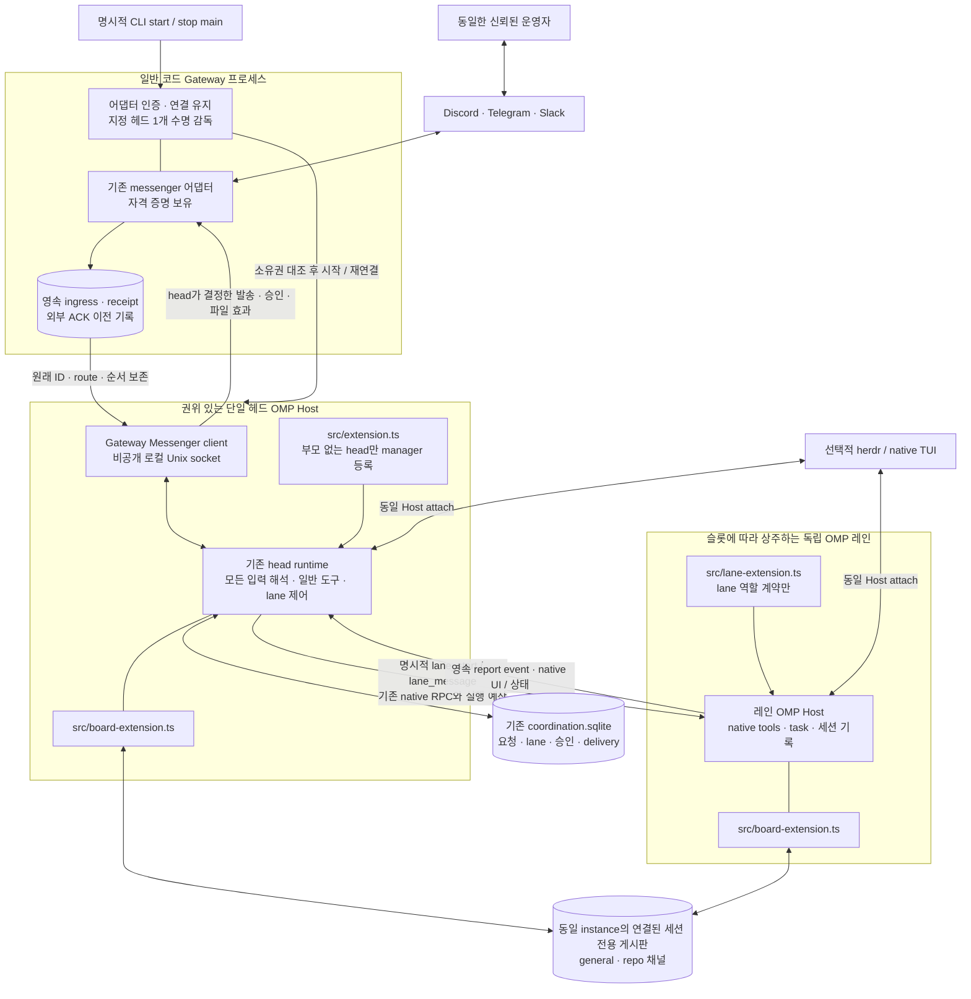
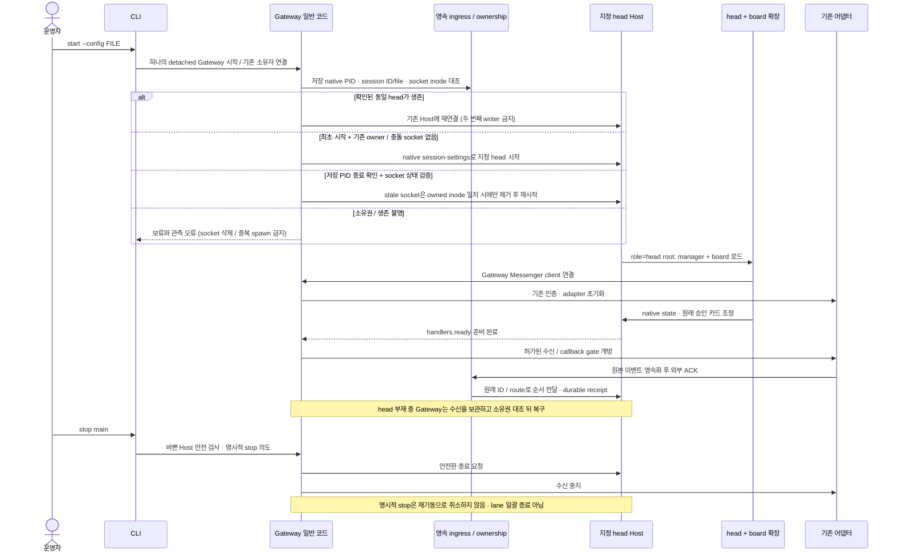
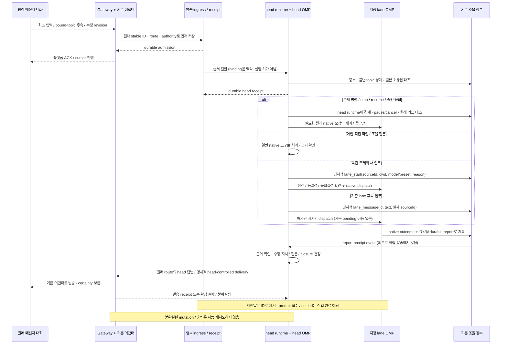
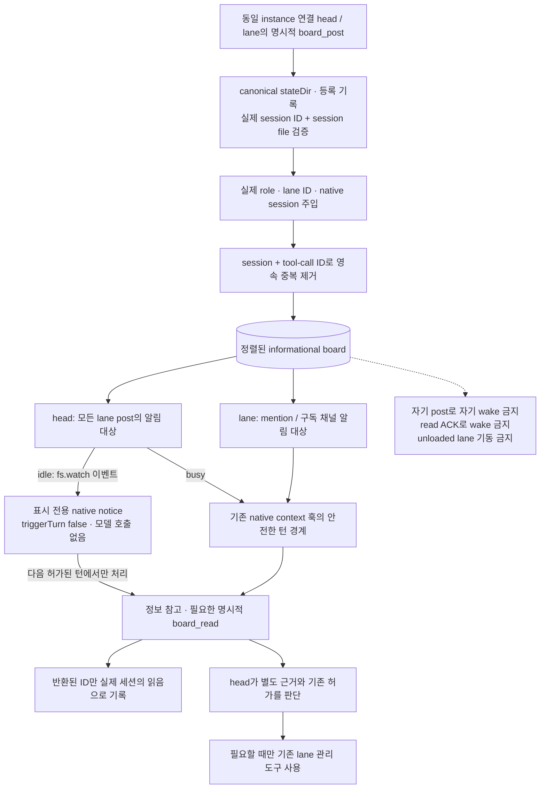

# omp-superagent 설계

상태: 기존 Discord·Telegram·Slack 어댑터·SQLite 장부·독립 레인·프로젝트 내부 OMP 코어
패치를 유지하면서 **Gateway → 단일 헤드 기동, 모든 입력의 헤드 경유, 역할별 확장 분리,
공유 정보 게시판**으로 전환한다. 기존 runtime 통합은 최종 검증 담당자가 root 타입 검사, Gateway/
board/Host/스킬·runtime/store의 아래 범위 회귀와 실제 native runtime·모델 선택·board·Gateway
E2E 경로를 확인했다. 이는 기존 통합 기록이다. 현재 변경은 최종 담당자가 root 타입 검사,
전체 root 회귀 345개 통과·7개 skip·0개 실패·2,542 assertion(Bun 1.4.4), native core managed-
extension/discovery 80개·235 assertion과 공식 ULW 설치 CLI를 확인했다. 실제 managed ULW 활성화
1개 통과·3.50초, 수정된 native Gateway/runtime/model 기준선 3개·217 assertion과 앞선 native
프롬프트 조합·Host/TUI/board 17개 통과도 확인했다. 마지막 bind→chmod readiness 수정 뒤에는
Host 15개·58 assertion과 최종 tsc를 확인했으며 그 뒤 전체 root 재실행으로 확대하지 않는다.
정확한 실행 묶음·중복 가능성·수치·남은 제한은
[운영·설치 가이드의 검증 이력](docs/OPERATIONS.md#6-개발자-검증)을 따른다. 기존 native RPC/TUI·플랫폼 기록도 당시 범위로만 보존하며 새 경로의
통과 증거로 재사용하지 않는다.
운영 메신저 로그인·herdr 제어는 미수행이며 이번 작업에서 봇을 활성화하지 않는다.
실제 제공자 호출·비용의 기존 미확인 사고도 [운영·설치 가이드](docs/OPERATIONS.md)의 제한을 그대로 유지한다.
조사 기준일: 2026-11-13.

## 1. 목표와 기본 결정

일반 코드 Gateway가 메신저 연결과 헤드 수명을 유지한다. 단일 OMP 메인 헤드가 모든 요청을 받고, 작은 일은 직접 처리하며,
독립 맥락이나 실행이 필요한 일은 OMP 레인에 맡긴다.
기존 OMP·이 저장소의 어댑터/장부/RPC를 재사용하며 공개 구현은 책임 경계의 참고로 삼는다.

- 메인 헤드는 하나다. 별도의 판단용 슈퍼바이저 에이전트를 추가하지 않는다.
- 설정된 Discord·Telegram·Slack을 동시에 연결하되 각 플랫폼 소유자는 **같은 신뢰된 운영자**다.
  모든 소유자의 메인 입력이 동일한 헤드 맥락을 공유하므로 멀티테넌트 사용자 격리로 쓰지 않는다.
  플랫폼별 ID를 검증하며 표시 이름으로 교차 플랫폼 신원이나 권한을 추정하지 않는다.
- 스레드·주제별 맥락과 무관한 저장소의 작업 맥락을 분리한다.
- 레인은 그 대화에서 직접 일하는 OMP 세션이다. 레인마다 감독자와 작업자를 둘씩 만들지 않는다.
- 맡긴 프로젝트 목표 안에서는 헤드·레인이 다음 유용한 일을 선택·우선순위화하고 계획·실행·검증·
  수정을 이어간다. 검증한 중간 결과 뒤에도 남은 허가 작업을 단계별 허락 없이 진행한다.
  완료 기준에 도달하면 멈추며 새 범위·외부 효과·불확실성·승인 경계는 그대로 지킨다.
- 모든 요청을 위임하지 않는다. 메인 헤드와 레인 모두 일반 OMP 작업 능력을 유지한다.
- 저장된 세션 수와 상주 실행 수를 분리한다.
- 실행은 herdr 없이도 가능하다. herdr는 동일한 실행에 접속하는 선택적 화면이다.
- RPC용 실행과 herdr용 실행을 별도 백엔드로 만들지 않는다.
- 자체 대시보드, 새로운 모델·인증·컴팩션·서브에이전트 엔진은 만들지 않는다.
- 명시적 `start`가 하나의 detached **Gateway**를 기동하고 Gateway가 정확히 하나의 지정 헤드를
  시작·재연결·감독한다. Gateway는 일반 코드 데몬이지 AI 감독자나 새 실행 백엔드가 아니다.
  macOS에서 명시적으로 `install`한 경우 다음 로그인에 일회성 LaunchAgent가 같은 `start`를
  호출한다. 설치 자체는 봇을 시작하지 않으며 상시 OS 감독자를 추가하지 않는다.
- 실제 메신저 자격 증명·어댑터는 Gateway가 소유한다. 헤드는 로컬 Messenger client로 연결하고,
  **레인 RPC·배정·재시도·결과 판단은 오직 헤드 runtime**이 소유한다. Gateway는 레인 소켓에 연결하지 않는다.
- 최초 입력과 연결된 주제의 모든 후속 입력도 헤드를 거친다. 주제 연결은 맥락 정보이지 자동 dispatch 허가가 아니다.
- 헤드와 관리 레인은 공통 정보 게시판을 사용한다. 게시물은 관측·근거이며 명령·승인·작업 배정이 아니다.

## 2. 구성

| 구성 | 책임 |
| --- | --- |
| Gateway | 실제 메신저 연결·자격 증명, 영속 ingress/receipt, 지정 헤드 1개의 시작·재연결·복구. 레인 제어나 LLM 판단 없음 |
| 메인 헤드 | 모든 입력·후속·주제 명령·승인 처리, 직접 작업, 저장소 조사·선택, 레인 제어·결과 확인, 외부 회신 결정 |
| 레인 | 주어진 주제·작업 범위에서 조사·구현·검증, 필요한 네이티브 task 사용 |
| 헤드 전용 확장 | 기존 runtime과 관리 도구 등록. 부모 없는 head에서만 활성화하고 레인/자식에서는 시작하지 않음 |
| 레인 전용 확장 | 관리 레인 역할 계약 주입. manager registry·메신저 어댑터·헤드 runtime 없음 |
| 공통 게시판 확장 | 동일 instance에 실제 연결·등록된 head/lane만 정보 read/post·구독·알림. 실행·전송·lane RPC 권한 없음 |
| OMP Host | 해당 세션의 실제 추론·도구 실행·기록을 소유하는 단일 실행 주체 |
| herdr TUI 클라이언트 | Host의 대화·활동 관찰과 권한 있는 사용자 제어 |

Gateway 수신 연결은 헤드/레인의 모델 턴과 프로세스 상주 여부에 귀속되지 않는다. 헤드가
없어도 Gateway는 허가된 수신을 먼저 영속화하고 지정 헤드 복구 뒤 순서대로 전달한다.
Gateway를 모든 lane 실행을 소유하는 별도 manager로 확장하지 않는다.
실행할 허가 작업 없이 이벤트를 기다리기 위해 LLM을 반복 호출하거나 상시 대기 goal을 돌리지 않는다.

### 구현 위치와 시작 경로

| 소스 | 구현 책임 |
| --- | --- |
| `src/cli.ts`, `src/config.ts` | `--config` 필수 CLI, 명시적 start, 설정·소유 경로 검증, doctor/status/attach/stop |
| `src/autostart.ts` | macOS의 인스턴스별 일회성 LaunchAgent install/uninstall·등록 상태 조회. 기존 start를 다음 로그인에 호출하며 별도 Gateway 실행·복구 엔진 없음 |
| `scripts/setup.sh`, `src/setup.ts`, `src/credentials.ts` | controlling-terminal 셋업·토큰 숨김 입력, 기존 config 검증 재사용, owner-only sibling 환경 파일과 start/doctor의 제한된 로딩. 봇 활성화 없음 |
| `src/gateway*.ts` | detached Gateway 기동·소유권·영속 수신/receipt·헤드 감독·로컬 transport 효과 proxy |
| `src/gateway-client.ts` | `createGatewayMessenger(config): Messenger`. 헤드 runtime에 기존 Messenger 계약을 제공하며 stop은 client만 detach |
| `src/extension.ts` | `role=head`인 부모 없는 root에서만 runtime 시작과 9개 관리 도구 등록 |
| `src/lane-extension.ts` | `role=lane`에서만 레인 지침 주입. 헤드 manager를 로드하지 않음 |
| `src/board.ts`, `src/board-extension.ts` | 독립 SQLite 정보 게시판과 head/lane 공통 도구·세션별 알림/구독 |
| `src/messengers.ts` | Gateway 안에서 구성된 실제 어댑터·자격 증명을 hub에 연결, 원래 platform으로 발송·승인·첨부 API dispatch |
| `skills/head/SKILL.md`, `skills/head/references/`, `skills/lane/SKILL.md` | `before_agent_start`의 필수 역할 계약과 native `skill://superagent-head`, `skill://superagent-lane` 진입점. root head에는 헤드 계약과 재귀적인 전체 Markdown 절차를 매 턴 주입하고, 레인의 `references/workflow.md`는 필요할 때 읽음 |
| `src/runtime.ts` | 요청·주제 라우팅, 레인 수명·대기열·예산, 승인·발송·catchup 조율 |
| `src/lane-models.ts` | 허용된 native chat 후보의 안전한 capability/cost 투영과 정확한 provider/id 동일성 |
| `src/contracts.ts`, `src/store.ts` | 명시적 연결/요청/레인 계약과 SQLite 장부. OMP 전체 transcript를 재구현하지 않음 |
| `src/discord.ts` | discord.js 기반 소유자 전용 수신·허용 목적지 검증·대화형 승인·첨부 전송 |
| `src/telegram.ts` | grammY `Api` 기반 getMe/getWebhookInfo/getUpdates long polling·영속 offset·native forum topic·inline 승인·토큰 없는 file 참조 |
| `src/slack.ts` | 공식 SocketModeClient/WebClient 기반 workspace 인증·메시지/Block Kit 수신·history·thread·외부 파일 업로드 |
| `src/host.ts` | 로컬 소켓 RpcClient와 분리된 세션별 OMP 프로세스의 시작·접속·소유권 확인 |
| `scripts/prepare-omp.ts`, `upstream/omp.json`, `patches/omp` | OMP v18.20.0 `c308970263ae13744ea15ab67302e3dac840e266` 준비와 실제 코어 패치, 필수 관리형 ULW 준비 연동 |
| `upstream/ulw.json`, `.upstream/ulw/` | 공식 ULW 원격·1시간 갱신 간격과 프로젝트 소유 immutable revision package·원자적 활성 pointer·업데이트 상태 |

설치·준비·doctor는 Gateway나 봇을 활성화하지 않는다. `start`만 Gateway를 백그라운드로
기동하고 Gateway가 패치된 OMP를 `--mode rpc-ui --rpc-socket … --session … --cwd …`로
시작하거나 이미 소유권이 확인된 지정 헤드에 연결한다. 헤드는 `src/extension.ts`와 공통 게시판
확장, 레인은 `src/lane-extension.ts`와 공통 게시판 확장을 로드한다. 일반 OMP에 전역 설치하지
않는다. 각 관리 Host는 관리형 ULW package도 시작 시 해석한 정확한 revision 경로로 로드한다.
native 자식에는 manager/board 권한이 없고 기존 active-tool 제외와 실행 시 거부를 유지한다.

Gateway는 설정된 메신저 자격 증명을 보유하고 헤드 환경에서는 해당 변수를 제거한다. 이는
같은 OS 사용자의 사고 노출을 줄이는 경계이지 capability framework나 OS 보안 샌드박스가
아니다. 기존 native 모델 제공자 인증·설정·일반 도구는 유지한다. 각 플랫폼 블록은 선택 항목이며
최소 하나가 필수다. Discord-only 설정·동시 어댑터 설정과 기존 신원/권한 검증을 그대로 사용한다.
`doctor`는 `platforms`·환경변수별 `credentials` boolean·`messengersActivated: false`만 진단한다.
소켓은 전용 `stateDir/run`에서 파생하고 임의 URL이나 범용 RPC forwarding을 허용하지 않는다.

### 필수 ULW 설치와 일반 코드 갱신 경계

`omp-ulw`는 선택적 사용자 checkout이 아니라 설치에 항상 포함되는 관리형 의존성이다.
공식 원격은 `https://github.com/dbc-hbin/omp-ulw.git`이며 `upstream/ulw.json`에 기록한다.
`bun scripts/prepare-omp.ts`, 루트 postinstall, 명시적인 `bun run prepare:ulw`가 같은 준비 경로를
사용한다. 설치 때 원격 기본 브랜치 HEAD를 확인한다. production Gateway 시작에는 이미 유효한
active 설치가 필요하며 검증 뒤 IPC/head를 먼저 시작한다. startup 원격 확인은 백그라운드로
진행하고 이후 `checkIntervalMs: 3600000`에 따라 매시간 확인한다. 느리거나 불가한 upstream이
정상 active를 가진 Gateway 시작을 막지 않는다. 업데이트 확인/준비는 일반 코드이며 새로운
모델 턴·lane 작업·메신저 로그인·별도 supervisor를 만들지 않는다.

확인한 commit의 전체 소스·submodule을 프로젝트 소유
`.upstream/ulw/revisions/<commit>/package`에 materialize한다. 의존성 설치는 임의 lifecycle
script를 무시하고 정해진 materialization과 유한 offline native loader probe를 거친다.
SQLite update lock으로 동시 준비를 직렬화하고 완전한 staging/probe 성공 뒤에만 `active.json`을
원자적으로 전환한다. `status.json`에 확인·오류 상태를 기록하며 실패 시 이전 active를 보존한다.
기존 active가 있으면 동일 source repository에서 active commit의 후손인 **fast-forward만**
활성화한다. 기본 브랜치 force-push의 rewind·divergence나 source repository 불일치는 오류로
기록하고 기존 active를 유지한다. 최초 설치는 공식 원격이 광고한 HEAD를 신뢰하며 존재하지 않는
고정 hash를 가정하지 않는다. 이력/source 충돌은 운영자 조정 대상이며 자동 재작성하지 않는다.
이전 revision은 자동 삭제하지 않고 사용자 checkout·전역 OMP 설정·공유 ULW 원본도 수정하지
않는다. 실패를 정상 업데이트로 가정하거나 pointer/lock을 수동 수정해 우회하지 않는다.
첫 staging/probe 실패나 active 설치 누락/무효면 production Gateway는 어댑터 활성화 전에
`bun run prepare:ulw` 선행을 요구하며 실패한다. `start`에서 긴 네트워크 설치를 시도하거나 ULW
없는 실행으로 fallback하지 않는다. 기존 `doctor`는 원격 최신성이나 loader 성공을 검사하지 않는다.

`bun run prepare:ulw -- --status`는 네트워크 없이 영속 상태를 읽는다. Gateway 상태의 `ulw`는
`revision`, `packagePath`, `upstreamRevision`, `checkedAt`, `error`, `updating`을 노출하며
테스트 주입에만 `injected`가 붙는다. `revision`/`packagePath`는 다음 launch의 active package다.
마지막 원격 관측·확인 시각·오류·갱신 중 상태를 분리하며 오래된 성공을 최신성 보증으로 쓰지 않는다.
각 live Host의 정확한 경로는 자기 `OMP_SUPERAGENT_MANAGED_ULW_PATH`에 고정되고 별도 공개
current-Host revision 필드는 없다.

live Host는 로드한 정확한 revision package 경로를 계속 사용한다. 업데이트는 live head/lane을
재시작하거나 hot reload하지 않는다. **각 새 Host launch**가 현재 active pointer를 해석하므로
기존 head가 나중에 새 lane을 시작할 때도 head의 과거 경로를 lane에 전파하지 않는다. 같은
Host의 attach는 기존 revision을 그대로 관측하며, current Host revision과 다음 launch의
active revision을 구분한다. 설치/업데이트 성공·프로필 로드·선택 SKILL 적용·실제 native mode
활성화·goal 생성·사용자 작업 완료는 서로 별도 사실이다. 절차와 검증 상태는 [운영·설치 가이드](docs/OPERATIONS.md)를 따른다.

### 기동·재기동·명시적 중지

확장은 `session_start`에서 자신의 RPC 큐가 열리기 전 자기 Host 요청을 기다리지 않는다.
초기 승인 조정의 ready gate와 헤드 부재 중 이미 준비된 Gateway의 durable admission은
별도 단계다. 준비 실패/중지 중에는 polling·offset·ACK를 앞당기지 않는다. 헤드의 client stop은
연결 해제일 뿐 실제 어댑터 종료가 아니다. `stop main`은 감독 대상 헤드와 Gateway를 함께
중지하며 즉시 부활시키지 않는다. busy-host 거부, 알 수 없는 socket 보존, 살아 있는 레인의
재연결·보존을 유지한다. macOS 로그인 자동 시작은 아래의 별도 명시적 설치로만 등록한다.
연동 제어 연결과 native TUI는 같은 Host/session을 보고 viewer 종료는 Host 종료가 아니다.

### macOS 로그인 자동 시작

`install --config FILE`은 현재 계정의 `~/Library/LaunchAgents`에 canonical stateDir별
고유 등록을 준비한다. 셸의 임의 `HOME`으로 다른 계정의 서비스 위치를 선택하지 않는다.
등록은 절대 Bun·CLI·config 경로와 argv를 사용하고, 셸 명령 문자열로 해석하지 않는다.
자격 증명은 기존 비공개 `FILE.env`에서 시작 시 읽으며 plist에 토큰·임의 환경을 복사하지 않는다.
설치 시 파일에 필요한 credential 이름이 준비됐는지만 확인하며 계정 인증은 하지 않는다.

`RunAtLoad`로 로그인 시 기존 `start`를 한 번 호출한다. `KeepAlive`는 끄고 launcher 종료가
detached Gateway를 정리하지 않게 한다. Gateway의 HEAD 감독·수명 소유권·메신저 `/restart`
successor 경로는 바꾸지 않는다. 설치 중 즉시 bootstrap·봇 로그인하지 않으며 준비·setup·doctor가
자동으로 설치하지 않는다. macOS 로그인 전 부팅 서비스, Linux/systemd·Windows 서비스,
Gateway crash 자동 재시작은 제공하지 않는다.

`status`의 `autostart`는 파일 등록·launchd 상태를 실제 Gateway/head ready와 구분한다.
`uninstall`은 정확히 소유한 등록만 제거하며 실행 중인 시작 launcher는 강제로 끊지 않는다.
Gateway/head·레인·자격 증명·세션 기록은 보존한다. `stop main`은 현재 실행을 중지하고
즉시 부활하지 않지만 등록을 유지하면 다음 로그인에 다시 시작한다. 영구 해제는 `uninstall`이다.
셸 환경에만 있던 credential은 다음 로그인에 상속되지 않으며 이동한 설치 경로는 재등록해야 한다.

Gateway endpoint는 `stateDir/run/gateway.sock`, 로그는 `stateDir/logs/gateway.log`다. 같은
`coordination.sqlite`의 `gateway_events`/`gateway_effects`와 metadata를 사용하고 별도 SQLite
lifetime lock으로 실제 Gateway 단일 소유자를 지킨다. 상태는 `gateway.ready`(실제 transport
인증 준비), `gateway.admissionReady`(최초 native 승인 barrier 통과), `head.pid`, `head.ready`
(controller gate), `head.connected`로 구분한다. 최초 ready barrier 이후에는 head outage 동안도
durable admission이 계속 열려 있다. 바쁜 native Host가 stop을 거부하면 서비스를 유지하고,
성공적인 stop은 native shutdown 전에 supervisor 재기동을 억제한다.
`gateway.unresolvedEvents`는 안전한 admission/답변 복구를 기다리는 미해결 ingress 수다.
이런 입력이 남아 있으면 `head.ready`는 false로 유지한다. 지속적으로 모호한 native 답변은
pending 순서를 보존하고 최대 30초의 capped reconnect backoff로 복구를 시도한다. 모든 문제
입력의 자동 복구를 보장하거나 맹목 replay/유실 처리로 ready를 만들지 않는다.

자동 복구는 저장한 native PID·session ID·session file·socket inode의 정확한 소유권 대조가
가능한 경우에만 한다. 재기동은 저장 PID의 실제 종료를 확인한 뒤에만 허용하며 stale socket도
저장된 owned inode와 정확히 일치할 때만 제거한다. 알 수 없거나 교체된 socket, 살아 있는 PID의
잘못된/관측 불가 identity, launch 뒤 durable ownership 기록 전 crash는 **운영자 조정이 필요한
보류 상태**다. 모든 crash를 자동 복구한다고 주장하지 않는다. 기존 transcript가 있는 head의
재시작에는 `config.model`을 다시 전달해 native 저장 모델을 덮지 않는다. status의 `head.ready`는
controller-ready이며 native PID 생존·정확한 identity·Gateway adapter-ready와 각각 다른 사실이다.

### 명시적 메신저 재시작

`/restart`(Slack `!restart` 또는 `/superagent-restart`)는 모델 턴이 아닌 우선 제어 명령이다.
Gateway와 지정 헤드 프로세스를 **모두 교체**하되 동일 native session file·session ID·모델 설정·
입출력/승인/레인 기록을 보존한다. 요청 시 바쁘다는 이유로 거절하지 않는다. 원래 route의
접수 응답이 `sent`인 뒤 헤드 카드만 원래 native ID로 취소하고 우선 abort/queue 회수와 goal
pause로 체크포인트를 만든다. 실제 native quiescence가 확인된 뒤에만 정상 shutdown한다.
독립 레인의 Host·작업·승인은 중단하지 않으며 교체 헤드가 정확한 PID/session/generation에
다시 연결한다. 서비스·소유권·효과가 해소되지 않으면 구체적 보류로 남기며 강제 종료하지 않는다.

헤드는 서비스 전체의 새 dispatch를 막고 원래 명령을 완료 처리한 뒤 기존 outbox로 접수
응답을 보낸다. 그 출력이 실제 `sent`임을 확인한 경우에만 인증된 Gateway 재시작 요청을 보낸다.
Gateway는 원래 소유자 입력·정확한 응답·현재 프로세스 신원을 대조하고 요청 ID별 수명 기록을
영속화한다. 재전달은 같은 기록을 반환하며 두 번째 교체를 시작하지 않는다.
socket Host는 실제 native session journal에 원래 RPC ID의 `rpc_prompt_result`를 발송 전에
영속화하고 실제 run 시작도 `rpc_agent_start`로 한 번씩 기록한다. 첫 receipt 전에 체크포인트한
레인의 후속 run 실패·중단은 이 native 경계와 마지막 outcome으로 복구하며 첫 성공으로 덮지 않는다.
동일 PID·세션·generation의 admission은 attach에서 buffered 이벤트를 관측하기 전에 복원한다.
초기 state/journal 읽기 사이의 완료 이벤트도 원래 입력·승인에 귀속한다. 복구한 작업은 정착할 때
native journal을 다시 대조하며, 두 읽기 사이에 lifecycle이 바뀌면 그 이벤트가 요청한 후속 정착에서
확인한다. run 수는 체크포인트 cursor에 고정해 재구성하고 assistant는 실제 이전 run 경계에
귀속하므로 중복 집계나 이전 실패를 새 실행의 outcome으로 옮기지 않는다.
교체 헤드는 체크포인트의 동일 세션·파일·요청 receipt만 사용해 레인 admission을
복원한다. receipt가 없는 과거 제출/외부 효과는 uncertain으로 유지하고 원래 prompt를 재제출하지
않는다. 헤드의 모델·effort readback이 일치하고 초기화가 확인되면 fence를 해제한다. 재시작이
중단한 활성 헤드 goal만 기존 source/route에 묶인 별도 native `goal resume` receipt로 이어가며,
이미 paused/cancelled인 goal이나 uncertain 제출은 자동 재개하지 않는다. 미제출 입력은 원래
장부 순서로 처리한다. goal 없는 중단 턴의 자동 복원 RPC는 없으므로 새 prompt로 위장하지 않는다.
native goal 생성 이벤트의 실제 owning input을 goal ID·session별로 보존한다. no-progress로
settled 상태가 되어도 이 원래 source/route를 재사용하며 `/restart` 입력을 대체 owner로 쓰지 않는다.
소유권을 확인할 수 없는 기존 native goal은 서비스 교체를 막지 않고 자동 재개만 보류한다.
Gateway가 소유한 정상 shutdown 경로와 일회성 일반 코드 successor가 기존 수명 lock 해제 뒤
새 Gateway를 시작한다. 헤드는 자신을 종료하지 않으며 새 AI supervisor나 실행 backend를 만들지 않는다.

새 헤드는 원래 세션과 실제 초기화 상태를 확인하고 원래 대화의 outbox에 결과를 알린다.
접수·프로세스 시작·준비 완료를 구분하고 불확실한 종료/발송/기동을 자동 재시도하지 않는다.
명시적 운영자 `stop main`이 재시작을 취소한 뒤 successor가 서비스를 되살려서는 안 된다.
명시적 stop 경계는 영속화한다. handoff 전 헤드 stop도 재시작 intent보다 우선한다.
체크포인트의 각 비동기 경계·게시와 Gateway의 수명 접수 직전에 동일 request와 캡처한 stop
경계를 재대조한다. 중지된 fence는 과거 snapshot으로 재취득하지 않는다. native busy로
`stop main` 종료가 거부되어도 해당 stop 경계는 이전 restart를 무효화한다.
모호한 승인 답변이 Gateway ingress 앞에서 격리되어도 원래 승인 캐시 복원 barrier와
소유자 `/restart`·`/stop` 제어는 헤드에 전달할 수 있다. 일반 입력의 순서와 격리 상태는
그대로 보존하며 Gateway가 승인하거나 레인 배정을 판단하지 않는다. 체크포인트는 아직
native에 남은 answered-attempt 세대의 취소 신원만 내용 없이 기록한다. 늦은 원래 답변은
rejected로 조정하며 이미 소비된 승인/외부 효과를 취소했다고 주장하지 않는다.
완료된 초기 승인 복원 상태는 인증된 동일 controller/PID에 귀속한다. 격리된 답변이 SSE만
끊어도 진행 중인 비동기 restart 접수를 무효화하지 않으며, 새 controller와 초기 barrier의
인증·승인 준비 요건은 유지한다.

### 플랫폼 인증·운영 설정

설치·권한·토큰 입력 절차와 공식 API 문서 링크는 [운영·설치 가이드의 플랫폼별 설정](docs/OPERATIONS.md#2-플랫폼별-앱과-접근-범위)을 따른다.
토큰은 JSON/argv 대신 이름이 지정된 환경변수로만 전달한다.

`bash scripts/setup.sh`는 새 구성의 플랫폼·소유자·허용 대화·경로를 묻고 토큰을 숨김
입력으로 받는다. JSON에는 기존 `tokenEnv` 계열 이름만 저장하고 비밀 값은 명시적 저장
확인 뒤 `<config 경로>.env`(`0600`)에 분리한다. 기존 유효한 JSON은 보존한다.
CLI `start`/`doctor`만 표준 dotenv parser로 구성된 자격 증명 이름을 읽으며 비어 있지 않은
셸 환경값이 우선한다. shell source/eval이나 Bun의 기본 `.env` 자동 로딩을 사용하지 않는다.
래퍼·권장 CLI 호출·새 native command에는 `--no-env-file`을 사용한다. 기존 설정은 자동으로
재작성하지 않으므로 수동 Bun 호출에서 이 옵션을 생략한 경우의 사전 dotenv 로딩까지
애플리케이션 loader가 취소한다고 주장하지 않는다.
OMP 라이브러리의 programmatic dotenv 로딩은 별도이므로 setup/doctor에서는 runtime
모듈을 import하지 않는다. start는 선택한 자격 증명의 필수 검사를 마친 뒤에만 Gateway를
로드해 누락된 토큰을 ambient 프로젝트 dotenv가 대신 채워 실행시키지 못하게 한다.
평문 파일·같은 OS 사용자라는 한계는 유지하며 새 인증 엔진·보안 샌드박스를 주장하지 않는다.
셋업·doctor는 실제 계정 연결이나 토큰 유효성 검증이 아니고 명시적 start 경계를 유지한다.

새 구성의 최초 셋업은 native Mnemopi 장기 기억을 권장하되 명시적인 `yes` 동의와 최종 저장
확인 뒤에만 OMP 전역 `memory.backend`를 `mnemopi`로 저장한다. Enter·거절·취소는 변경하지
않고 기존 구성의 자격 증명 갱신에서는 다시 묻지 않는다. native 설정 API로 이 키만 변경하고
재조회하며 다른 backend 옵션·모델·스코프·기존 기억을 보존한다. 프로젝트 override 등으로
실효 설정이 다르면 전역 저장과 실제 활성 설정을 구분해 알린다. 로컬 구성 저장 뒤 메모리 설정이
실패해도 로컬 저장을 취소한 것처럼 말하지 않는다. native 설정 import는 자격 증명 접수·저장
뒤로 지연하며 셋업 자체는 메모리 backend·모델·서비스를 시작하지 않는다. 기억은 대화 이후에도
남고 기존 native 옵션에 따라 모델 처리·다운로드가 발생할 수 있으며, 전역 선택은 다른 OMP
세션에도 영향을 줄 수 있다.

새 구성이 성공적으로 저장된 뒤에는 head 작업 디렉터리의 native 설정을 읽기 전용으로
확인한다. 실효 `judge` 역할이 미설정이면 일반 OMP의 `/models` → Roles → Judge에서 지정하도록
권장한다. 기존 전역·프로젝트·overlay의 선택과 별칭/선택자 체인은 보존하고, Mnemopi 동의
여부와 무관하게 확인한다. 판독 실패는 미설정으로 단정하지 않고 확인 불가로 알린다.
쉼표와 공백뿐인 선택자 체인은 미설정이다. 현행 전역 설정 파일 없이 legacy 설정만 남아
실효 역할을 판정할 수 없으면 확인 불가로 알린다. 파일 존재 여부만 확인하며 legacy 설정이나
계정 DB를 열거나 이관하지 않는다. 명시적인 상위 layer의 역할 선택·해제는 그대로 따른다.
이 권장은 judge 모델·fallback·timeout을 자동 변경하거나 인증 DB·모델을 호출하지 않는다.
설정 존재 확인은 실제 모델 가용성·인증·judge 호출 성공 검증이 아니다. 기존 구성의 토큰 갱신과
취소·저장 실패에는 이 검사를 실행하지 않는다.

| 플랫폼 | 설정 및 실제 권한 경계 |
| --- | --- |
| Discord | `tokenEnv`, 숫자 `ownerId`, `allowedGuildIds`, `allowedChannelIds`. bot/Gateway 계정과 소유자를 확인하며 서버·부모 채널 allowlist를 모두 요구. 소유자 1:1 DM은 별도 허용 |
| Telegram | `tokenEnv`, 양수 사용자 `ownerId`, 음수 그룹 `allowedChatIds`. `getMe`로 실제 bot ID 확인. 소유자 private chat 또는 허용 group/supergroup의 직접 소유자 메시지만 수락. 익명·봇·forward/via_bot/business 신원 불허 |
| Slack | `botTokenEnv`(`xoxb`), `appTokenEnv`(`xapp`, `connections:write`), `ownerId`, `teamId`, `allowedChannelIds`. `auth.test` bot/workspace와 `users.info` 활성 인간 소유자 대조. `conversations.info`로 실제 1:1 DM 소유자/채널 membership을 확인하며 그룹 DM 불허 |

Telegram은 public webhook endpoint 없이 polling한다. 이미 활성 webhook이 있으면 **거부**하고
자동 삭제·교체하지 않는다. 그룹 가시성은 BotFather Privacy Mode/관리자 설정에 달려 있고,
supergroup forum 생성에는 `can_manage_topics`가 필요하다. private topic은 getMe가 해당 기능을
알려준 봇에서만 native thread로 인정한다. private `/new`의 접수 경계는 논리 주제로
기록하지만 헤드가 레인을 연결할 때 native topic 지원 여부를 확인해 실제 topic을 우선 생성한다.

Slack은 Socket Mode·Interactivity·`message.channels/groups/im` 구독으로 공개 endpoint 없이
동작한다. bot scopes는 `chat:write`, `users:read`, `files:read/write`와 사용하는 대화 유형별
`channels:read/groups:read/im:read`, `channels:history/groups:history/im:history`다.
`conversations.replies`는 현재 공식 문서의 bot history scope를 따른다. 폐기된 bot-thread
조회 제한이나 `files.upload`에 의존하지 않는다. 등록된 `/superagent-*` 명령도 같은
Socket Mode 연결로 수신하며 별도 공개 HTTP endpoint를 만들지 않는다.

## 3. 요청 라우팅과 맥락 경계

### 메인 대화

메신저의 구현·변경 등 작업 지시는 최소한의 범위/cwd 확인 뒤 먼저 작업 스레드·topic에
연결한다. 헤드는 `lane_start.kickoff`에 사용자 언어로 짧은 구체적 진행 방식을 제공하며,
runtime은 해당 목적지로 이 메시지가 발송됐다는 영수증을 확인한 뒤 레인 실행을 허용한다.
질문·상태 조회·계산·연결 테스트는 직접 답하고, 사용자가 명시적으로 메인 작업을 요청하면
헤드의 직접 실행 능력도 유지한다. 같은 작업의 후속 지시마다 새 스레드를 만들지 않는다.

새 DM, 아직 담당이 없는 요청, 여러 작업의 현황·조율뿐 아니라 **연결된 주제의 후속 입력도
모두 메인 헤드가 먼저 받는다.** Gateway는 수신·저장·전달만 하며 작업 내용을 라우팅하지 않는다.
질문·조율과 사용자가 메인에서 처리하도록 지정한 일은 직접 끝낸다.
작업 지시의 thread-first 정책 외에 코드 크기·PR·단계 수만으로 추가 레인을 강제하지 않는다.

### 독립된 스레드·주제

- 새 스레드·topic의 작업 맥락은 독립 OMP 레인으로 분리하되, 헤드가 범위·cwd·모델을 결정한 뒤
  명시적 `lane_start`로 연결한다. 스레드 생성 자체가 Gateway의 lane 실행 허가가 아니다.
- 같은 스레드의 후속 메시지도 원래 route·source ID와 기존 연결 정보를 담아 헤드로 전달한다.
  헤드가 직접 답할 조율인지, 기존 레인으로 보낼 작업인지 판단하고 필요하면 `lane_message`를 호출한다.
- 새 레인을 만들어도 이미 헤드에 접수된 후속 메시지나 대기 입력을 자동으로 레인에 옮기지 않는다.
  각 새 지시는 실제 저장된 입력 ID와 명시적인 head dispatch를 요구한다.
- 새 레인은 메인 헤드의 전체 대화를 상속하지 않는다. 원본 요청, 관련 근거, 제약만 인계한다.
- 별도 주제로 분리된 요청은 새 연결을 만든다. 불명확한 주제 전환을 모델 추측만으로 확정하지 않는다.
- 스레드 없는 DM은 메인 대화를 기본으로 한다. 명확한 독립 주제는 별도 사용자 명령 없이
  헤드가 `lane_start`로 분리하며 native thread/topic을 우선 생성하고 미지원 private chat만
  논리 주제를 사용한다. `/new 요청`은 명시적 주제 경계 제어로 유지한다.
- 종료된 작업의 후속 대화는 같은 기록을 재개할 수 있다. 일시정지·취소된 작업을 자동 입력으로 재개하지 않는다.

스레드 없는 private/DM의 논리 주제는 실제 플랫폼 thread로 위장하지 않는다. `Route.topicId`는
선택적인 논리 연결 키이며 실제 channelId와 null인 threadId는 그대로 둔다. 주제가 없는 기존
물리 연결 키는 바뀌지 않는다. 아래 `/` 제어는 Discord·Telegram의 일반 메시지 표기이며
Discord는 명시적으로 등록한 application command도 같은 제어 경로로 정규화한다.
Slack은 같은 의미의 **`!new [요청]`, `!main`, `!stop`, `!resume`** 일반 메시지를 정규화한다.
등록된 `/superagent-new`·`/superagent-main` 등도 같은 제어 경로로 연결한다.
Slack client가 가로챌 수 있는 `/new`를 등록된 slash command처럼 안내하지 않는다.
실제 메시지 ID/ts와 Discord interaction snowflake로 순서를 보존하며 가짜 timestamp를 만들지 않는다.
Discord 명령 입력은 `messageId: null`과 실제 `interactionId`를 구분한다. interaction ID를
메시지 fetch·반응·history cursor·스레드 원본으로 사용하지 않으며 응답 token은 영속화하지 않는다.
Slack 명령에는 실제 메시지 `ts`가 없으므로 `messageId: null`과 소유 범위에 묶인
비가역 호출 fingerprint를 저장한다. `trigger_id`·`response_url`은 저장하지 않는다.
DM 명령 경계는 마지막으로 영속 접수한 실제 소유자 메시지 뒤에 놓고 같은 anchor에서는
영속 접수 순서를 따른다. 이는 관측한 접수 순서이지 여러 연결 사이의 전역 송신 시각 보장이 아니다.
기존 메시지 timestamp 경계와 이미 접수한 수정본의 원래 주제 바인딩은 유지한다.

### 기본 steer와 자동 native 주제 연결

활성 실행과 **platform/account/authority/channel/thread/topic 전체 route가 같은** 일반
후속 입력은 native `prompt`의 `streamingBehavior: "steer"`로 전달한다. 별도 `/steer`
명령은 요구하지 않는다. 새 source ID를 유지하며 레인 입력은 여전히 헤드의 명시적
`lane_message`가 필요하다. 다른 대화·내부 보고·workflow 선택·제어 명령은 현재 실행에
섞지 않는다. 일시정지·승인·압축·불확실성 보류도 우회하지 않는다.

각 입력을 native 제출 전에 영속화하고 개별 `prompt_result`와 실제 settled 상태를
대조한다. admission ACK는 완료가 아니다. 같은 대화의 합쳐진 실행은 최종 답변/레인
보고를 한 번만 만들며 개별 접수 기록은 모두 정리한다. abort/disconnect/restart에서도
steer로 합류한 입력을 누락하거나 자동 재제출하지 않는다.

| 플랫폼 | 자동 생성 범위 | 미지원/제약 |
| --- | --- | --- |
| Discord | 허용된 서버 text/announcement 부모의 public thread, forum/media의 starter-message post | DM은 논리 주제. 필수 태그가 있는 forum/media는 임의 태그 선택 없이 거부 |
| Telegram | forum supergroup의 topic 또는 `getMe.has_topics_enabled`인 owner-private topic | supergroup 관리자·`can_manage_topics` 필요. 일반 그룹은 topic 생성 불가 |
| Slack | 허용 채널·owner-DM의 실제 root `ts`에 붙는 thread | 기존 thread 안에는 중첩하지 않고 별도 root를 생성 |

실제 capability는 인증된 어댑터가 읽고 Gateway가 전달한다. 권한·네트워크 실패를
“미지원”으로 바꿔 조용히 다른 목적지에 보내지 않는다. 봇 topic 모드·권한을 변경하거나
채널·서버를 임의로 생성하지 않는다.

기존 thread의 같은 주제는 연결된 세션을 재사용한다. 명확히 다른 주제/저장소는 헤드가
`destination`에 같은 허용 부모와 `threadId:null`(논리 `topicId` 없음)을 지정해 sibling
생성을 선택한다. 원래 thread의 binding은 보존한다. 생성 의도와 결과를 원본 source ID에
고정하고 원격 생성 전에 불확실성 기록을 남긴다. 모호한 원격 결과는 맹목 재생성하지 않는다.
논리 주제에서 native thread로 넘어간 alias는 head 맥락에만 사용하며 과거 대기 입력을
이동시키지 않는다.

바인딩 안내는 영속 outbox로 발송하며 저장된 레인·대화 식별자와 실제 Host 실행 여부를
구분한다. 원래 메인 답변은 원래 대화에 남는다. 생성한 주제 레인의 결과는 head가 명시적으로
선택한 목적지를 가진 durable report로 돌아오고 그 보고에 대한 헤드 답변이 해당 thread로
나간다. 레인이 직접 외부 발송하거나 마지막 활성 대화로 결과를 보내지 않는다.

### 헤드 모델·effort 제어

`/model`, `/model list`, `/model <provider/model>`, `/effort`, `/effort <level>`은
head runtime이 일반 코드로 처리하는 메신저 명령이다. Slack은 `!model`, `!effort` 표기를
같은 경로로 정규화한다. 현재 주제가 레인에 연결되어 있어도 대상은 **공유 메인 헤드
세션**이며, 응답에 대상을 표시하고 원래 요청 route로만 보낸다. 모델 턴이나 레인 dispatch는
만들지 않는다. 모델은 native 가용 chat 목록의 정확한 provider/id, effort는 native
`get_available_thinking_levels`가 광고한 값만 허용한다. 별도 모델·effort 목록을 유지하지 않는다.

`/model preset`(또는 `/model preset list`)은 기존 `NativePresetManager.inspect()`로
프리셋을 조회하고 `/model preset <name>`은 기존 resolve 결과의 전체 역할·기본 thinking
snapshot을 native `set_model_preset`으로 적용한다. 기본은 head 세션 전용이고 프리셋 원본을
저장·생성·삭제하지 않는다. `/model preset <name> --global`을 명시한 경우에만 헤드 적용을
확인한 동일 snapshot을 기존 native Settings의 전역 기본 역할·thinking으로 저장한다.
프리셋이 thinking 정책을 생략하면 현재 헤드의 세션 정책을 상속한다. 영속 기본값으로
되돌리지 않으며, 프리셋의 명시적 정책과 모델 selector의 명시적 effort 우선순위는 유지한다.
레인은 기존처럼 생성 시점의 유효 정책을 고정하므로 이후 전역 변경으로 재해석하지 않는다.
전역 저장은 기존 실행 레인이나 프로젝트 override를 바꾸지 않는다. 변경 전후 실제 모델·effort와
세션/전역 범위를 회신하고 세션 적용 성공·전역 저장 실패의 부분 결과를 구분한다.
적용은 유휴·session scope와 전체 native readback을 요구한다. 확인된
head 설정은 native session ID별 metadata에 보관하고 재시작의 private `--config` overlay로
복원한다. 제거된 역할은 null tombstone으로 복원해 이전 전역 역할이 다시 살아나지 않게 한다.
`--model-preset`을 재실행하지 않으므로 이후 transcript에 기록된 명시적 모델·effort 선택을
과거 프리셋 기본값으로 덮지 않는다.

조회는 실행 중에도 가능하다. 변경은 실행·대기 중인 native 작업, 승인, goal, compaction,
소유 서비스 또는 미해결 제출이 없는 헤드에서만 허용하며 자동 중단하거나 나중에 몰래
적용하지 않는다. 실제 native `settingsScope: "session"`을 확인한 뒤 `set_model` /
`set_thinking_level`을 호출하고 같은 세션의 `get_state`로 적용 결과를 확인한다. 모델 변경이
effort를 native 지원 범위로 조정할 수 있으므로 요청값이 아닌 실제 결과를 회신한다.
입력을 먼저 영속화하고 mutation 제출을 기록한다. 중복 수신은 다시 변경하지 않으며,
응답 유실·readback 불일치는 불확실성으로 남기고 자동 재시도하지 않는다.

기본 적용 범위는 현재 head 세션이다. 명시적인 프리셋 `--global` 외에는 전역 OMP
설정·기본 모델을 바꾸지 않으며 기존 레인은 어느 경우에도 변경하지 않는다.
여러 메신저가 동일한 head를 공유하므로 그 head의 이후 작업에는 함께 적용된다.
동일 transcript 재시작의 모델·effort 복원은 OMP native 세션 기록을 사용하며 별도 설정
저장소를 추가하지 않는다. 프리셋 외 일반 모델·effort의 `--global`과 모든 `--once`는 지원하지 않는다. Hermes의 세션 override
UX를 참고하되 OMP 공개 RPC를 사용한 독립 구현이다
([참고 revision](https://github.com/NousResearch/hermes-agent/blob/0d2dec897ff8e2dfba853c313f05cdd2624d6200/gateway/slash_commands_model.py)).

### 메신저 운영 명령

Discord 자동완성은 일반 텍스트 명령과 동일한 소유자·계정·채널·DM 경계를 검사한다.
Gateway가 입력을 영속 접수한 뒤에만 비공개 접수 확인을 보내며, 실제 결과는 기존 outbox로
원래 대화에 전달한다. 시작 준비 전·미지원·권한 밖 명령은 접수하지 않고 명시적으로 거절한다.
Discord의 최초 응답 제한은 3초이며 모델 실행이나 일반 메시지 fetch 뒤에 접수를 대기시키지 않는다.
접수·응답 결과가 불확실해도 명령을 자동 재실행하지 않는다.
`discord-commands --config FILE`은 등록 변경을 조회하고, 명시적 `--apply`만 전역 명령 목록을
지원 명령으로 교체한다. 세 플랫폼의 명령·설명·인수는 `src/messenger-commands.ts`를 단일 원본으로 사용한다.
다른 guild 등록은 몰래 삭제하지 않으며 충돌은 보고한다. setup·doctor·start는 등록하지 않는다.
Telegram은 `telegram-commands`의 명시적 apply로 소유자 DM·허용 그룹의 소유자 메뉴만
갱신하고 실제 `bot_command` entity와 현재 봇 username으로 `/명령@봇이름`을 정규화한다.
다른 봇 대상 명령은 업무로 받아들이지 않는다. 언어별 목록은 선택한 language code만 다룬다.
Slack은 `slack-commands`와 별도 앱 구성 token으로 현재 앱 manifest의 명령만 바꾼다.
bot/workspace/app 신원을 확인하고 무관한 manifest 필드는 보존한다. `commands` 권한의
실제 grant·재설치 필요 여부는 manifest 저장 성공과 구분한다. 실제 실행은 기존 Socket Mode
영속 접수와 outbox를 사용하며, 앱·팀·소유자·대화 인증과 접수 후 ACK 원칙은 유지한다.

`/help`, `/status`, `/context`, `/usage`는 확정적인 head runtime 조회이며 모델 턴 없이
처리한다. 상태는 현재 주제·연결 레인과 공유 헤드의 native 실행 상태·대기·승인·불확실성을
구분한다. 사용량은 native 세션 기록이지 계정 전체 청구액이 아니고, 컨텍스트 추정치와 미상
필드를 확정값이나 0으로 바꾸지 않는다. credential-bearing native DTO 전체를 외부에 보내지 않는다.

`/compact [보존 지시]`는 기존 native 압축을 사용하며 대화 초기화나 별도 요약 엔진이 아니다.
유휴·안전한 헤드에서만 시작하고 제출을 먼저 기록한다. 완료 전 뒤의 헤드 실행·설정 변경을
막되 조회와 긴급 중단은 계속 처리한다. native RPC의 압축 실행과 중단·조회 경로를 분리해
압축을 기다리는 serialized command tail이 `/stop head`를 막지 않게 한다.

`/stop`은 연결 레인이 있으면 기존 pause 계약을 유지하고, 없으면 헤드 작업을 중단한다.
`/stop head`와 `/stop <lane-id>`로 대상을 명시할 수 있다. 원래 route 권한과 실제 관리
대상을 확인하고 임의 세션·소켓을 제어하지 않는다. 헤드 중단 접수 이전의 현재/대기 일반 입력과
아직 제출되지 않은 설정 변경 명령을
영속 취소하고 native queue를 버리며 활성 실행·압축·하위 작업·승인을 정리한다. goal 자동 계속
실행도 멈춘다. 미해결 uncertain 효과를 소급 취소하거나 완료로 바꾸지 않는다. 중단 뒤 새
입력은 별도 새 작업으로 처리하며 Gateway와 무관한 레인은 유지한다. Slack은 위 명령의
동일한 `!` 표기를 기존 정규화 지점에서 지원한다.

### 주제 명령의 영속 경계

- `/new 요청`은 원래 입력을 새 논리 주제에 미할당 대기로 영속화하고 별도 메인 라우팅 envelope를
  만든다. 헤드가 실제 존재하는 절대 cwd를 선택한 뒤 `lane_start`가 그 주제를 레인에 연결한다.
- 내용 없는 `/new`는 주제를 활성화하고 고정 안내만 회신한다. 모델 호출이나 레인을 시작하지 않는다.
- 후속 일반 텍스트는 활성 주제 정보를 유지한 **헤드 입력**이다. 레인이 없으면 헤드가 저장소를
  조사하고, 있으면 그 연결을 참고해 명시적으로 전달한다. 주제 바인딩이 자동 발송을 만들지 않는다.
- `/main`은 이후 입력의 맥락을 메인 대화로 돌리며 기존 레인·작업 기록은 보존한다.
- 이미 제출한 일반 DM 작업도 `lane_start`로 인계할 수 있다. 원래 입력은 main 소유로 두고
  별도 handoff와 지원되는 native 주제(미지원 DM은 논리 주제)를 연결한다. 서버 소속은 필수가 아니며 허용된 명시적 서버
  스레드 목적지를 지정할 수도 있다.
- 주제 경계와 실제 채널 cursor를 함께 영속화한다. 늦은 catchup은 명령 메시지 ID 순서로
  주제를 결정하며, 접수된 명령 재전달은 불변인 원래 연결을 사용하고 현재 선택을 초기화하지 않는다.
- `/new`·`/main`으로 주제가 바뀌어도 기존 승인은 원래 카드와 native 요청 ID로만 답한다.
  일반 입력 텍스트나 현재 주제가 승인 대상을 고르지 않는다. 그룹/채널에서 `/new`는 새 스레드/topic 안내이며
  네이티브 OMP `/new`를 실행하지 않는다.
- 접수된 `/new`·`/main` 제어 메시지의 수정은 영속 주제 경계·기존 작업·현재 선택을 바꾸지 않는다.
  수정은 기록하고 고정 안내로 새 제어 메시지를 요구한다. Slack `!` 표기도 같은 계약이다.
  일반 작업의 수정 revision은 새 입력이며 이미 실행한 외부 효과를 되돌리지 않는다.

맥락 분리를 위한 레인 생성과 추가 작업자 위임을 구분한다.
헤드가 작은 주제 질문을 레인에 맡겼다면 레인이 직접 작업하고 헤드에 결과를 보고하면 된다.
그 질문을 다시 다른 레인으로 넘기지 않는다.

연결 키에는 메신저 종류, 연결 계정·workspace, 대화 ID, thread/topic ID와 권한 범위를 포함한다.
표시 이름이나 본문에 적힌 발신자 문자열을 신원·권한의 근거로 사용하지 않는다.
메시지와 회신은 원래 요청의 연결 키를 유지한다. 마지막으로 활동한 채팅방에 보내지 않는다.
Slack의 account는 인증된 `teamId:botUserId`, Telegram은 `getMe`의 bot ID다. Telegram group의
음수 chat ID 부호와 Slack 메시지 ts 문자열의 정밀도를 보존한다. 플랫폼 간 공유하는 것은
신뢰된 메인 운영 맥락이지 대화/thread 연결 키나 callback 권한이 아니다.

### 입력·명시적 dispatch·결과·발송 흐름

헤드 runtime은 명확한 stop/pause와 원래 승인 응답을 일반 업무 대기열 때문에 지연하거나
LLM 추측에 맡기지 않는다. Gateway는 명령의 의미나 lane 대상·재시도를 판단하지 않는다.
레인의 일반 assistant 출력은 헤드용 report 입력이다. 외부 전송은 헤드가 원래 요청 맥락을
검토한 뒤 내는 답변 또는 명시적으로 헤드가 통제하는 delivery 경로만 사용한다.
보고의 sourceId·원래 route와 새 report receipt ID를 구분하고 마지막 활동 대화로 보내지 않는다.

같은 요청의 마지막 비어 있지 않은 assistant 답변은 native 정착까지 보존한다. TODO 알림
등으로 이어진 빈 응답·공백·thinking-only 메시지는 그 답변을 지우지 않으며 새 답변이 있으면
교체한다. 실패·중단은 이전 답변을 폐기하고, 새 요청에는 이전 요청의 답변을 넘기지 않는다.
발송은 기존 원본 요청의 outbox·중복 제거 경로를 그대로 사용한다.

메신저 상태 반응은 기존 Messenger 표면의 `setActivity`로 전달한다. Gateway의 영속 접수
성공 뒤에만 `received`를 비동기로 보내고, 중복 ingress에는 다시 보내지 않는다. native
`agent_start` 및 steer가 `thinking`을 시작하며 결과 settlement, stop/pause, 연결 상실,
native 승인 대기에서 `idle`로 전환한다. 승인 응답 뒤에는 다시 시작한다. 동일 원본 메시지의
수정본·헤드·레인 실행을 합산하고, report에는 저장된 `activity-source` 링크로 원본만 찾는다.
보고 본문이나 새 delivery route를 반응 대상으로 해석하지 않는다. 메시지별 상태 변경을
직렬화하되 모델 실행·ACK·최종 답변은 반응 응답을 기다리지 않는다.
Discord/Slack은 수신 👀를 유지하고 처리 중 💭만 봇 자신의 반응으로 추가·제거한다.
Telegram Bot API의 단일 반응/허용 emoji 제약상 👀→🤔→👀로 바뀐다. 실패는 장식적 상태
진단이며 재접수·모델 재실행·답변 실패·자동 retry로 바꾸지 않는다. 강제 종료 후 원격 반응
정리를 보장하는 별도 scheduler나 장부는 추가하지 않는다.
공식 API, 플랫폼 권한과 운영상의 한계는 [상태 반응 안내](docs/OPERATIONS.md#메시지-수신처리-중-반응)를 따른다.

착수 보고는 기존 outputs 장부로 영속화하며 원본 입력마다 고정 ID를 갖는다. 입력 바인딩 전에
`kickoff-output` fence를 저장하고, `sent` 영수증 전에는 그 레인의 신규 dispatch/steer를
막는다. 발송 지연·확정 실패·모호한 결과를 일반 실행으로 우회하지 않으며 동일 요청 재시도로
보고를 중복 발송하지 않는다. 같은 fence와 출력 상태를 재시작 후에도 재사용한다.

### 저장소 결정

메인 헤드는 실제 파일·검색·기억·기존 레인 현황으로 작업 위치를 판단한다.
레인에는 저장소 루트, 작업 디렉터리, 변경 범위, 목표와 완료 조건을 명시한다.
대상이 불분명하면 조사하거나 질문하고, 확정 전에 임의의 기본 저장소를 수정하지 않는다.

- 같은 저장소라도 무관한 스레드의 대화를 자동으로 합치지 않는다.
- 같은 스레드라도 무관한 다른 저장소의 작업은 별도 레인·주제로 연결한다.
- 기존 레인의 cwd만 바꿔 다른 프로젝트 작업을 이어가지 않는다.
- 명시적인 다중 저장소 요청은 처음부터 해당 저장소들을 포함한 작업 범위로 기록한다.
- 같은 저장소를 여러 레인이 수정할 때는 충돌을 확인하고 필요하면 worktree로 분리한다.
- 읽기·질문용 레인까지 무조건 branch나 worktree를 생성하지 않는다.

각 실행은 프로젝트 지침·설정·도구 상태를 해당 작업 공간에서 구성한다.
bash·eval 상태, 대기 입력, 승인, 비동기 결과가 다른 세션으로 넘어가면 안 된다.
프로세스·worktree 격리는 충돌을 줄이는 수단이지 보안 샌드박스는 아니다.

## 4. 직접 처리·task·레인 선택

| 방식 | 선택 기준 |
| --- | --- |
| 직접 처리 | 현재 맥락이 충분하며 위임·맥락 전달·결과 회수보다 직접 해결이 효율적 |
| 네이티브 task | 제한된 부분 작업이나 짧은 병렬 조사 |
| 독립 레인 | 맥락 분리, 독립 수명, 병렬 진행, 변경 격리에 실질적인 이점이 있음 |

헤드의 실행·수정 도구를 일괄 제거하지 않는다.
위임 정책은 운영 스킬로 조율하고, 행동 권한은 기존 native 승인·도구 제외·원래 배정의 경계로 집행한다.
파일 수·줄 수·예상 시간 같은 임의 임계값으로 위임을 강제하지 않는다.
직접 시작한 작업이 커지면 원본 요구와 진행·검증 상태를 정리해 레인으로 넘길 수 있다.

## 5. 레인 관리 도구와 운영 스킬

현재 `src/extension.ts`가 다음 도구를 등록한다. 기존 OMP task·세션 엔진을 대체하지 않는다.
관리 도구는 9개이며 부모 없는 헤드만 사용할 수 있다. 레인과 native 자식은 관리 호출을 거부하고,
운영자가 명시적으로 제외한 도구를 역할 스킬이 다시 활성화하지 않는다.

| 도구 | 책임 |
| --- | --- |
| `lane_models` | authoritative 가용 chat 후보와 native 프리셋 상태·안전한 역할/thinking·bootstrap 필요 여부 조회. 광고된 역할 selector·관측한 정확한 provider/id로 shortlist. 프리셋 쓰기 없음 |
| `lane_init_presets` | `choices`의 선택적 high/middle/low 각각 `{model:{provider,id},reason}`으로 누락 native 프리셋만 최초 생성. 기존 프리셋·기본/활성 역할·judge 보존. 충돌 덮어쓰기 없음. 유일한 의도된 영속 preset 쓰기 |
| `lane_start` | 실제 수신 `sourceId`, 제목, 존재하는 절대 cwd, 정확히 하나의 `model: {provider,id}` 또는 `preset: string`(관측된 임의의 native 프리셋 이름), 필수 비어 있지 않은 `modelReason`, 선택적 brief/acceptance/destination과 `workflow: {name,reason}`으로 생성·동일 선택 재사용 |
| `lane_set_model` | `id`, 실제 허가 입력 `sourceId`, 정확히 하나의 model/preset, 필수 modelReason으로 명시적 유휴 레인 변경. active input/UI/goal/소유 서비스/불확실성 없이 durable intent/receipt·native readback으로 확인. 자동 interrupt·승격·전역 설정 변경 없음 |
| `lane_inspect` | ID 생략 시 관리 레인 목록, 지정 시 기록·실제 실행 상태 조회 |
| `lane_message` | `id`, `text`, 실제 허가 입력 `sourceId`, 선택적 `workflow: {name,reason}`으로 지정 레인에 명시적 지시·후속 맥락 전달 |
| `lane_pause`, `lane_resume` | 실행과 자동 재개 정책을 함께 제어하고 상태 확인. `lane_resume`는 실제 재개 지시의 `sourceId`로 기존 paused native goal의 결과를 원래 route에 연결 |
| `lane_close` | 확인한 evidence와 completed/cancelled 결과를 기록. merge·게시·worktree 삭제 권한을 부여하지 않음 |

`lane_start`는 실행 완료나 빈 슬롯을 기다리지 않고 레인 ID와 접수 상태를 반환한다.
중복된 원본 요청이나 재전달이 같은 레인을 중복 생성하지 않게 한다.
작업을 기다리는 메인 헤드는 턴을 끝내고 후속 이벤트로 깨어난다.

root head의 manager 확장은 Host 시작 시 `skills/head/SKILL.md`와
`skills/head/references/` 아래의 모든 Markdown 파일을 재귀적으로 한 번 읽는다.
각 root-head `before_agent_start`에서 기존 system prompt를 보존한 채 전체 번들을 덧붙이므로
첫 추론부터 후속 턴까지 모든 헤드 운영 절차가 필수 지침으로 제공된다. 첫 메시지에만
transcript로 삽입하는 방식이 아니며, 적용 전에 별도 `read`나 스킬 조회를 할 필요가 없다.
파일 수정은 Host 재시작 후 반영된다. 같은 소스의 native URI는 기존 OMP 패키지 discovery로
계속 제공하며 별도 스킬 레지스트리는 만들지 않는다.
소스 편집은 현재 운영 서비스의 적용 증거가 아니며, 기존 Host의 역할 번들을 바꾸려면 별도로
허가된 재시작이 필요하다. 이번 역할 변경만으로 live 서비스를 재시작하거나 적용했다고 하지 않는다.

전체 로드는 번들된 헤드 운영 절차에만 적용하며 관련 없는 사용자·프로젝트 스킬을 모두
로드하지 않는다. 헤드 번들은 레인이나 native 자식에 주입하지 않는다. 레인은 기존의 별도
필수 역할 계약을 유지하고 상세 workflow는 필요한 판단 시점에 native `read`로 읽는다.
native 위임과 manager/board 권한 경계는 그대로 유지한다.

- `skill://superagent-head/references/routing.md`: 실제 저장소·cwd 결정, 직접 처리·native task·레인 선택, 병렬 변경 충돌, 브리핑·완료 조건.
- `skill://superagent-head/references/model-selection.md`: 실제 요구·native 후보 조사, 통상적인 judge 자문, 헤드의 최종 역량/비용 판단, 생략·실패·선택 유지와 관측 한계.
- `skill://superagent-head/references/supervision.md`: 보고 수신·수정 지시, 승인·일시정지, 중단 후 상태 대조, 증거 기반 종료.
- `skill://superagent-lane/references/workflow.md`: 작업 범위 확인, 직접 구현·부분 위임, 실제 검증, 결과·미검증 항목·인계.
- 역할 진입점은 `hide: true`로 일반 스킬 목록 광고를 숨기되 native URI와 역할 주입은 유지한다.
  헤드 역할이 자식 세션의 일반 지침으로 섞이지 않게 하고, 자식의 레인 관리 호출도 거부한다.
- `lane_inspect({})`는 기록된 목록이고 ID 지정 시에만 연결된 실제 상태를 더한다.
  현재 도구에는 불확실한 제출 기록을 해제하는 API가 없으므로 `lane_resume`를 복구 완료로 설명하지 않는다.

- 헤드 스킬: 요청 해석, 저장소 결정, 직접 처리·위임 판단, 브리핑, 감독, 복구, 결과 전달.
- 레인 스킬: 범위 내 직접 작업, 전문 스킬 활용, 진행·막힘·완료 근거 보고.
- Dori harness의 “모든 요청을 레인으로” 지침은 채택하지 않는다.
- 별도의 duty LLM이나 레인별 감독 루프를 기본 구성으로 추가하지 않는다.

### 맡긴 목표의 자율 실행과 native continuation

자율성은 맡긴 프로젝트 목표의 다음 유용한 작업을 고르고 계획·실행·테스트·수정한 뒤,
검증된 결과에서 남은 허가 작업으로 이어가는 것이다. 단계별 진행 허락을 반복해서 묻지 않는다.
완료 기준을 충족하면 끝내고, 실제 범위·권한·운영자 결정이나 불확실성이 막는 행동만 보류한다.
미배정 유지보수나 새 외부 효과를 목표에 추가하지 않는다. 작업 topic 생성·확인된 간결한 착수
보고를 먼저 보내는 기존 fence, 원래 source/route와 pause/cancel·native 승인·도구 제외는 유지한다.

목표의 기존 native goal 또는 durable workflow owner 하나를 재사용한다. 이어갈 실행 작업에
소유자가 없으면 실제 광고된 native goal 도구로 목표·관측 가능한 완료/중단 기준을 설정한다.
질문·상태·연결 테스트·프리셋 bootstrap마다 goal을 만들지 않으며 ULW 선택은 필수 조건이 아니다.
기존 workflow와 경쟁하는 두 번째 aggregate goal·장부도 만들지 않는다. 헤드는 실제 durable
lane report event에서 근거를 확인해 다음 허가 작업을 명시적으로 지시한다. 레인을 기다리기만
하려고 head goal을 돌리지 않고 턴을 끝낸다. 부분 작업·명령은 native task/job·대기 이벤트를
사용하며 Duty AI·새 scheduler·shadow registry·요청별 grant 체계·임의 타이머/예산을 추가하지 않는다.

새 관리 Host launch는 프로젝트 범위의 native goal 설정과 `goal.continuationModes`의 `rpc`를
사용한다. 일반 OMP 전역 설정·공유 ULW 소스는 바꾸지 않고 native 승인·도구 제외도 우회하지
않는다. pinned core patch `0003`은 이 opt-in이 있는 root의 기본 도구에만 native `goal`을
노출한다. 명시적 `--tools`·`--no-tools`, child 제한, `goal.enabled=false`는 유지한다.
이 launch 설정과 이미 로드한 역할 번들의 적용 시점을 구분한다. 저장된 goal은 실제
계속 실행·완료나 crash prompt 자동 replay, unloaded 상태의 실행을 보장하지 않는다.
기존 `lane_resume`는 runtime queue만 다시 열었지만, 이제 명시적으로 허가된 재개에서만 기존
paused native lane goal도 재개한다. 자동 report·재연결·새 queued 입력은 재개 허가가 아니며,
재개는 없는 goal 생성·불확실성 해제·이전 외부 효과 취소가 아니다.
unloaded 세션은 기존 소유권·모델·Host 한도 안에서 먼저 복원한다. native resume ACK는 실행
완료가 아니며 첫 재개 run의 실패·중단과 zero-run 거부도 별도로 판정한다. 더 늦은 pause가
앞선 resume의 준비·ACK를 추월해도 취소된 입력이나 실행을 되살리지 않는다.
native serial tail에 대기 중인 resume도 기존 `RpcUserInputGate`의 접수 순서로 취소한다.
별도 `resume:<sourceId>:<laneId>` receipt는 같은 원본 지시·첨부를 전달하는 일반 handoff
신원을 소비하지 않으며 동일 재개 source 재시도는 새 실행을 만들지 않는다. 완료된 unloaded
대화도 명시적 source가 있으면 모델·세션 소유권과 최신 pause 경계를 지키며 다시 연다.

### 일반 모델 프로필과 역할 특화의 범위

`omp-ulw` 같은 일반 모델 프로필은 조사·구현·계획·검증 등의 작업 방법을 제공할 수 있지만
head/lane 신원, 감독자 토폴로지, 대화 라우팅, 외부 발송 권한을 결정하지 않는다. 기존 필수
head 번들과 lane SKILL 주입에서 역할을 특화하므로 별도 공용 프롬프트 레지스트리나 중복 TS
역할 문구를 추가하지 않는다. 운영자 권한·도구 제외, 실제 native 도구 스키마·승인 계약은
계속 권위가 있으며 역할 특화는 프로필의 일반 페르소나·위임/라우팅·출력 기본값에만 적용한다.
프로필의 유용한 작업 방법 전체를 덮어쓰는 전역 우선순위 정책이 아니다.

| 판단 지점 | 역할에 맞는 적용 |
| --- | --- |
| 직접 처리/위임 | 헤드는 bounded 메인 작업을 비단순 구현까지 직접 수행할 수 있다. 독립 대화·저장소 작업은 head lane 도구로 분리하며 native `task`로 레인을 대체하지 않는다. |
| 레인 실행 | 레인은 실제 구현자다. 비단순 구현이라는 이유로 추가 감독자/작업자 쌍을 요구하지 않는다. 유용한 bounded native `task`는 원래 배정·native 권한 안에서 부분 작업마다 헤드 허가 없이 선택할 수 있다. |
| 결과 표면 | 레인 프로필의 `final`·`delivered`·human-facing output은 durable head report로 해석한다. 실제 메신저 회신·관측된 발송 receipt와 구분한다. |
| workflow/continuation | 기존 허가 목표와 원래 source 경계 안에서만 이어가고 pause/cancel·불확실성 보류를 유지한다. 사용자의 명시적 선택 또는 아래 필요성 판단을 거친 헤드의 명시적 방법 선택을 따르며 레인의 자의적 추론은 금지한다. 설치·읽기·보고/brief/인용/board의 단순 이름 언급은 선택이 아니다. 레인 대기 중 자율 watchdog은 금지한다. |

head→lane 지시·lane→head durable 보고는 영어로 작성하고 필요한 원문·인용을 보존한다.
헤드의 외부 메신저 답변만 사용자 언어를 따른다. 내부 보고를 외부 발송으로 취급하지 않는다.

### ULW 방법 선택과 명시적 레인 인계

운영자는 **이미 허가한 목표 안의 방법 선택**을 헤드에 위임한다. 따라서 사용자가 workflow
이름을 말하지 않았어도 헤드는 정말 필요한 경우 명시적으로 선택·요청할 수 있다. 이 요청은
기존 허가를 대신 집행하는 `selectedBy: head` 선택이며 사용자가 그 이름을 요청했다고 쓰지
않는다. 사용자의 명시적 선택은 `selectedBy: user`로 구분한다. 단순 인용·보고·board 언급은
선택이 아니며 레인이 envelope의 토큰을 보고 스스로 승격하지 않는다. workflow 브랜드 동의만
받기 위한 질문은 하지 않는다. 실제 권한, 비용·범위의 운영자 선택, 설치된 스킬의 더 엄격한
조건, 계획 artifact/접근 승인·review 및 native plan 승인은 그대로 지킨다.

헤드 선택에는 현재 근거에 따른 두 조건이 모두 필요하다. **더 가벼운 직접 처리/native task/
일반 레인 대안의 구체적 부족**을 밝히고, **선택한 workflow 고유의 durable artifact·증거 gate·
의존 handoff·복구 이점이 상태 작성·review 비용보다 큼**을 설명한다. 어려운 문제라는 이유만,
파일 수·예상 시간·모델명 같은 임계값은 충분하지 않다. 비단순하거나 모호한 방법 선택은
통상 사용 가능한 native judge에 최소 사실로 자문하되 헤드가 최종 판단한다. judge는 추가
감독자나 권한·지출 허가가 아니다. 가벼운 대안으로 충분하면 ULW를 선택하지 않는다.

| 방법 | 필요한 경우 / 피할 경우 | 권위 artifact와 소유권 |
| --- | --- | --- |
| plain ULW | native-goal 소유·continuation 계약이 실제로 필요할 때만. ULW는 arm하지만 별도 전문 workflow/native mode를 선택하거나 암묵적 RPC goal을 만들지 않는다. | 기존 OMP native goal. 필요한 새 goal은 허가·가용한 실제 native goal API로만 만들며 head manager에는 lane goal 생성 도구가 없다. 기존 active/paused/budget-limited goal 및 durable 목표와 중복하지 않는다. |
| `ulw-plan` | decision-complete 계획과 plan review가 산출물일 때. 단순 작업의 의식이나 구현 허가로 쓰지 않는다. | lead의 `doc/drafts/`, `doc/plans/`; native plan mode에서는 canonical `local://` draft/plan과 `xd://propose`. 구현·위임 구현 금지. 기본 adversarial plan review와 native 밖 접근 승인 유지. |
| `ulw-execute` | 선택된 decision-complete 계획을 durable task/증거/재개 상태로 실행할 때. 단순 구현이나 실행 허가 없는 계획에 쓰지 않는다. | 선택 계획, `doc/boulder.json`, `doc/ulw-execute/ledger.jsonl`의 단일 작성자. 없는 계획의 prerequisite planning도 native 승인을 우회하지 않는다. 승인된 local 계획은 그대로 두며 Boulder task로 진행 기록. `--make-pr`·`--ship`는 암묵적이지 않다. |
| `ulw-loop` | 진짜 다중 목표·의존 기준·검증 checkpoint·중단 복구가 필요할 때. 대기 watchdog이나 단일 평범한 목표에는 쓰지 않는다. | lead의 `doc/ulw-loop/<run-id>/` brief/goals/ledger와 final quality evidence. aggregate 목표는 하나이며 다른 run의 native goal 충돌은 교체하지 않고 보고한다. |
| `mass-ulw` | producer 파일을 소비하는 실제 의존 handoff·write 순서·node 복구가 필요할 때. 독립 병렬 작업만으로는 불필요하다. | lead의 `doc/mass-ulw/<run-id>/` graph/node ledger. enclosing loop/execute 목표와 completion 증거를 참조하고 별도 aggregate 목표를 만들지 않는다. |
| `ulw-research` | 다축·논쟁적·깊은 조사에 독립 관측·반증·claim gate·인용 synthesis가 필요할 때. 보통 lookup/debug 또는 계획의 context 수집은 아니다. | 단일 synthesis owner의 timestamp 연구 journal·claim/observation graph·deliverable/outcome. standalone은 session-owned loop-format continuation을 참조하되 loop 실행을 선택하지 않으며 nested 연구는 기존 owner에 연결한다. |

표는 설치 스킬의 대체물이 아니다. 헤드는 최종 인계 전 선택한 실제 native `skill://…`를 읽고
필요한 authority/artifact 참조를 확인한다(plain ULW는 `skill://ultrawork`). 레인도 선택 SKILL과
필수 참조를 읽은 뒤 substantive 계약을 수행한다. 계획 review identity/convergence, 실행·graph
시도 한도, 연구의 실제 원문·독립성·반증·high-risk claim gate, expansion/excursion 한도와
5-wave 이후 사용자 연장, 약속한 deliverable 검증은 줄이지 않는다. 기존 레인·workflow 소유권을
재개하며 branding만을 위한 중복 레인·native goal·durable aggregate 기록을 만들지 않는다.

`lane_start`와 `lane_message`의 실제 선택 필드는 선택적 `workflow: {name, reason}`이다.
`name`은 `ulw`, `mass-ulw`, `ulw-plan`, `ulw-loop`, `ulw-execute`, `ulw-research` 중 하나,
`reason`은 비어 있지 않은 선택 근거다. `selectedBy: user|head`, 필요성/근거, 가벼운 대안과 부족,
권위 artifact/owner, acceptance/stop, 권한 한계는 간결한 `lane_start.brief` 또는 기존 레인의
`lane_message.text` 문맥으로 적는다. 별도 `selectedBy`·owner·provenance 도구 필드는 없다.
runtime은 실제 저장된 source와 신뢰된 dispatch에서 출처를 결합하며 prose 라벨을 권한으로
받지 않는다. 실제 원래 사용자→head 입력만 선두 호출로 선택을 유도할 수 있다. **모든
head→lane 인계의 workflow 선택에는 구조화된 `workflow`가 필요하며 사용자 명시 선택도 헤드가
이 필드로 전달한다.**
인계에서 생략하면 일반 작업이며 복사된 사용자 호출·brief/text·보고·board 본문에서 선택을
추출하거나 native armed라고 주장하지 않는다. 명시 선택이 원래 사용자 호출과 충돌하면
거부한다. 입력별 선택·출처는 source/handoff와 영속 결합되고 변경·생략하는 충돌 재시도로
바꾸지 못한다.
원래 저장된 허가 `sourceId`와 기존 deduplication 규칙을 유지한다. 새 report receipt는 기존
목표의 조율과 명시적 head 선택을 지원할 수 있지만 그 본문이 활성화나 새 외부 효과를 허가하지
않는다. unrelated context나 승인 우회는 방법 선택의 일부가 될 수 없다.

공식 `omp-ulw`는 관리형 설치/업데이트 대상에 포함한다. 설치·프로필 로드 자체는 workflow
선택이 아니며 **선택한 skill loaded/applied, 실제 ULW/native mode armed, native goal 생성은
별도 사실**이다. runtime이 신뢰된 원래 사용자 호출 또는 구조화된 head 선택을 native 입력
선두에 두고 `Request ID`·source metadata와 작업 본문을 보존하므로 종전 Request ID 선두
차단에 의존하지 않는다. passive 보고·board 본문은 활성화하지 않는다. 수동 envelope 편집·삭제·
입력 재전송으로 우회하지 않는다.

| 선택 | native bridge 요청 매핑 |
| --- | --- |
| `ulw` | ULW arm, 전문 native mode 선택 없음; 암묵적 RPC goal 생성 없음 |
| `ulw-plan` | `ultrathink` |
| `ulw-execute`, `ulw-loop` | `orchestrate` |
| `ulw-research`, `mass-ulw` | `workflowz` |

기존 native 키워드 해석이 매핑보다 우선하며 인용·부정 문맥에 있는 원문의 키워드도 upstream의
기존 해석대로 보존한다. 모드를 강제하려고 사용자 원문을 정제하지 않는다. dispatch 전 native
mode 기본 키워드는 원래 source에 raw standalone lowercase native 키워드가 없을 때만 삽입한다.
인용·부정·inline code의 키워드도 기존 bridge와 동일하게 기본값 삽입을 막는다. request metadata·
brief·report envelope는 동적으로 fence하여 native mode 선택에 끼어들지 않으며 원래 사용자
선택을 덮어쓰지 않는다. native
`get_available_commands`에서 `source: "extension"`, 정확한 명령 이름·ULW 설명을 대조해
선택 workflow의 로드된 capability를 확인한다. 조회 실패·미광고면 해당 요청을 명시적으로 취소하며
일반 작업이나 local 스킬 적용으로 fallback하지 않는다. 광고는 가용성이지 활성화 증거가 아니다.
native disable 설정·도구 gate·승인은 그대로 유지한다. 필수 스킬/native mode/goal API/승인
surface가 없으면 정확한 gap을 보고하며 local 스킬 적용만으로 실제 활성화를 주장하지 않는다.
공용 ULW 코드나 `session_stop` 훅, 전역 설정은 변경하지 않는다. 새 activation·
설치/업데이트 변경의 새 root/설치/discovery 결과는 [운영·설치 가이드의 검증 이력](docs/OPERATIONS.md#6-개발자-검증)에 별도로 기록하며 추가 실제 native
조합 결과도 별도 범위로 기록한다. 기존 runtime 통과 기록을 이 변경의 증거로 재사용하지 않는다.
공식 설치 CLI는 프로젝트 소유 immutable package에 revision
`1f5ef903a2f4234ffdfe4a5295f4d8c994036c64`를 활성화했으며 공용 ULW 원본은 변경하지 않았다.
그 별도의 실제 native 검증은 plain ULW arm·자동 goal 미생성, head 선택 lane plan→`ultrathink`·
execute→`orchestrate`의 model-context notice와 영속 custom_message/directive, passive
인용/report/board 비활성화와 source/route/dedup을 확인했다. 설치 성공만으로 활성화를 추정한
것이 아니며 결정적 로컬 제공자·기록용 Messenger 범위다. 모든 workflow·상태 조합의 무결함,
운영 봇 활성화·실제 제공자 호출·사용자 작업 완료를 이 검증으로 주장하지 않는다.

### Native judge 자문과 모델 동일성의 구분

명시적 `start`는 기존 메인 헤드의 native 연결·승인 복구 뒤 프리셋을 조사한다. 세 프리셋이
유효하고 가용하면 모델 호출·쓰기 없이 완료한다. 최초 초기화가 필요하면 같은 헤드에 전용
초기 설정 턴 하나를 제출한다. 첫 사용자 메시지에 맡기거나 별도 셋업 에이전트·모델을 만들지
않는다. 이 턴은 `lane_models`로 native 프리셋·기존 역할/thinking·가용 후보를 조사하고
필요한 선택과 생성을 수행한다. 터미널 `setup`과 `doctor`는 계속 봇·모델을 실행하지 않는다.
실제 OMP 프리셋은 `modelPresets.<name> = {modelRoles:{...}, defaultThinkingLevel?}`이고 기존
`/modelpreset list/save/switch/delete`로 관리한다. high/middle/low는 이 프리셋 이름이며 custom
`@high` 역할이 아니다. 세 프리셋이 유효하게 있으면 쓰기 없이 재사용한다.

없는 항목만 헤드가 근거·native judge 자문을 비판적으로 검토해 `lane_init_presets.choices`에
각각 정확한 모델과 간결한 reason을 전달한다. NativePresetBootstrap이 누락 항목만 생성하며
다른 기존 역할/thinking을 snapshot한다. 기존 프리셋·기본/활성 역할·judge·무관한 설정을 보존한다.
invalid/tombstoned/shadowed 충돌은 덮어쓰지 않고 진짜 운영자 결정이 필요할 때만 질문한다.
이 최초 생성만 의도된 영속 preset 쓰기이며 재시작·레인 생성·재개·실패·모델 변경 때 반복하지
않는다. 전용 턴의 성공적인 실제 실행 결과와 세 프리셋의 native readback을 모두 확인해야
완료다. 모델이 생성 도구를 호출하지 않거나 일부만 생성한 경우도 완료가 아니다.
`head.initialization`은 `checking/running/complete/blocked/failed/uncertain`을 구분하며
`head.ready`는 초기화 완료까지 요구한다. 최초 승인 복구 후의 영속 수신과 읽기 전용 제어·중지는
유지하되 일반 사용자 작업은 초기화 뒤에 실행한다. 초기 설정 출력은 외부 답변으로 발송하지 않는다.
제출 전 시도 상태를 저장하고 자동 재연결·재시작으로 불확실한 모델 턴을 반복하지 않는다.
실패·충돌·완료 후 삭제는 운영자가 native 프리셋을 복구한 뒤 헤드를 재시작하여 재조회한다.
별도 유휴 모델 폴링·자동 재시도 루프는 없다. 이름은 측정된 성능·가격 등급이 아니다.

레인 선택은 프리셋 전체 역할/thinking을 `Lane.modelPresetSnapshot`, 해석된 정확한 기본 모델을
`Lane.model`, 이름/null을 `modelPreset`에 저장한다. high/middle/low 외에도 관측한 임의의 native
프리셋 이름을 지원한다. 이후 전역 프리셋 편집은 기존 snapshot을 retarget하지 않는다. 일상적인
레인 선택·변경은 OMP 전역 모델/설정을 쓰거나 인증 구성을 다시 쓰거나 헤드/다른 레인을 바꾸면 안 된다.

작고 명확한 메인 대화 작업은 직접 처리한다. 실질적인 새 레인 모델 선택과 역량·위험·브리핑이
모호한 결정은 헤드가 근거를 조사하고 **native `eval`의 judge 자문을 통상 거쳐 직접 결정**한다.
judge를 또 다른 슈퍼바이저나 최종 결정자로 만들지 않으며 상태 감시·존재 확인용 LLM 호출을 하지 않는다.

1. `lane_models`의 native 프리셋 상태와 현재 광고된 역할 selector 또는 관측한 정확한 provider/id로
   후보를 좁힌다. 관측된 native 프리셋은 실제 내용을 사용한다. `@default`·`@smol`·`@slow`
   같은 native 별칭은 설정된 역할이지 저가/고성능 등급이 아니다. 조회 과정에서 native 프리셋을
   다시 쓰지 않는다. native 해석과 authoritative RPC enabled-model 범위를 교차하며 judge/tiny 등
   특수 모델을 레인 실행용으로 쓰지 않는다. 사용할 수 없는 별칭 해석은 null이다.
2. 목표·입력 형식·필요 맥락과 출력·추론/도구 요구·검증 부담·실패 영향·운영자 예산 등 실제로
   관련된 요구를 근거에서 추린다. 필요한 최소 작업 사실과 안전한 카탈로그 필드만 judge에 보낸다.
   허용 필드는 provider/id/name/input/contextWindow/maxTokens/reasoning/supportsTools/cost이며 전체 transcript,
   비밀·헤더·endpoint·토큰을 보내지 않는다. 카탈로그 가격은 실제 총비용·쿼터가 아니고 속성은
   실측 품질·지연·성공 보장이 아니다. 미상은 미상으로 남기며 모델명·업체·줄 수로 등급화하지 않는다.
   헤드는 실제 tool 필요를 판단한다. 도구 의존 작업의 supportsTools:false는 역량 불일치이고
   누락은 미상이며 chat-eligible native 프리셋이라는 이유만으로 tool 지원을 보증하지 않는다.
3. 단일 상태의 독립 질문은 정확한 typed `judge(state, questions)`로 묶는다. choice는 최소 두
   label, bool은 P(yes), score는 순서 있는 최소 두 수준의 확률 가중 index라는 native 계약을
   따른다. 여러 독립 작업 비교는 같은 질문 스키마의 `judge_batch`로 묶고 이벤트/필요한 bounded
   drain으로 결과를 받는다. 폴링·임의 확률 임계값·confidence 보증을 만들지 않는다. 동적 후보의
   실제 helper 예제는 model-selection 참조에 있으며 별도 스크립트나 제공자 엔진은 없다.
4. 헤드는 권고와 근거·누락·운영자 제약을 비판적으로 대조해 최종 정확한 provider/id를 선택한다.
   `lane_start`에는 정확히 하나의 model/preset과 필수 modelReason을 전달한다.
   `modelReason`에는 짧은 역량/비용 절충, 필요시 권고와 다른 결정 이유를 기록하며 내부 사고
   과정이 아닌 간결한 정당화를 남긴다. 권고는
   최종 결정·검증 근거·지출이나 새 작업의 허가가 아니다. 단일 강제/명시적 허가 모델 또는
   사소한 라우팅은 무의미한 비교를 생략할 수 있고 이유를 밝힌다.

judge 미제공·제외·실패는 그대로 보고한다. native fallback만 사용하고 스스로 `modelRoles`,
fallback, timeout, 전역 설정을 변경하거나 도구를 활성화하거나 custom provider/추가 결제로
우회하지 않는다. 헤드는 기존 권한 안에서 사용 가능한 선택을 근거와 함께 내릴 수 있으며,
실제 예산/역량 절충이 운영자 몫일 때만 native `ask`로 결정받는다. 실패한 자문을 성공으로
기록하지 않는다. 사용량의 원본은 native purpose `judge`이며 자체 영수증 장부를 추가하지 않는다.

**자문은 스킬 정책, 가용성·동일성은 runtime 계약이다.** 코드는 매 `lane_start`의 judge 호출이나
자문 영수증을 강제·생성하지 않는다. 새 레인의 필수 정확한 모델·이유와 현재 가용성을 검사하고
선택을 영속화한다. 같은 source/topic 재사용의 다른 모델 선택을 거부하며 unload·resume·헤드
재시작에도 저장된 선택을 사용한다. `config.model`은 헤드 시작 기본값일 뿐 모든 새 레인의
모델이 아니다. 선택이 unavailable이거나 native 상태와 drift가 있으면 자동 대체 없이 보류한다.
동일성 유지는 암묵적 재사용·기본값 변경·프리셋 편집에 의한 retarget을 막는다. 명시적으로
허가된 유휴 레인의 모델 변경까지 금지하는 계약은 아니다. 헤드는 실제 상태와 역량/예산 영향을
판단하고 지원되는 대상 레인 변경 흐름으로만 새 정확한 모델·이유 snapshot을 저장한다.
`lane_set_model`은 실제 저장된 허가 sourceId를 요구하고 실행 중 입력·native UI·goal·소유 서비스·
보류된 불확실성이 있으면 변경하지 않는다. durable intent/receipt와 native model readback으로
결과를 확인하며 접수·실패·미상 결과를 성공으로 바꾸지 않는다. 불확실한 변경을 맹목 재생하지 않는다.
전역 OMP 모델/설정·modelRoles·인증 구성을 다시 쓰거나 헤드/다른 레인에 영향을 주지 않는다. 변경 자체는
pause/cancel·입력 불확실성을 해제하거나 새 작업·재실행을 허가하지 않는다.
이 연동은 자동 모델 승격을 추가하지 않지만 기존 OMP native fallback·재시도·사용량 정책은
유지한다. 하위 native 재시도가 다른 설정 모델을 절대 사용하지 않는다는 보장은 하지 않는다.
runtime은 관측한 drift를 추가 dispatch 전에 보류하며 저장된 선택을 몰래 다시 쓰지 않는다.

모든 관리 Host와 TUI attach replica는 헤드까지 native `--session-settings`/`Settings.overlay`로
일상적인 startup·RPC·TUI의 모델/default/fallback 변경을 private in-memory 설정에만 적용한다.
`--model-preset` 시작과 RPC `set_model_preset`은 실제 native preset helper를 overlay에 적용한다.
별도 preset 엔진을 만들지 않으며 세션 모델 변경 transcript는 계속 영속화한다. 위의 누락 native
프리셋 최초 생성만 의도된 전역 preset 쓰기다. 기존 native 인증·judge 설정과 auth DB의 정상
자격 증명 갱신은 유지한다. 운영자의 명시적 `/model preset <name> --global`은 별도로
전역 기본 역할·thinking 저장을 허가하지만 이름 있는 preset 원본은 바꾸지 않는다.
따라서 일상적인 session-only 작업의 모델/config 쓰기 불변이지 OMP 아래 모든 파일의 바이트 불변을
주장하지 않는다. shadow credential store를 만들거나 lane의 high 선택을 위해 전역 프리셋/
modelRoles를 다시 쓰지 않는다.

ID 지정 `lane_inspect`는 저장 `model`/`modelPreset`/`modelPresetSnapshot`/`modelReason`, 연결된 실제 `state.model`,
`modelCheck.expected`/`actual`/`error`를 드러낸다. null actual/state는 미관측이지 일치가 아니다.
선택 도입 전의 null 기록은 authoritative native 세션 모델을 채택한다. 한 번도 시작하지 않았고
세션 기록도 없는 기존 레인만 현재 헤드 모델을 한 번 채택한다. 기록된 세션의 transcript 누락은
임의 재생성 근거가 아니다. 채택 사유에 not judge-selected를 명시하며 자문 성공으로 소급하지 않는다.
모델 가용성과 identity 확인은 과제 적합성이나 제공자 요청 성공을 보증하지 않는다.

레인은 모델을 스스로 바꾸거나 운영 정책을 다시 쓰지 않는다. 역량 불일치의 요구·근거·영향을
기존 결과/막힘 흐름으로 보고하고 헤드가 처리한다. 자동 재개는 고비용 승격·새 업무 권한이 아니다.
일반 native `task`는 별도로 광고된 자체 모델 정책을 따를 수 있지만 레인 선택을 바꾸지는 않는다.

### 공유 정보 게시판 — 별도 공통 확장

게시판은 **동일 superagent instance에 실제 연결·등록된 head와 lane**이 사실·관측·참조·작업
충돌을 공유하는 **일반 SQLite 조율 로그**다. membership은 같은 canonical `stateDir`의 관리
기록과 실제 native session ID **및 session file**을 대조해 검증하며 환경변수의 role만 믿지 않는다.
일반 OMP, 다른 instance, role 환경을 복사/상속했지만 별도 standalone session인 OMP, native
subagent는 읽기·쓰기·알림 모두 불가하다. 아래의 모든 참여자·lane은 이 membership 범위만 뜻한다.
검증은 startup 한 번으로 끝나지 않고 read/post/구독/알림마다 다시 수행한다. head는
`main:sessionId`·설정된 session file뿐 아니라 Gateway 소유 `gateway:head`의 PID·session ID/file을
대조하고 `pid === process.pid`를 요구한다. 과거 session ID/file이 같은 standalone resume 복사본에는
권한이 없다. 실제 관리 head는 소유 identity가 등록된 동안 일시적 Gateway client disconnect에도
membership을 유지하며 실제 native 프로세스 종료 확인 뒤 Gateway가 owner를 지운다. shutdown
ACK만으로 소유권을 해제하지 않는다. 매번 비동기 IPC나
새 인증 프레임워크를 만들지 않는다. lane은 authoritative lane ID·session ID/file·
현재 generation·live state·`pid === process.pid`를 대조한다. 실제 연결된 paused lane의 읽기는
허용하지만 closed/unloaded/stale Host는 거부한다. 시작 중 아직 binding이 없으면 안전하게
활성화를 미루며 도구 접근을 계기로 membership이나 board 상태를 가짜 생성하지 않는다.
Gateway/실행기/transport가 아니며 lane RPC·명령 실행·자동 배정·재시도 기능이 없다. 기존 OMP
세션과 native context/message 훅을 재사용하고 전체 transcript를 게시판에 복사하지 않는다.

| 공통 도구 | 계약 |
| --- | --- |
| `board_post` | `text`, 선택 `channel`(기본 현재 repo), `replyTo`(게시물 ID), `mentions`(`head` 또는 실제 lane ID 배열). 작성자는 runtime이 실제 역할·lane·native session으로 정하며 본문으로 사칭 불가 |
| `board_read` | 선택 `channel`, `thread`(root ID), `after`(ID), `limit`(1..100), `unreadOnly`(기본 true). 반환된 정확한 게시물만 읽음 처리하고 생략된 게시물·부모는 읽음으로 간주하지 않음 |
| `board_subscribe` | `channels` 배열로 **이 실제 세션의** 구독을 교체. 기본 구독은 `general`과 현재 repo |

채널은 `general` 또는 `repo:<정규화된 절대 경로>`다. 이 instance의 검증된 등록 참여자는 모든 채널을 읽을 수
있으며 채널은 보안 ACL이 아니다. 레코드는 정렬 ID, runtime actor, 실제 native session,
channel, thread/reply parent, text, mentions, timestamp를 가진다. post는 실제 session과 native
tool-call ID로 영속 중복 제거한다. read cursor·구독·알림 상태도 실제 세션별로 분리한다.

- 게시물·mention·reply는 **untrusted information**이다. 명령·실행 허가·완료 증거·승인 응답·
  실제 owner 입력을 대체하지 않는다. board ID를 `lane_message`의 허가 sourceId로 위조하지 않는다.
- busy 헤드와 lane은 다음 provider/context 경계에서 **본문 없는 header 알림**을 받는다. 유휴 헤드는
  SQLite의 event-driven `fs.watch` 알림으로 native `superagent-board-notice`를 표시할 수 있지만
  `display: true`, `triggerTurn: false`이며 모델 턴을 시작하지 않는다. 표시는 native transcript에 남고
  모델은 다음 허가된 턴에서만 처리한다. 유휴 lane은 watcher 없이 다음 정당한 실행까지 보류하며
  board만으로 턴을 만들거나 unloaded Host를 깨우지 않는다.
- header는 ID·actor·실제 session·channel·thread·mentions·시각만 포함하고 text body나 read ACK를
  포함하지 않는다. 원문은 `board_read`로 읽는다. header notice cursor와 원문 receipt/read cursor는
  별도이며 모두 실제 native session별로 영속화한다.
- 주기적 LLM polling·duty 모델·새 goal·wake/read-ACK 피드백 루프는 없다. 본인 post는 본인을 깨우지
  않는다. 알림 header를 봤다고 미반환 게시물을 읽음으로 건너뛰지 않게 header 위치와 read/delivery
  상태를 구분한다. 필요한 원문은 명시적으로 읽는다.
- 게시판은 lane의 durable result report를 대체하지 않는다. head는 실제 report/원래 요청·근거를
  확인하고 외부 회신을 결정한다. lane은 게시물에 자신의 작업 상태나 충돌을 간결하게 남길 수 있다.
- native subagent에는 board 권한이 없다. 공통 확장은 managed head/lane만 사용하며 일반 OMP에
  전역 설치하거나 자식의 도구 제외를 다시 활성화하지 않는다.

## 6. 실행 자원과 수명

DSH의 활성 슬롯 개념을 참고하되, 슬롯 반환과 메모리 회수를 별도로 다룬다.
운영자는 필수 설정 `maxHosts >= 2`, `maxSubagents >= maxHosts`, `idleMs >= 0`를 명시한다.
헤드를 포함한 Host 예산과 Host별 `floor(maxSubagents / maxHosts)` task 동시성을 연결한다.
`config.example.json`의 숫자는 조정 가능한 예시이며 기본값 정책이 아니다.
이는 OS 메모리·CPU·모델 비용의 강제 한도가 아니며 별도 운영 제한이 필요하다.

- 메인 헤드는 하나만 유지하고 전체 자원 예산에 포함한다.
- 추가 레인은 실행 슬롯이 있을 때 시작하거나 재개한다. 없으면 영속 대기열에서 기다린다.
- 기존 작업의 사용자 후속 입력을 새 자동 작업보다 우선한다.
- 중단·승인 응답은 일반 작업 대기열에 막히지 않게 한다.
- 네이티브 서브에이전트도 실행 예산을 우회하지 않게 OMP 병렬도와 연결한다.
- 실행 슬롯은 허가 단위다. 서로 다른 프로젝트 세션을 한 프로세스에 동시에 넣는다는 뜻이 아니다.
- 동시 실행되는 레인들은 독립 프로세스로 격리한다.

유휴 회수는 다음을 확인한 뒤 수행한다.

1. 실행 중인 턴·도구·서브에이전트가 없다.
2. 뒤늦게 돌아올 비동기 결과나 처리 대기 입력이 없다.
3. 미해결 승인·질문이나 프로세스에 귀속된 서비스가 없다.
4. OMP 세션 기록의 저장 완료를 확인했다.
5. enabled native goal이 없다. 기존 shutdown guard를 유지하므로 paused goal도 enabled이면
   Host·슬롯을 유지할 수 있다. 명시적으로 해결하기 전에는 pause를 unload·종료로 취급하지 않는다.

`agent_end`는 회수 근거로 충분하지 않다. `session_settled`/실제 실행 상태와
미해결 요청·소유 자원을 함께 확인한다. 유휴 실행을 종료해도 세션 기록은 보존한다.
다음 입력에서 재개하며, 작업·실행 상태를 별도로 기록한다.
패치된 `get_state`의 미해결 UI·비동기 작업·소유 자원을 대조하며,
필수 `pendingUiRequests`·`hasOwnedRunningWork`가 없으면 유휴로 추측하지 않는다.
소유권 불명·오래된 socket은 자동 삭제하거나
중복 Host로 대체하지 않고, 실제 소유권 대조 전까지 상주 예산에 남긴다.
shutdown ACK는 native 프로세스 종료 증거가 아니다. unload/stop의 슬롯·소유권 해제는 실제
native 종료를 확인한 뒤에만 수행한다. RPC disconnect·기존 PID 종료·socket 부재를 대조하며
관측 불가면 예산과 보류를 유지한다. 미해결 제출 입력이
있는 레인에는 뒤의 queued 입력도 dispatch하지 않고 새 후속·resume으로 이 fence를 우회하지 않는다.

| 작업 상태 | 의미 |
| --- | --- |
| 진행·대기·검증 필요 | 사용자의 목표가 아직 끝나지 않음 |
| 완료·취소 | 목표의 처리 결과가 정해짐 |
| 실행 상태 | 별도 축: 대기열·실행 중·유휴·언로드·중단됨 |

유휴 또는 언로드는 작업 완료를 의미하지 않는다.
레인 프로세스 수명은 헤드의 제어 소켓과 분리했다. 헤드 재시작 시 실제 소켓·PID·세션을 대조해
기존 레인에 다시 연결한다. 기존 stdio RPC 자식 프로세스의 EOF 동작을 수명 보장으로 사용하지 않는다.

## 7. 통합 실행과 herdr 관측

하나의 OMP Host가 세션의 추론·도구 실행·기록을 소유한다.
확장은 구조화된 제어 연결로 입력·상태를 주고받고, herdr pane은 같은 Host의 TUI 클라이언트를 띄운다.
pane 닫기는 연결 해제이지 작업 종료가 아니다.

이 구조를 위해 `patches/omp/0001-process-owned-local-rpc-and-native-attach.patch`로
다음 OMP 코어 변경을 적용한다. 코드 존재와 실제 TUI/herdr 사용자 흐름의 검증은 구분한다.

- 기존 Collab Host의 `InteractiveModeContext` 의존성을 세션 호스팅 경계에서 분리.
- RPC로 제어되는 Host에도 기존 OMP TUI의 attach·동기화 허용.
- 동일 머신에서는 외부 relay를 필수화하지 않는 로컬 연결과 탐색 지원.
- 읽기 전용 관측과 사용자 제어 권한 분리.
- 메신저와 TUI에 동시에 뜬 요청은 동일 ID를 사용하고 최초 유효 응답 하나만 적용.
- 연결이 끊기거나 세션이 교체되면 오래된 입력·승인이 새 실행에 적용되지 않게 처리.

기존 Collab의 화면·이벤트·서브에이전트 표시를 재사용한다.
새 대시보드나 TUI를 작성하지 않고, herdr용·headless용 실행을 이중화하지 않는다.
현재 OMP의 `--mode rpc`와 `omp join`을 조합하는 것만으로 이미 구현된 기능처럼 표현하지 않는다.

일반 OMP 세션 탐색·lease 조회는 재사용한다.
실제 연결에 필요한 endpoint·실행 식별자는 기존 discovery 확장으로 해결할 수 있는지 먼저 확인한다.
세션 파일 존재, lease 보유, 턴 실행 중, attach 가능은 각각 다른 사실이다.
일반 사용자 세션은 명시적인 채택 없이 관리 대상 레인으로 바꾸지 않는다.

## 8. 영속 상태·권한·복구

OMP가 대화·도구·goal·서브에이전트 기록의 원본이다.
연동 저장소는 요청, 대화↔세션 연결, 레인 관계, 수신·발송·승인·재확인 기록만 관리한다.
`src/store.ts`는 SQLite에 이 조율 상태를 영속화한다. 요청 처리에 필요한 입력은 보관하지만
OMP의 전체 대화·도구 transcript를 별도 복제하지 않는다.

Gateway와 head는 필요하면 기존 `coordination.sqlite`에 독립 SQLite connection을 연다.
Gateway ingress/receipt 테이블은 **외부 ACK 이전 수신 보존**, head 장부는 **실제 요청 접수·
dispatch·승인·결과·delivery**를 담당한다. Gateway의 원본 queue와 head의 durable receipt를
구분해 crash 사이의 재전달을 같은 원본 ID로 제거한다. 게시판도 독립 정보 로그이지 대화 복제본이 아니다.

수신 receipt의 `accepted`는 **head의 durable admission 완료**, `rejected`는 명시적인 확정
거부다. 임의의 handler/store 오류나 종료 중 오류를 `rejected`로 바꾸지 않는다. 그런 입력은
미해결 pending으로 보존하고 bounded reconnect backoff로 연결을 복구한다. transport 재연결과
접수 재전달은 실제 작업·외부 효과의 맹목 재실행이 아니다. 외부 플랫폼 ACK, Gateway 수신 보존,
head의 durable admission, 실제 모델 실행·완료·외부 발송을 서로 구분한다.

승인 답변 attempt는 head로 stream 전달하기 **전에** 영속 기록한다. 복구/재전달 때 원래
approval 카드·route·native pending request의 정확한 동일성을 대조하며 모호한 `uiResponse`를
그대로 다시 보내지 않는다. 확정 적용·거부와 미해결 답변을 구분하고 현재 주제나 다른 dialog로
대상을 바꾸지 않는다. Telegram의 직접 `hasPendingAnswer(id, route)`는 대기 중 비활성 카드도
정확한 원래 identity로 readback할 수 있다. 카드가 현재 active가 아니라는 이유만으로 저장된
답변 attempt를 유실/확정 거부로 처리하거나 새 답변 효과를 추정하지 않는다. head 복구 뒤에도
queued 미해결 답변은 보존·대조하며 오류 receipt만으로 버리지 않는다. Discord의 실제 승인
답변 ACK 역시 durable 접수 뒤에만 진행하며 단순 handler 진입을 성공으로 보지 않는다.

Gateway client가 proxy하는 효과는 기존 Messenger의 `send`, `showApproval`, `dismissApproval`,
`canCreateThread`(읽기 전용 capability), `createThread`, `fetchAfter`, `openAttachment`로 한정한다. private Unix socket에서 원래 route와
stable ID를 보존하며 임의 URL·범용 native RPC forwarding을 추가하지 않는다. `DeliveryError`의
확정 실패/불확실성, 첨부 스트림의 실제 byte limit·abort, mutation 자동 재시도 금지를 IPC 너머로
보존한다. 수신 event receipt는 외부 효과 성공 영수증이 아니다.

- 수신 요청을 영속 기록한 뒤 플랫폼 cursor/확인 처리를 진행한다.
- 플랫폼 이벤트 ID·수정 버전과 실행 요청 ID로 재전달을 구분한다.
- 승인·응답·비동기 결과는 원래 요청·세션·실행 세대에 연결한다.
- 인용·전달 메시지와 worker 출력은 새로운 권한을 부여하지 않는다.
- 자동 작업은 사용자가 승인한 목표·backlog·상시 규칙 범위에서만 시작한다.
- 승인이나 작업 결과가 불명확하면 자동 성공·무조건 재시도로 처리하지 않는다.
- 프로세스 재시작 시 실제 lease와 연결 상태를 대조하고 살아 있는 레인을 중복 실행하지 않는다.
- 중단된 외부 행동은 git·서비스·원격 상태를 확인한 뒤 재개한다.
- 취소·일시정지는 자동 이벤트가 임의로 해제하지 못한다.

레인의 상세 로그는 해당 세션에 둔다. 메인 헤드에는 조율에 필요한 요약·질문·상태 변화만 전달한다.
레인 결과는 durable head report로만 들어오며 직접 메신저로 나가지 않는다. 헤드의 최종 답변이나
명시적으로 head-controlled delivery만 Gateway를 통해 원래 요청의 대화로 보낸다. report의
route와 원래 source를 보존하고 동일 결과를 lane/head 양쪽에서 이중 발송하지 않는다.

### 전송·승인·복구의 플랫폼 차이

- Telegram은 Gateway의 durable admission을 await한 뒤 bot별 update offset을 영속화하고 다음 getUpdates로
  확인한다. Bot API에 history/getMessage 조회가 없으므로 `fetchAfter`는 `null`이다.
  저장 offset과 **최대 24시간** 업데이트 보존 외에는 과거 대화·놓친 옛 수정/삭제를 복구하지 않는다.
  인증 이후에도 runtime의 `handlers.ready` 시작 승인 조정이 끝나기 전에는 getUpdates를 호출하지
  않는다. 준비 실패·대기 중 stop은 polling/offset/ACK 없이 수신을 닫는다.
  관측 시각은 접수 후 offset 다음에 저장한다. 24시간 이상 업데이트가 없거나 시각 메타데이터
  누락/오류·시계 역행이 있으면 오래된 offset을 생략한다. 일주일 이상 유휴 뒤 임의 재설정될 수
  있는 update_id를 전역 단조 cursor로 추정하지 않는다. 메시지 재전달은 안정적인 메시지 ID,
  승인 부분 진행의 replay는 고유 callback-query/message identity로 구분한다.
- Discord·Slack은 장부에 이미 있는 route/cursor 이후만 조회한다. 처음 보는 오프라인 대화와
  cursor 이전 수정/삭제는 복구하지 않는다. Slack은 history/replies scope, membership, retention,
  rate limit의 실제 제약을 유지하고 불완전 조회를 완전한 복구로 보고하지 않는다.
- 승인 origin에는 platform·인증 account/workspace·owner·물리 대화/thread·카드 ID와 native 요청·
  세션·generation이 포함된다. Telegram 자유 입력은 정확한 활성 bot 카드 답장으로만 받고,
  Slack 버튼/모달은 원래 카드 및 modal ID/metadata로 검증한다. 주제 전환은 기존 승인을 옮기지 않는다.
  Telegram은 ask 진행을 영속화하고 재시작 시 같은 원격 카드를 편집해 응답 신원을 확인한다.
  불확실한 편집이나 누락된 카드를 새 카드 전송으로 덮지 않는다.
  인증된 카드의 account·물리 chat/thread·메시지 ID 표식은 영속화하고 닫힌 카드에는 내용 없는
  tombstone을 보존한다. 버튼 제거·재시작 뒤의 늦은 답장도 새 주제의 작업으로 재해석하지 않는다.
  닫힌 dialog의 별도 진행 메타데이터는 부분 ask 선택/자유 입력을 비운다. native transcript나
  이미 접수된 전체 입력 기록의 삭제 정책과는 별개다.
- 비밀 입력·표현 불가능한 UI를 축약·자동 승인하지 않는다. native 요청을 취소하고 로컬 OMP UI를
  안내한다. Telegram 카드/콜백과 Slack Block Kit/모달의 실제 한계는 [운영·설치 가이드의 승인 UI 표](docs/OPERATIONS.md#4-명령과-일상-사용)를 따른다.
- 입력은 공통 10개·개별 20 MiB·합계 40 MiB와 image RPC 합계 8 MiB를 적용한다. Telegram은
  `telegram-file:<id>`를 원래 접수 route에 대조한 뒤 getFile·즉시 다운로드로 해석하고,
  Slack은 `slack-file:<id>`를 files.info의 소유자/team/share에 대조한 뒤 허용 private 파일 URL을
  bot 헤더로 다운로드한다. 토큰/서명 URL은 장부·프롬프트·SDK 오류에 남기지 않고 redirect를 금지한다.
- 일반 출력 한계는 Discord 2,000자·Telegram 4,096 UTF-16 단위·Slack 3,000자이며 긴 출력은
  각각 최대 8 MiB·50 MiB·8 MiB의 단일 텍스트 첨부다. Slack은 upload URL 발급 → 바이트 업로드 →
  `files.completeUploadExternal`로 원래 목적지에 게시한다. Telegram·Slack SDK의 mutation 자동 재시도는 끄며
  전송 결과가 불확실하면 성공이나 안전한 재실행으로 가정하지 않는다.

`prompt_result`와 `session_settled`는 요청의 산출물 검증을 대신하지 않는다.
직접 작업과 위임 작업 모두 완료 조건에 맞는 근거를 확인한다.
검증 통과는 merge·배포·결제 권한을 뜻하지 않는다.
레인 종료와 worktree 삭제도 구분하며, 미보존 변경·미전송 커밋·실행 자원을 먼저 확인한다.

## 9. 기존 구현 검색과 재사용

구현 전 공개 코드와 OMP 최신 API를 다시 검색한다.
아래는 조사 당시 확인한 기준선이지 현재 호환성 보장이 아니다.
전체 프로젝트를 합치기보다 필요한 모듈·API·회귀 사례를 선택하고, 동일 기능의 두 체계를 병존시키지 않는다.
실제 구현의 OMP pin은 위 구성 절과 `upstream/omp.json`을 따른다. SQLite 패턴 수정 재사용,
Discord 동작 참조 revision과 의존 패키지의 정확한 고지는 `THIRD_PARTY_NOTICES.md`에 기록한다.
Telegram·Slack은 기존 SUL 봇 구현을 복사하지 않고 grammY와 공식 Slack API client를 재사용한다.

| 후보·조사 revision | 재사용할 부분 | 제약 |
| --- | --- | --- |
| [OMP](https://github.com/can1357/oh-my-pi/tree/aece16f78fad7e9e777b4aeaa1ca583544a17723) | 세션·RPC·승인·task·goal·Collab·discovery | 당시 Collab Host는 TUI 의존. 저장된 세션 목록만으로 모든 live 상태를 알 수 없음 |
| [omp-dori](https://github.com/vntrevx/omp-dori/tree/3b5487df12540cdd428ebcf7455375d72921e2dc) | 직접 처리·위임·감독, 보고·복구·완료의 운영 개념을 재검토하고 현재 OMP 도구 계약에 맞게 독립 작성 | SUL 유래 스킬·프롬프트는 복사하지 않음. 강제 위임·herdr/hc 실행·별도 duty 모델·시간 경과 자동 종료·worktree 삭제를 채택하지 않음 |
| [gimso2x/ompbot](https://github.com/gimso2x/ompbot/tree/ddd0f854e8e8d395b7ed43104ec541f909a52ad4) | 헤드 도구·독립 레인·모니터·SQLite 장부 | Linux/systemd 운영, 설치 패키지 내부 RpcClient import, 단독 OMP 바이너리 미지원 |
| [TerrifiedBug/omp-telegram](https://github.com/TerrifiedBug/omp-telegram/tree/4f9f288f44dfa5dc8afed4f245edceb926d4a54a) | in-process 메신저 확장, topic 연결, outbox, 이중 표면 질문 | 일반 대화는 herdr 불필요, spawn/복구 일부는 herdr 의존 |
| [tickernelz/omp-telegram](https://github.com/tickernelz/omp-telegram/tree/852938e32aeecf0ef2727230aecc2b3d35e8e1de) | 다중 인스턴스 IPC·수신 journal·질문 응답 경합 | plan 처리에 synthetic keystroke 사용. 상주 방식은 systemd+tmux |
| [fcying/omp-telegram](https://github.com/fcying/omp-telegram/tree/eb693c89d29310c277a9947e36f6e8fe30cc4b88) | RPC UI·승인·inbox/outbox·불확실 전송 복구 | Go 외부 브리지이며 대화별 실행 모델. 헤드 위임 체계는 아님 |
| [agentix](https://github.com/tenfyzhong/agentix/tree/d0fcc56685fae638a20c46514b4a10b7c8650b69) | 원래 OMP 세션을 제어하는 확장·로컬 IPC | 별도 daemon, 일부 OMP 질문은 터미널 판독. headless Host에 TUI attach하는 구현은 아님 |
| [DSH prototype](https://github.com/deepseek-ai/dsh-superagent-prototype/tree/8c32a9dc5d72c033816c6a8110b37f40cf94fba4) | 이벤트·작업·실행 분리, 활성 슬롯, 영속 effects와 후속 입력 소유권 | 단일 저장소·엄격한 라우터 모델. 공개 코드에 유휴 Agent eviction 없음 |

특히 `ompbot_work_start`의 독립 레인은 herdr 없이도 동작한다.
herdr가 필요한 `ompbot_dispatch`의 `taskSpec`/`[TASK]` 경로와 혼동하지 않는다.
동일한 TUI 세션에 메신저를 연결한 사례를 headless RPC Host의 TUI attach 구현으로 오인하지 않는다.

### Gateway 책임 분리의 추가 1차 자료

아래는 2026-11-13에 이미 조사한 **아키텍처 참고**다. 위의 고정 재사용 revision·기존 고지·
OMP pin을 바꾸지 않으며 새 코드나 라이선스 문구를 복사하지 않는다. branch snapshot에 없던
commit SHA를 만들어 pin된 검증 근거로 제시하지 않는다.

| 1차 자료·조사 revision | 관측과 이번 설계의 차이 |
| --- | --- |
| Dori [`src/cli-up.ts`](https://github.com/vntrevx/omp-dori/blob/93bff33007af9da4ea8479bfad4ea7cc9f658a17/src/cli-up.ts), [`extension/monitor.ts`](https://github.com/vntrevx/omp-dori/blob/93bff33007af9da4ea8479bfad4ea7cc9f658a17/extension/monitor.ts), `93bff33007af9da4ea8479bfad4ea7cc9f658a17` | monitor child receiver의 분리는 참고하지만 이 저장소의 통합 Gateway·단일 head 경로와 같지 않다. 별도 duty AI나 lane 실행 관리자는 도입하지 않음 |
| OpenClaw [architecture](https://docs.openclaw.ai/concepts/architecture), [agent-loop](https://raw.githubusercontent.com/openclaw/openclaw/main/docs/concepts/agent-loop.md), [restart-and-supervision](https://raw.githubusercontent.com/openclaw/openclaw/main/docs/cli/gateway/restart-and-supervision.md); `main` branch snapshot, 2026-11-13 (정확한 SHA 미수집) | Gateway의 adapter 소유·restart 책임은 참고. 기본 agent turn이 Gateway 프로세스에 embedded되는 구조이므로 별도 OMP head Host의 crash boundary가 이미 동일하게 구현됐다고 주장하지 않음 |
| Hermes [`gateway/session_execution.py`](https://github.com/NousResearch/hermes-agent/blob/main/gateway/session_execution.py), [`gateway-internals.md`](https://github.com/NousResearch/hermes-agent/blob/main/website/docs/developer-guide/gateway-internals.md); `main` branch snapshot, 2026-11-13 (정확한 SHA 미수집) | Gateway adapter/session cache·불확실한 admission의 durable 처리 개념 참고. 기본 embedded agent와 이 설계의 native OMP Host 분리는 다름 |

실제 구현은 이 저장소의 기존 adapter·Store·native RPC/Host를 재사용한다. 외부 gateway 엔진,
두 번째 transcript 저장소·실행 backend, OS sandbox/capability 체계는 도입하지 않는다.

### 라이선스

- 가져오기 전 해당 revision과 파일의 출처·라이선스를 확인한다.
- 복사·수정하는 코드의 저작권·라이선스 고지를 보존하고 출처·revision을 기록한다.
- Dori의 `LICENSE.omp-dori`는 현재 전체 소스를 MIT로 바꾸는 문서가 아니다.
- SUL 코드를 MIT 코드처럼 취급하지 않는다. 프로젝트 배포 조건과 맞지 않으면 구현 아이디어만 참고한다.
- 공개 저장소라는 이유만으로 라이선스가 없는 코드를 복사하지 않는다.
- `tickernelz`는 package에 MIT를 선언하지만 조사 시 루트 LICENSE가 없었다. 코드 도입 전에 정리한다.
- 이 저장소 자체의 배포 라이선스는 아직 정하지 않았다. 의존 코드의 조건을 확인한 뒤 결정한다.

## 10. 구현 확인 범위와 운영 완료 기준

구현된 코드·코어 패치에 대해 아래 실제 흐름을 검증한다. 코드 회귀, 로컬 결정적 모델을
사용한 CLI/소켓, 실제 메신저·모델·herdr 검증은 서로 다른 근거다. 현재 관측 결과는
[운영·설치 가이드의 검증 표](docs/OPERATIONS.md#6-개발자-검증)를 따르며, 미수행 운영 항목을 완료로 간주하지 않는다.

1. **메신저와 같은 OMP 세션 연결**
   - Discord에 사용자가 추가 선택한 Telegram·Slack을 같은 헤드에 연결한다.
   - 플랫폼 블록 최소 하나·기존 Discord 설정·동시 어댑터 설정과 환경변수 매핑을 확인한다.
   - 소유자 요청 수신·회신·승인, 잘못된 대화로의 발송 방지를 확인한다.
   - 플랫폼별 실제 신원·권한·UI·파일·복구 제약을 확인하고 메인 맥락 공유와 주제 격리를 구분한다.
2. **헤드·레인과 맥락 격리**
   - 작은 메인 대화 요청은 추가 레인 없이 처리.
   - 새 스레드는 헤드의 명시적 결정으로 독립 세션에 연결되고 후속 입력도 먼저 헤드로 전달.
   - bound-topic 수신이나 `lane_start`가 pending 후속 입력을 자동 dispatch하지 않음.
   - lane 결과는 durable head report이며 head의 검토·결정 없이 직접 외부 발송하지 않음.
   - DM `/new`·`/main`과 직접 인계에서 실제 채널은 유지하고 논리 주제·후속 입력을 분리.
   - 주제 전환·재시작·늦은 catchup이 기존 카드의 승인 목적지나 제출된 원본 소유권을 바꾸지 않음.
   - 저장소 A/B의 작업 디렉터리·프로젝트 지침·도구 상태·결과가 섞이지 않음을 확인.
   - 새 모델 선택 변경은 별도 검증 대기: 허용 chat 후보/안전 메타데이터, 필수 모델·이유,
     재사용 충돌·unavailable·drift 보류, unload/재시작/기존 기록 채택의 모델 유지와 자식 권한.
   - 최초 native high/middle/low 초기화의 기존 프리셋·기본/활성 역할·judge 보존, 충돌 덮어쓰기
     거부, 전체 역할/thinking snapshot과 편집 후 기존 레인 불변, 명시적 유휴 레인 변경,
     최초 생성 및 운영자의 명시적 preset `--global` 외 전역 모델/config 쓰기 금지·TUI replica/헤드/다른 레인 격리를 확인한다.
     정상 native 인증 갱신은 유지하며 모든 OMP 파일 불변으로 과장하지 않는다.
   - 스킬의 자문 정책과 runtime 강제를 구분하고 실제 judge 자문/사용량은 native purpose
     `judge` 증거로 따로 확인. 기존 로컬 fixture나 과거 통과 수치로 대신하지 않음.
3. **실행 예산·회수·복구**
   - 슬롯 포화에서 새 요청은 대기하고 제어 응답은 동작.
   - 백그라운드 작업을 유휴로 잘못 회수하지 않음.
   - 안전한 unload 후 같은 기록을 재개하고, 헤드 재시작으로 살아 있는 레인을 복제하지 않음.
4. **통합 Host와 herdr attach**
   - 패치된 OMP 호스팅·연결 기능을 실제 CLI와 네이티브 TUI로 확인한다.
   - herdr 없이 실행한 동일 세션에 접속·해제·재접속.
   - 창을 닫아도 작업이 유지되고, 두 표면의 승인 응답은 한 번만 적용.
5. **완료 검증·발송**
   - 턴 종료를 완료로 오인하지 않고 근거 확인 후 원래 스레드에 한 번 회신.
   - 재시작·전송 불확실성에서 외부 행동을 맹목적으로 반복하지 않음.
6. **Gateway 수명·durable ingress·확장 분리**
   - 명시적 start → Gateway → 지정 head의 실제 boot와 단일 writer·busy-host 보호.
   - head 부재 중 수신 보존·ACK 순서, crash 이후 ordered redelivery/receipt·dedupe와 원래 route.
   - 초기 승인 ready gate, client detach와 transport stop의 차이, stop main 이후 부활 금지.
   - Gateway는 lane socket/RPC에 연결하지 않고 manager는 head만, lane 지침은 lane만 로드.
   - Gateway만 메신저 credential 환경변수를 보유하며 native 도구·인증·설정 격리는 유지.
7. **공유 정보 게시판**
   - 실제 role/session actor·tool-call 중복 제거, general/repo 채널·thread·mention·세션별 구독.
   - 반환된 ID만 읽음 처리하고 truncation/header·구독 변경·재시작에서 unread 유실 없음.
   - 안전한 context 경계 알림, self-post/read-ACK 루프 없음, unloaded lane wake 없음.
   - 같은 canonical stateDir의 등록 head/lane session ID+file을 검증하고 일반 OMP·다른 instance·
     복사/상속 role의 standalone session·native 자식의 read/post/알림을 모두 거부.
   - 게시물이 lane 제어·새 업무·승인으로 승격되지 않음.

위 목록은 수용 기준이며 그 자체가 실행 결과는 아니다. 최종 담당자가 관측한 통합 검증은
[운영·설치 가이드의 새 결과 행](docs/OPERATIONS.md#6-개발자-검증)을 따른다. 실제 native Gateway E2E도 wrapper 1개가 통과했으며 production
Gateway와 native head/lane/board, head 부재 중 수신·복구·중복 제거·원래 route의 head-only 회신을
확인했다. 결정적 로컬 제공자·기록용 Messenger 범위로, 운영 메신저·실제 제공자/비용·herdr
검증으로 확대하지 않는다. 기존 모델 프리셋 최초 생성·
`--session-settings`·정확한 모델 snapshot·head/다른 lane 격리는 변경하지 않았고 native
runtime/model-selection 2개·215 assertion은 로컬 결정적 제공자에서 head 경유·모델/judge
readback을 확인한 근거다.

코드 기반 회귀 검증과 실제 OMP·메신저·herdr 사용자 흐름 검증을 구분한다.
실제 모델 제공자 결과·사용량과 운영 Discord/Telegram/Slack 토큰 활성화 증거가 없는 항목은
미검증으로 명시한다. 잘못된 generator 호출로 실행된 보조 OMP의 응답은 [운영·설치 가이드](docs/OPERATIONS.md)의 제한된
사고 기록으로 구분하며, 실행/제공자 사용량 미확보를 결정적 로컬 테스트 성공으로 대신하지 않는다.
herdr는 설치되어 있으나 `HERDR_ENV`가 없어 제어를 시도하지 않았으며,
일반 PTY에서의 네이티브 attach 확인을 herdr QA로 바꾸어 기록하지 않는다.
