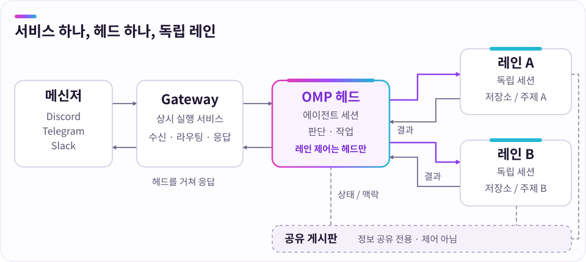

<p align="center">
  
</p>

<h1 align="center">omp-superagent</h1>

<p align="center">
  <strong>메신저에서 하나의 OMP 헤드와 대화하고, 필요한 작업만 독립적인 저장소·주제 레인으로 나눕니다.</strong>
</p>

<p align="center">
  Discord·Telegram·Slack을 <a href="https://github.com/can1357/oh-my-pi">oh-my-pi</a>의 세션·인증·도구·native <code>task</code>에 연결합니다.
  일반 작업과 후속 답변은 주제별 독립 OMP 세션에서 처리합니다. 주제 간 조정은 <code>/head</code>로 전역 헤드에 요청합니다.
</p>

<p align="center">
  <a href="https://www.npmjs.com/package/omp-superagent"></a>
  <a href="https://github.com/dbc-hbin/omp-superagent/actions/workflows/ci.yml?query=branch%3Amain"></a>
  <a href="LICENSE"></a>
  <a href="https://bun.sh"></a>
</p>

<p align="center">
  <a href="#빠른-시작"><strong>빠른 시작</strong></a> ·
  <a href="DESIGN.md"><strong>설계</strong></a> ·
  <a href="docs/OPERATIONS.md"><strong>운영</strong></a> ·
  <a href="config.example.json"><strong>설정 예제</strong></a>
</p>

<p align="center">
  <a href="README.md">English</a> · <strong>한국어</strong>
</p>

## 차별점

<table>
  <tr>
    <td width="50%" valign="top">
      <h4>직접 실행하는 헤드</h4>
      조사·구현을 직접 처리하거나, 분리할 작업의 범위와 인계를 정해 위임합니다.
    </td>
    <td width="50%" valign="top">
      <h4>맡긴 목표 안의 자율 실행</h4>
      다음 유용한 일을 선택·우선순위화하고 계획·실행·검증·수정합니다.
      검증한 중간 결과 뒤에도 남은 허가 작업을 단계별 허락 없이 이어가되 새 범위·외부 효과를 임의로 추가하지 않습니다.
    </td>
  </tr>
  <tr>
    <td width="50%" valign="top">
      <h4>저장소·주제별 독립 레인</h4>
      별도 OMP Host와 세션으로 작업 디렉터리와 맥락을 나눕니다.
    </td>
    <td width="50%" valign="top">
      <h4>레인별 native 모델·프리셋</h4>
      새 주제는 현재 헤드 모델로 시작한 뒤 자기 모델을 유지합니다. 명시적 위임에는 별도 모델이나 프리셋을 선택할 수 있습니다.
    </td>
  </tr>
  <tr>
    <td width="50%" valign="top">
      <h4>연결과 세션 수명의 분리</h4>
      지속 실행되는 Gateway가 메신저 연결과 수신·조율 장부를 맡고, OMP 세션이 대화 맥락을 맡습니다.
    </td>
    <td width="50%" valign="top">
      <h4>관리 세션만 쓰는 공유 게시판</h4>
      같은 인스턴스에 등록된 헤드·레인이 정보를 공유하며, 명령이나 승인 경로로 쓰지 않습니다.
    </td>
  </tr>
  <tr>
    <td colspan="2" valign="top">
      <h4>순정 OMP 사용</h4>
      관리형 익스텐션과 공개 API로 기존 세션·도구·승인·인증을 재사용하며 코어 fork를 유지하지 않습니다.
    </td>
  </tr>
</table>

## 구조

<picture>
  <source media="(prefers-color-scheme: dark)" srcset="assets/architecture.ko-dark.svg">
  <source media="(prefers-color-scheme: light)" srcset="assets/architecture.ko.svg">
  
</picture>

Gateway는 메신저 연결·수신 장부·헤드 수명을 관리하는 데몬입니다. 작업을 판단하고 레인을 지시하는 주체는 헤드입니다.
헤드 런타임이 승인과 전송을 관리하되, 연결된 레인의 진행·답변은 전역 모델을 거치지 않습니다.

[구조도 Mermaid 원본](assets/architecture.mmd)

## 안전과 권한

설정한 모든 메신저 소유자는 같은 신뢰된 운영자 한 명으로 취급합니다. 멀티테넌트 서비스나
OS 샌드박스가 아닙니다. 자세한 내용은 [설계(영문)](DESIGN.md)를 참고하세요.

| 단계 | 바뀌는 것 |
| --- | --- |
| [설치](#1-설치) | 의존성과 관리형 omp-superkit 통합을 준비합니다. 봇을 시작하거나 설치된 OMP를 교체하지 않습니다. |
| [`setup`](#2-설정과-자격-증명) | `config.local.json`과 소유자 전용 평문 파일 `config.local.json.env`(`0600`)를 만듭니다. 최종 저장 전에 필요한 OMP 전역 메모리 변경과 봇 프로필 사진 교체를 안내합니다. 봇·모델 세션은 시작하지 않습니다. |
| [`doctor`](#3-진단-후-명시적으로-시작) | 메신저에 로그인하거나 설정을 변경하지 않고 로컬 설정과 OMP 메모리 백엔드의 실효 상태를 진단합니다. |
| [`start`](#3-진단-후-명시적으로-시작) | 필요한 경우 OMP 메모리 기본값을 저장한 뒤 detached Gateway와 헤드를 시작하고 설정한 모든 플랫폼에 연결합니다. |
| [Discord 음성채팅](docs/discord-voice.md) | 기본값은 꺼짐입니다. 구독 권한이 없으면 유료 API로 전환하지 않습니다. |
| [`/stop`](#사용-방법) | 연결 레인을 일시정지합니다. 승인·취소·도구 제외와 불확실한 효과에 대한 보류는 유지합니다. |

## 배포 형태

[npm 패키지](https://www.npmjs.com/package/omp-superagent)를 Bun 또는 npm으로 설치하거나
[GitHub Release](https://github.com/dbc-hbin/omp-superagent/releases/tag/v0.1.7)의 소스·npm tarball을 받으세요.
실행에는 Bun이 필요하며 독립 실행 바이너리는 아닙니다. 설치 시 관리형 의존성을 준비합니다.
Host를 실행하려면 별도로 설치한 OMP가 필요하며, 이 프로젝트가 패치하거나 빌드하지 않습니다.

## 빠른 시작

현재 소스는 Git, **Bun >= 1.4.4**, 로컬 Unix socket을 사용합니다. 패키지 설치에는 OMP가
필요 없습니다. Host를 실행할 때는 별도로 설치한 OMP의 기능을 검사하며, 버전 범위로 제한하지
않습니다. CI 기준판은 **OMP 19.0.0**이며, **18.20.3과 18.22.2**는 이전 릴리스에서 검증했습니다.
Windows는 지원하지 않습니다.

<details>
<summary><strong>SDK 고정 버전과 CI 재현</strong></summary>

SDK는 **19.0.0**으로 유지하며 upstream 커밋은
[`57771ae562b9345e0579bceb2d68d585e3e6927e`](https://github.com/can1357/oh-my-pi/commit/57771ae562b9345e0579bceb2d68d585e3e6927e)입니다.
`bun run test:ci`는 현재 설치된 OMP를 검사합니다. CI 기준판을 재현하려면 `bun run test:baseline`을
사용하세요. OMP 18은 수동 검사만 제공합니다. `bash scripts/test-omp.sh v18.22.2` 또는 `v18.20.3`을
지정하면 해당 공식 바이너리를 검증한 뒤 같은 회귀를 로컬에서 실행합니다.
별도의 주간·수동 **OMP upstream compatibility** 검사는 최신판이 깨지면 그대로 실패하며 릴리스를 막지 않습니다.

</details>

### 1. 설치

<table width="100%"><tr><td>

**중요**

Host를 OMP 18에서 19로 바꾸기 전에 기존 백그라운드 서비스를 확인하세요.
OMP 19 데몬은 이전 브로커의 서비스를 인수하지 않습니다.

</td></tr></table>

OMP 자체를 설치하려면 [공식 설치 안내](https://github.com/can1357/oh-my-pi#install)를 참고하세요.

```sh
bun add --global --trust omp-superagent@0.1.7
omp-sa --help
```

`--trust`는 관리형 omp-superkit 통합 준비 등 패키지 설치 스크립트 실행을 허용합니다.
`bun pm bin --global`의 출력 경로를 `PATH`에 포함하세요.

<details>
<summary><strong>npm으로 설치</strong></summary>

Bun이 `PATH`에 있다면 npm으로도 설치할 수 있습니다.

```sh
npm install --global omp-superagent@0.1.7
```

postinstall이 필수 관리형 omp-superkit 통합을 준비하므로 설치 스크립트를 생략하지 마세요.

</details>

공개 SDK 패키지와 플랫폼 네이티브 의존성은 패키지 레지스트리에서 받으며, Rust 도구·OMP 소스
checkout·코어 패치·네이티브 빌드가 필요하지 않습니다. 의존성 설치에는 네트워크가 필요하지만,
봇을 시작하거나 설치된 OMP를 교체하지는 않습니다.
`command`에는 설치된 OMP 실행 파일과 그 뒤에 네이티브 CLI 옵션을 지정합니다.
Bun 등 런타임으로 OMP 소스를 실행하는 래퍼는 지원하지 않습니다.

CLI 명령어는 <strong><code>omp-sa</code></strong>이며 프로젝트·패키지 이름은 `omp-superagent`로 유지합니다.

<details>
<summary><strong>소스 checkout에서 실행</strong></summary>

소스 checkout이나 소스 tarball에는 stable Rust/Cargo, CMake, C 컴파일러가 필요합니다. Cargo는 Gateway와 Host 중계기만 빌드하며 OMP는 빌드하지 않습니다. Rust 코드 변경 후에는 `bun run build:native`를 실행하세요. 소스 루트에서:

```sh
bun install --frozen-lockfile
bun link
```

`omp-sa`와 소스 호출 `bun --no-env-file src/cli.ts`는 같은 CLI이며 둘 다 `.env` 자동 로딩을 끕니다.

</details>

### 2. 설정과 자격 증명

원격 실행이 필요하면 헤드를 평소처럼 설정한 뒤 [원격 워커 추가](#원격-워커-추가)를 따르세요.
워커에서는 메신저를 설정하지 않습니다.

[플랫폼 앱·권한](docs/OPERATIONS.md#2-플랫폼별-앱과-접근-범위)을 준비한 뒤 터미널에서 실행합니다.

```sh
omp-sa setup --config ./config.local.json
```

<table width="100%"><tr><td>

**중요**

셋업은 `config.local.json`을 만들고 숨김 입력으로 받은 토큰을 소유자 전용
`config.local.json.env`(`0600`)에 저장합니다. 파일은 암호화 저장소가 아닌 평문이며,
비어 있지 않은 셸 자격 증명이 우선합니다. 모델 제공자 인증은 기존 OMP 방식으로 설정합니다.

</td></tr></table>

봇·모델 세션은 시작하지 않습니다. 최종 저장 확인에는 Discord/Telegram 봇 프로필 사진을
마스코트로 바꾸는 작업도 포함됩니다.

관리형 헤드와 레인은 실효 설정이 `off`가 아닌 모든 지원 OMP 메모리 백엔드를 사용할 수
있습니다. 선택된 프로필에 백엔드가 미설정이거나 전역 설정에서 꺼져 있으면, 셋업은 최종
저장 전에 이를 안내하고 저장을 승인한 뒤 해당 프로필의 전역 `memory.backend`만 `mnemopi`로
설정합니다. 메모리만 따로 묻지 않으며 프로젝트·실행 오버레이는 변경하지 않습니다.
저장 뒤에도 메모리가 꺼져 있거나 실효 상태를 확인할 수 없으면 저장 파일을 보존하고 셋업이
완료되지 않았다고 알립니다.

누락된 native judge 역할은 설정을 권장하지만 모델을 자동 선택하거나 호출하지 않습니다.

메모리 동작, 다른 설정 경로, 수동 설정과 저장 효과는
[설정 가이드](docs/OPERATIONS.md#3-설정)를 참고하세요.

### 3. 진단 후 명시적으로 시작

```sh
omp-sa doctor --config ./config.local.json
```

소스 준비와 `doctor`는 메신저에 로그인하지 않습니다. `doctor`로 로컬 설정과 CLI·자격 증명 환경,
실효 메모리 설정을 변경 없이 진단합니다. 기존 구성에서도 Gateway 시작·재시작과 각 관리형 Host
실행에는 셋업과 같은 기본값 보완 규칙이 적용됩니다. 각 Host는 자기 작업 디렉터리를 기준으로
확인하며, 프로젝트·실행 오버레이에서 명시적으로 꺼둔 경우에는 시작하지 않습니다.
`start`는 설정에 남긴 **모든 플랫폼**을 활성화하고, detached Gateway와 헤드를 시작합니다.

```sh
omp-sa start --config ./config.local.json
```

같은 헤드가 누락된 native `high`/`middle`/`low` 프리셋만 초기화한 뒤 일반 작업을 시작합니다.
관리 프리셋은 이후 OMP의 `slow`·`default`·`smol` 역할을 따라가며, 활성 세션과 수동 프리셋은
보존합니다. `status`는 초기화와 transport 준비를 구분합니다.
setup과 doctor는 봇·모델 세션을 시작하지 않습니다.

<table width="100%"><tr><td>

**참고**

이 패치 없는 배포판은 관리형 RPC Host에 native TUI/herdr로 접속하는 기능을 제공하지 않습니다.
관리 세션은 메신저 명령과 `omp-sa status`로 확인하고 제어합니다.
레인 기록은 일반 OMP의 기본 세션 검색에서도 찾습니다. `/resume`(Tab으로 모든 프로젝트)
또는 native 기록 도구를 사용하세요. 의도적인 재개는 일반 OMP 작업이며 관리 Host 접속이나
관리·게시판 권한 부여가 아닙니다.
[native 세션 접근](docs/OPERATIONS.md#일반-omp에서-세션-기록-찾기)에서 범위와 사용법을 확인하세요.

</td></tr></table>

상태 조회·종료·macOS 로그인 후 자동 시작·복구는 [운영 가이드](docs/OPERATIONS.md)를
참고하세요. 로그인 자동 시작은 한 번 실행하는 방식이며 crash 자동 재시작은 아닙니다.
Linux 서비스 설치는 제공하지 않습니다.

## 원격 워커 추가

“이 저장소 Linux에서 테스트해”라고 했을 때 다른 머신에 레인을 열 수 있습니다.
메신저 계정과 봇 토큰은 **헤드에만** 둡니다. 양쪽 모두 `omp-sa worker`가 있는
빌드를 사용하세요. 아직 배포되지 않은 소스라면 이전 npm 버전 대신 위의 소스 설치 방법을 따르세요.

1. **워커에서:** 위의 방법으로 Git, Bun, stock OMP, `omp-superagent`를 설치합니다.
   실행 파일과 `omp-superagent` 설치 경로는 등록할 작업용 checkout 밖에 있어야 하며,
   다른 사용자가 해당 경로의 파일을 교체할 수 없어야 합니다.
   작업할 계정에서 OMP 모델 인증과 네이티브 메모리 백엔드를 설정하세요. 워커에서는 셸 명령으로
   가져오는 API 키와 원격 인증 브로커를 지원하지 않습니다. 메모리 백엔드가 없다면
   예를 들어 `omp config set memory.backend mnemopi`를 사용할 수 있습니다. 같은 Git 저장소의 전용 clone을
   **요청할 커밋으로** 맞춥니다. 커밋만 받아 놓고 다른 브랜치에서 작업 중인 상태로는 부족합니다.
   테일넷 등 사설망을 통해 이 계정의 **OpenSSH 서버**에 접속할 수 있어야 합니다.
   `authorized_keys`의 지정 명령 제한을 사용하므로 Tailscale SSH 자체의 로그인 정책으로 대체할 수 없습니다.
   공개 포트, 두 번째 헤드, 워커에서의 `omp-sa setup`이나 `omp-sa start`는 필요 없습니다.
2. **헤드에서:** 워커 운영자와 SSH 호스트 키 지문을 확인한 뒤 `known_hosts`에 등록합니다.
   `~/.ssh/config` 별칭 대신 직접 접속할 수 있는 DNS 이름이나 IP를 사용하세요. Tailscale SSH가
   22번 포트를 사용한다면 사설망에서 별도 포트로 수신하는 OpenSSH를 사용하세요. 해당 키는
   `known_hosts`의 `[호스트]:포트`에 고정하고, 두 번의 `worker add` 모두 `dev@linux-box:포트`를
   지정합니다. 기본 SSH 포트를 쓸 때는 다음과 같습니다.
   ```sh
   omp-sa worker add dev@linux-box --config ./config.local.json
   ```
3. **워커에서 `dev` 계정으로:** 위 명령이 출력한 `worker init` 명령을 실행합니다.
   생성된 헤드의 **공개키**는 그대로 두고 예시 경로만 실제 저장소로 바꾸세요.
   ```sh
   omp-sa worker init --head-key 'ssh-ed25519 …' --repo "$HOME/src/my-app"
   ```
   지정된 워커 명령만 호출할 수 있는 전용 키가 `~/.ssh/authorized_keys`에 등록됩니다.
   헤드의 개인 키·봇 토큰·설정 파일은 복사하지 마세요. 레인의 도구는 워커 OS 계정의
   권한으로 실행되므로 다른 파일과 격리하려면 전용 계정을 사용하세요.
4. **다시 헤드에서:** 같은 `worker add` 명령을 실행합니다. 처음 안내가 나왔을 때가
   아니라 **`verified`가 표시되어야 등록 완료**입니다. 특정 헤드 checkout의 새 레인에
   이 워커를 우선 사용하려면 `--default --local-repo /헤드의/경로/my-app`을 붙입니다.
   `--local-repo`를 생략하면 설정의 `headCwd`를 사용합니다. 같은 Git 원격 주소라도
   다른 checkout에 이 기본 배치 권한이 넘어가지는 않습니다.

등록 목록은 `omp-sa worker list --config ./config.local.json`으로 확인합니다. 목록 조회는
워커에 접속하지 않습니다. 지금 연결되는지 확인하려면
`omp-sa worker doctor dev@linux-box --config ./config.local.json`에 등록 때 쓴 주소와
포트를 그대로 지정하세요. 워커 신원과 빈 슬롯을 확인하며, 기본 워커라면 승인된 헤드
checkout의 현재 커밋도 대조합니다. 확인이 막히면 종료 코드는 0이 아니며, 레인을 시작하지 않습니다.

이제 채팅에서 원격 실행이나 필요한 OS를 지정하면 됩니다. 저장소는 폴더 이름이 아니라
Git 원격 주소로 매칭합니다. 커밋하지 않은 변경과 무시된 파일을 동기화하지 않으므로
깨끗한 커밋을 기준으로 요청하세요. 실행 중인 레인이 해당 checkout을 예약하며
자동 fetch·브랜치 전환·변경 폐기는 하지 않습니다. 후속 요청은 같은 워커의 같은 세션으로 갑니다.
SSH가 끊겨도 Host 자체는 종료되지 않습니다. Host가 종료된 뒤 checkout이 달라져 있으면
재기동은 보류됩니다. 답변과 승인 카드는 원래 대화로 돌아오지만 메신저 첨부파일 전달과
헤드의 로컬 SQLite 보드 접근은 원격 레인에서 지원하지 않습니다. 헤드의 OMP 실행 명령에
도구·프로필·승인 등의 추가 플래그가 있으면 이를 빼고 원격 실행하지 않고 요청을 거부합니다.
워커는 자동 로드 플러그인이 없는 전용 OMP 프로필을 사용하세요. `.omp/`, `.env`, Git 필터 등
실행 설정이 있는 checkout, linked worktree, 서브모듈은 자동으로 수정하거나 로드하지 않고 거부합니다.
커스텀 모델 확장이 필요하면 워커 OMP agent 디렉터리의 `worker-extensions.json`(`0600`)에
등록된 checkout 밖의 신뢰하는 모듈 절대경로를 JSON 배열로 적습니다. 배치된 위치는
`omp-sa status --config ./config.local.json`에서 확인합니다. 접근을 철회할 때는
워커에서 **해당 등록 키만** 제거하세요. 키 제거가 이미 실행 중인 레인을 중단하지는 않습니다.

## 사용 방법

- `디스코드 봇 온라인 상태 유지해 줘`, `owner/repo#35 CI가 통과하면 알려줘`, `이 작업이 멈추거나 끝나면 알려줘`처럼 요청하세요. 같은 대화에서 상태를 묻거나 감시만 중지할 수 있습니다. 감시가 PR 병합이나 작업 중지를 허가하지는 않습니다. Discord 온라인 표시를 꺼도 메시지는 계속 받습니다.
- 이미 연결된 작업 스레드나 주제에서는 저장소 이름이나 명령 없이 후속 메시지를 보내면 그 작업을 이어갑니다.
- 그 밖에서는 요청을 그대로 보내세요. 저장소 이름을 안다면 `client-ui에서 로그인 오류 봐줘`처럼 적어도 됩니다.
  HEAD는 저장소가 필요 없는 질문에는 직접 답하고, 작업에는 요청과 해당 대화의 문맥을 바탕으로 실제
  작업 디렉터리를 찾아 확인한 뒤 배정합니다. 중요한 모호함이 남을 때만 구체적으로 묻습니다.
  기본 저장소나 마지막으로 활동한 채팅을 기준으로 삼지 않습니다. 아직 연결되지 않은 Discord
  스레드에서 요청했다면, 따로 나눠 달라고 하지 않는 한 그 스레드에서 작업을 이어갑니다.
- 디렉터리를 직접 정하려면 첫 줄에 `cwd: /작업/절대경로`를, 별도 주제로 시작하려면 `/new 요청`을
  사용하세요. 이미 배정된 작업 메시지에 직접 답장하면 이전 대화 내용 없이 확인된 작업 경로만 다시 쓸 수 있습니다.
- 헤드에서 Mnemopi가 활성화되어 검색할 수 있으면 다른 운영자 채널에서도 `지난주 로그인 버그 보던 데서 계속해줘`라고 할 수 있습니다. Mnemopi `recall`로 단서를 찾고, 날짜와 작업 내용을 원래 세션에서 확인합니다. 하나로 좁혀지면 그 저장소에서 이어가고, 여럿이면 번호로 고릅니다. 다른 메모리 백엔드로도 관리형 세션을 실행할 수 있지만 이 과거 작업 검색은 지원하지 않습니다. 제한 그룹방은 검색 대상이 아닙니다.
- 전역 조정은 `/head 요청`을 사용합니다. 저장소·주제별 레인 맥락은
  독립적입니다. 음성 첨부 메타데이터 보존이 자동 전사를 뜻하지는 않습니다.
- `/help`와 `/status`로 명령·상태를 확인합니다. `/model`·`/effort`는 유휴 헤드 세션만
  바꾸며 기존 레인·전역 기본값은 유지합니다. `/head`로 헤드 모델 변경을 요청하면
  해당 턴이 끝난 뒤 적용합니다. 전역 프리셋 저장은 명시적 `--global`이 필요합니다.
  Slack 일반 메시지 명령은 `!`를 씁니다.
- `/usage`는 OMP가 조회한 기본·확장 제공자의 계정별 한도와 리셋 시각을 마스킹된 계정 이름과 함께 보여줍니다. 모델은 호출하지 않습니다.
- `/usage reset`은 계정별로 지금 쓸 수 있는 리셋권 수를 보여줍니다. 계정을 고르고 Confirm을 누르면 한 개를 사용합니다. 계정 지정 리셋을 지원하는 순정 OMP가 필요합니다.
- 결과 파일을 받으려면 운영자 요청 첫 줄에 `attach: 보고서/결과.pdf`처럼 작업 디렉터리 상대 경로를 적으세요.
- 단체방·서버에서는 [제한 그룹 모드](docs/OPERATIONS.md#단체방서버-권한-분리)로 허용된 사용자에게 요청 접수, 도구 없는 채팅 또는 worktree 편집을 열 수 있습니다. 운영자 세션 권한은 주지 않습니다.
- `/head 2시간마다 CI 상태를 요약해서 여기로 보내줘`라고 요청하거나
  `/cron add "every 2h" CI 상태를 요약해줘`로 직접 등록하고,
  `/cron list`로 확인합니다. [예약 작업 명령](docs/OPERATIONS.md#예약-작업-cron)으로 수정·중지·재개·즉시 실행·삭제할 수 있습니다.
- `/stop`은 연결 레인을 일시정지하고 `/resume`은 재개를 허가합니다. 승인·취소·도구 제외와
  불확실한 효과에 대한 보류는 유지합니다. 진척 보고·복구가 작업 완료의 검증이나 외부 효과의
  취소를 뜻하지 않으며, 저장된 goal은 crash replay나 로드되지 않은 상태의 실행을 보장하지 않습니다.

<table width="100%"><tr><td>

**음성**

Discord에서는 [소유자 전용 음성채팅](docs/discord-voice.md)을 선택적으로 켤 수 있습니다.
Codex 구독 음성 또는 별도 과금되는 API 음성 중 하나를 선택합니다. 구독 모드는 API 키 없이
동작하며, 구독 권한이 없으면 유료 API로 전환하지 않습니다. 작업은 텍스트로 확인한 뒤 기존 HEAD가 맡습니다.
기본값은 꺼짐이며 봇 시작만으로 음성 채널에 들어가거나 음성 요금이 발생하지 않습니다.

</td></tr></table>

명령 등록, 재시작·복구 의미와 플랫폼 차이는
[명령과 일상 사용](docs/OPERATIONS.md#4-명령과-일상-사용)을 참고하세요.
저장소를 편집했다고 현재 운영 서비스에 반영되는 것은 아닙니다.

## SUPER 워크플로

공식 [omp-superkit](https://github.com/dbc-hbin/omp-superkit)은 필수 관리형 통합입니다.
통합을 로드하는 것만으로 워크플로가 활성화되지는 않습니다. 메신저에서 워크플로를 요청하려면
작업 요청의 첫 단어로 `super`, `super-plan`, `super-run`, `super-loop`, `super-research`,
`super-graph` 중 하나를 사용하세요. 이에 대응하는 `/super`, `/super-plan`, `/super-run`,
`/super-loop`, `/super-research`, `/super-graph`는 OMP 명령이지 메신저 슬래시 명령이 아닙니다.
각 용도와 설치된 스킬 ID, 기준 upstream 리비전은 [워크플로 표(영문)](docs/design/execution.md#workflow-selection)를
참고하세요.

헤드는 허가된 작업에 구체적으로 도움이 될 때 워크플로를 선택할 수 있습니다.
일반 작업은 직접 세션·native task·일반 레인으로 처리할 수 있습니다.

업데이트는 새 Host에 적용하며 실행 중인 헤드·레인의 버전은 유지합니다.
[관리형 통합 운영](docs/OPERATIONS.md#필수-관리형-omp-superkit-설치와-갱신)에서 갱신·활성화 동작을 확인하세요.

## 개발

설치 후 로컬 검사를 실행합니다.

```sh
bun run check
bun test test
bun run test:ci
```

오프라인 native/PTY 범위·필요 도구·로컬 패키징과 게시 경계는
[개발자 검증·소스 릴리즈 절차](docs/OPERATIONS.md#6-개발자-검증)를 참고하세요.
[현재 CI](https://github.com/dbc-hbin/omp-superagent/blob/main/.github/workflows/ci.yml)는
순정 OMP 19.0.0을 검사 대상에 포함합니다.
[과거 실행 기록](docs/releases/0.1.0.md#verification-records)은 기록된 버전과 시나리오에만 적용됩니다.
오프라인 CI는 실계정 접속이나 운영 준비 완료를 보증하지 않습니다.

## 문서와 출처

| 문서 | 내용 |
| --- | --- |
| [설계(영문)](DESIGN.md) | 아키텍처와 메신저 권한·실행 계약. |
| [메시징과 권한(영문)](docs/design/messaging.md) | 수신·라우팅·제어·승인·복구·전달과 Discord 음성채팅. |
| [실행과 조율(영문)](docs/design/execution.md) | 레인·native Host 수명·모델·workflow·관리형 통합·모니터링·게시판. |
| [운영 가이드](docs/OPERATIONS.md) | 설치·설정·명령·복구 절차. |
| [Discord 음성채팅](docs/discord-voice.md) | Codex 구독 음성 또는 별도 과금되는 API 음성 선택. |
| 릴리즈 | [릴리즈 노트](docs/releases/0.1.7.md) 및 [과거 검증 기록](docs/releases/0.1.0.md#verification-records). |

[oh-my-pi](https://github.com/can1357/oh-my-pi)를 기반으로 하며, workflow에는 [omp-superkit](https://github.com/dbc-hbin/omp-superkit)을 사용합니다.

[Jay (@Momentum96)](https://github.com/Momentum96)는
[Discord 멘션·답글 필터(#29)](https://github.com/dbc-hbin/omp-superagent/pull/29)의 원안을 기여했고,
[원격 레인 동작 검증(#30)](https://github.com/dbc-hbin/omp-superagent/pull/30),
[워커 등록·진단(#32)](https://github.com/dbc-hbin/omp-superagent/pull/32),
[macOS GUI 워커(#33)](https://github.com/dbc-hbin/omp-superagent/pull/33)를 제안했습니다.
워커 진단·별도 SSH 포트·원격 의사결정 검증에는 이 제안을 반영했습니다.
워커는 기존 SSH 실행 방식을 유지하며 GUI 런처는 포함하지 않습니다.

## License

프로젝트 코드는 [MIT 라이선스](LICENSE)를 따릅니다. 서드파티 구성 요소에는 별도 조건이
적용됩니다. [THIRD_PARTY_NOTICES.md](THIRD_PARTY_NOTICES.md)를 참고하세요.

<p align="center">
  <a href="https://github.com/dbc-hbin/omp-superagent/issues">이슈</a> ·
  <a href="https://github.com/dbc-hbin/omp-superagent/releases">릴리즈</a> ·
  <a href="https://www.npmjs.com/package/omp-superagent">npm</a>
</p>
