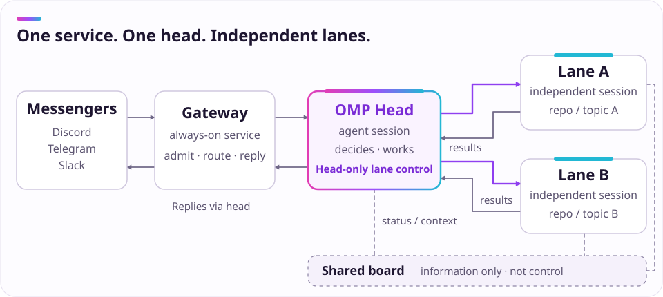

<p align="center">
  
</p>

# omp-superagent

**English** · [한국어](README.ko.md)

**One OMP head in your messenger. Independent sessions for work that needs its own context.**

Connect Discord, Telegram, and Slack to [oh-my-pi](https://github.com/can1357/oh-my-pi).
The head can investigate, write code, and answer directly—or assign work to independent
OMP sessions called **lanes**, each with its own repository, context, and model.
Every request and follow-up goes through the head, which coordinates the work and brings
the results back to your conversation.

[Design](DESIGN.md) · [Setup & operations](docs/OPERATIONS.md) · [Configuration](config.example.json)

## Distribution

Install from [npm](https://www.npmjs.com/package/omp-superagent) or use the source
and npm tarballs from the
[GitHub Release](https://github.com/dbc-hbin/omp-superagent/releases/tag/v0.1.2).
Install with Bun or npm below. Bun is still required at runtime; this is not a
standalone binary. OMP must already be installed; this project neither patches nor
builds it. Installation prepares the managed dependencies.

## Why superagent?

- **A head that works, not just delegates.** Keep straightforward work in the main session.
  Open lanes when separate context or independent execution helps.
- **Autonomy inside the entrusted objective.** Choose and prioritize useful next work,
  plan, act, test, and repair. Verified intermediate results lead to remaining authorized
  work without per-step permission, not to unrelated scope or automatic external effects.
- **Separate repositories and topics.** Lanes are real OMP work sessions, not another
  supervisor layered over a worker.
- **Models chosen per lane.** The head consults OMP's judge and chooses a native model or
  preset. Lane model changes stay local to that session, without rewriting global settings.
- **An always-on gateway, not an always-thinking agent.** The daemon keeps messenger
  connections and durable intake alive. OMP retains conversations separately from process residency.
- **A shared information board.** The head and its managed lanes exchange findings and
  progress. Unconnected OMP sessions cannot join; posts are information, not commands.
- **Unmodified OMP.** Reuse native sessions, tools, approvals, and authentication through
  managed extensions and public APIs, without maintaining a core fork.

## Architecture



[Mermaid source](assets/architecture.mmd)

The **Gateway** owns messenger connections and the head's lifecycle. The **head** owns
lane control and decides whether to work directly or delegate. **Lanes** report to the
head; the head replies to the original conversation.

## Quick start

This checkout requires Git, **Bun >= 1.4.4**, and local Unix sockets. Installing the
package does not require OMP. To run a Host, install stock OMP separately; the
CLI checks capabilities, not a version range. The tested releases are
**OMP 18.20.3, 18.22.2, and 19.0.0**.
The SDK stays pinned to **19.0.0**, from upstream `v19.0.0` commit
[`57771ae562b9345e0579bceb2d68d585e3e6927e`](https://github.com/can1357/oh-my-pi/commit/57771ae562b9345e0579bceb2d68d585e3e6927e).
`bun run test:ci` tests the installed OMP. To reproduce CI, use
`bun run test:baseline` for the SDK-matched CLI or `bash scripts/test-omp.sh v18.22.2`
(or `v18.20.3`) for OMP 18. Each verifies the release binary and runs the same suite.
The separate weekly/manual **OMP upstream compatibility** workflow tests the latest
published CLI without falling back to the baseline or blocking releases.
Windows is unsupported.
Configure `command` with the installed OMP executable followed by native CLI flags;
runtime/script wrappers are unsupported.

### 1. Install

Before switching a Host from OMP 18 to 19, check its background services; the
OMP 19 daemon does not take over the old broker's services.

To install OMP separately, see the
[upstream instructions](https://github.com/can1357/oh-my-pi#installation).

```sh
bun add --global --trust omp-superagent@0.1.2
omp-sa --help
```

`--trust` allows package lifecycle scripts, including managed `omp-ulw` preparation.
Ensure `bun pm bin --global` is on `PATH`. Alternatively, with Bun on `PATH`:

```sh
npm install --global omp-superagent@0.1.2
```

Keep lifecycle scripts enabled for the managed `omp-ulw` integration.
Published SDK packages and platform-native dependencies come from the package registry;
no Rust toolchain, OMP source checkout, core patch, or native build is required.
Dependency installation needs network access. It does not start a bot or replace OMP.

The CLI command is **`omp-sa`**; the package name is `omp-superagent`.
For a source checkout or extracted source tarball, run from its root instead:

```sh
bun install --frozen-lockfile
bun link
```

Both `omp-sa` and the source invocation `bun --no-env-file src/cli.ts` run the same
CLI with automatic `.env` loading disabled.

### 2. Configure

Prepare your platform apps using the [operations guide](docs/OPERATIONS.md#2-플랫폼별-앱과-접근-범위),
then run:

```sh
omp-sa setup --config ./config.local.json
```

Setup creates `config.local.json` and stores hidden-input tokens in owner-only
`config.local.json.env` (`0600`). That file is plaintext, not a vault; nonempty shell
credentials take precedence. Configure model authentication through OMP.

Setup does not start a bot or model session. Its final save confirmation includes
replacing configured Discord/Telegram bot avatars with the mascot. Enabling the
recommended Mnemopi memory backend requires a separate explicit `yes` and final save;
it changes OMP's global memory backend. Setup recommends configuring a missing native
judge role but does not choose or call a model.

See [configuration and setup effects](docs/OPERATIONS.md#3-설정) for permissions,
memory behavior, alternative config paths, and manual configuration.

### 3. Start

Check local configuration without logging into the messengers:

```sh
omp-sa doctor --config ./config.local.json
```

Start the detached Gateway and head, connecting **all configured messengers**:

```sh
omp-sa start --config ./config.local.json
```

The same head initializes missing native `high`/`middle`/`low` presets before ordinary
work. Managed presets then follow OMP's `slow`/`default`/`smol` roles without changing
active sessions or overwriting custom presets. `status` distinguishes initialization from
transport readiness. Setup and doctor do not start bot/model sessions.

Native TUI/herdr attachment to managed RPC Hosts is not available in this patch-free
release. Use messenger commands and `omp-sa status` for managed sessions.
Lane journals also appear in ordinary OMP's native session discovery. Use `/resume`
(Tab for all projects) or native history tools; an intentional resume is normal OMP work,
not managed-Host attachment or a manager/board permission grant. See
[native session access](docs/OPERATIONS.md#일반-omp에서-세션-기록-찾기).

For status, shutdown, macOS login startup, and recovery, use the
[operations guide](docs/OPERATIONS.md). Login startup is a one-shot launch, not a
crash supervisor; Linux service installation is not provided.

## Working from chat

Discord can optionally join a private voice conversation with the owner. A separate
OpenAI Live session answers speech; work goes to HEAD only after written confirmation.
Select Codex subscription voice or the separately billed API in the
[voice configuration guide](docs/discord-voice.md). Voice is off by default;
a rejected subscription call never switches to API billing.

- Ask normally. Questions get direct answers; work instructions open a topic with a
  brief approach, followed by meaningful progress and results.
- Follow up in the same topic to steer active work through the head. Repositories and
  topics keep independent lane context; voice metadata does not imply transcription.
- Use `/help` and `/status` for controls and state. `/model` and `/effort` manage the
  idle head session, not existing lanes or global defaults. You can also ask the head
  in a normal message to switch its own model after that turn. Global preset changes
  require explicit `--global`. Slack's message commands use `!`.
- Ask HEAD to summarize CI every two hours, or use `/cron add "every 2h" Summarize CI`, and
  manage it from the same chat with [`/cron`](docs/OPERATIONS.md#예약-작업-cron).
- `/stop` pauses the bound lane; `/resume` authorizes continuation. Approvals,
  cancellations, tool exclusions, and uncertain-effect holds remain binding.
  Neither progress reports nor recovery prove task completion or undo external effects.
  Saved goals do not guarantee crash replay or execution while unloaded.

See [commands, approvals, and everyday use](docs/OPERATIONS.md#4-명령과-일상-사용)
for command registration, restart and recovery semantics, and platform differences.
Repository changes alone do not update a running service.

## ULW included

[omp-ulw](https://github.com/dbc-hbin/omp-ulw) is installed and loaded as a managed integration.
Use a workflow explicitly, or let the head select one when the authorized task genuinely
benefits from it. Ordinary work can stay in a direct session, native task, or regular lane.

Updates apply to new Hosts, not running heads or lanes. See
[managed integration operations](docs/OPERATIONS.md#필수-관리형-omp-ulw-설치와-갱신)
for update and activation behavior.

## Development

Local checks after installation:

```sh
bun run check
bun test test
bun run test:ci
```

See [developer verification and source release steps](docs/OPERATIONS.md#6-개발자-검증)
for offline native/PTY coverage, prerequisites, and local packaging/publication boundaries.
[Recorded results and limitations](docs/releases/0.1.0.md#verification-records) apply
to the versions tested; they do not verify the OMP 19.0.0 runtime, live accounts,
or production readiness.

## Documentation & credits

- [Design](DESIGN.md): routing, roles, sessions, and lifecycle.
- [Operations guide](docs/OPERATIONS.md): platform setup, commands, and recovery.
- [Release records](docs/releases/0.1.0.md#verification-records): dated verification evidence and limits.

Built on [oh-my-pi](https://github.com/can1357/oh-my-pi), with
[omp-ulw](https://github.com/dbc-hbin/omp-ulw) workflow integration.
The mascot reimagines OMP's pi mark as a little superhero.

## License

Project code is licensed under [MIT](LICENSE). Third-party components retain their
separate terms; see [THIRD_PARTY_NOTICES.md](THIRD_PARTY_NOTICES.md).
