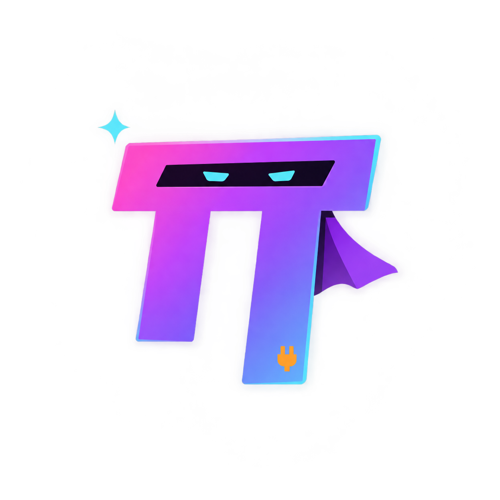

<p align="center">
  
</p>

# omp-superagent

**English** · [한국어](README.ko.md)

**One OMP head in your messenger. Independent sessions for work that needs its own context.**

Connect Discord, Telegram, and Slack to [oh-my-pi](https://github.com/can1357/oh-my-pi).
The head can investigate, write code, and answer directly—or assign work to independent
OMP sessions called **lanes**, each with its own repository, context, and model.
Every request and follow-up goes through the head, which coordinates the work and brings
the results back to your conversation.

[Design](DESIGN.md) · [Setup & operations](docs/OPERATIONS.md) · [Configuration](config.example.json)

## Why superagent?

- **A head that works, not just delegates.** Keep straightforward work in the main session.
  Open lanes when separate context or independent execution helps.
- **Separate repositories and topics.** Lanes are real OMP work sessions, not another
  supervisor layered over a worker.
- **Models chosen per lane.** The head consults OMP's judge and chooses a native model or
  preset. Lane model changes stay local to that session, without rewriting global settings.
- **An always-on gateway, not an always-thinking agent.** The daemon keeps messenger
  connections and durable intake alive. OMP retains conversations separately from process residency.
- **A shared information board.** The head and its managed lanes exchange findings and
  progress. Unconnected OMP sessions cannot join; posts are information, not commands.
- **The OMP interface you already use.** Attach the native TUI to the same running Host.
  Use herdr as an optional terminal view, not a separate execution backend or required service.

## Architecture


[Mermaid source](assets/architecture.mmd)

The **Gateway** owns messenger connections and the head's lifecycle. The **head** owns
lane control and decides whether to work directly or delegate. **Lanes** report to the
head; the head replies to the original conversation.

## Quick start

Requires Git, **Bun >= 1.4.4**, local Unix sockets, and Rust/Cargo with your platform's
native build tools. Use this repository's pinned, patched OMP source.

### 1. Prepare

From the repository root:

```sh
bun scripts/prepare-omp.ts
bun install --frozen-lockfile
bun --cwd=.upstream/omp run build:native
cp config.example.json config.local.json
```

Preparation installs the pinned OMP source, its patches, and the managed `omp-ulw` integration.
It does not start a bot or replace your global OMP installation.

### 2. Configure

- Follow the [platform setup guide](docs/OPERATIONS.md#2-플랫폼별-앱과-접근-범위).
  Keep at least one messenger block; remove those you do not use.
- Replace the example values and paths. Set `command` to the absolute paths of Bun and
  `.upstream/omp/packages/coding-agent/src/cli.ts`.
- Choose `stateDir`, `headCwd`, allowed owner/channel IDs, and Host/subagent budgets.
  Configure model authentication through OMP.
- Keep tokens in environment variables. Fields such as `tokenEnv` contain variable
  **names**, never token values.

See the [configuration guide](docs/OPERATIONS.md#3-설정) for field details.

### 3. Start

Check local configuration without logging into the messengers:

```sh
bun src/cli.ts doctor --config config.local.json
```

Start the detached Gateway and head, connecting **all configured messengers**:

```sh
bun src/cli.ts start --config config.local.json
```

Attach a read-only native TUI to the same head:

```sh
bun src/cli.ts attach main --config config.local.json --read-only
```

## Working from chat

- Ask “Explain the authentication flow in this repository.” The head can handle it directly.
- Open a separate topic with `/new Fix the login bug in repository A` in a Discord or
  Telegram DM. Use `!new` on Slack; use native threads/topics in group channels.
- Follow up in the same conversation. The head receives the message, coordinates any
  lane work, and returns the result. Separate repository work keeps its own lane context.

[Commands, approvals, and everyday use](docs/OPERATIONS.md#4-명령과-일상-사용)

## ULW included

[omp-ulw](https://github.com/dbc-hbin/omp-ulw) is installed and loaded as a managed integration.
Use a workflow explicitly, or let the head select one when the authorized task genuinely
benefits from it. Ordinary work can stay in a direct session, native task, or regular lane.

The Gateway checks upstream commits at startup and hourly. New Hosts use the prepared
revision; running heads and lanes keep theirs. Failed updates leave the previous active
revision in place.

## Documentation & credits

- [Design](DESIGN.md): routing, roles, sessions, and lifecycle.
- [Operations guide](docs/OPERATIONS.md): platform setup, recovery, and verification records.
- [Third-party notices](THIRD_PARTY_NOTICES.md): source attribution and licensing.

Built on [oh-my-pi](https://github.com/can1357/oh-my-pi), with
[omp-ulw](https://github.com/dbc-hbin/omp-ulw) workflow integration.
The mascot reimagines OMP's pi mark as a little superhero.
