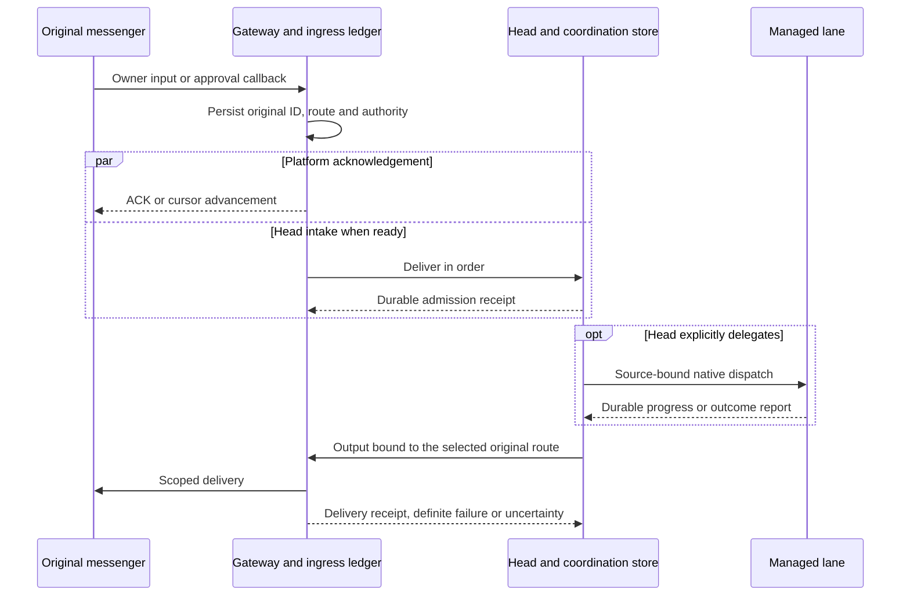

# Messaging and authority

[Architecture](../../DESIGN.md) · [Execution and coordination](execution.md) · [Operations](../OPERATIONS.md)

## Transport and identity

The [native Gateway](../../gateway/src/main.rs) owns credentials, the
[adapter hub](../../gateway/src/adapter.rs), remote connections and authenticated
messenger effects. At least one adapter is required; all configured adapters run
together. The [head runtime](../../src/runtime.ts) owns conversation routing and
approval handling. It uses the Gateway's typed local Messenger interface, not
platform SDKs, arbitrary URLs or a generic RPC tunnel.

The operator is shared; routes are not. Bind each source and effect to platform,
authenticated account, owner authority, conversation and physical thread, plus a
logical topic where applicable. Preserve signed Telegram chat IDs and Slack
timestamp strings. Do not infer identity from display names or content. A logical
topic is a binding key, not a fabricated conversation or thread ID.

| Adapter | Authentication and recovery boundary |
| --- | --- |
| [Discord](../../gateway/src/discord.rs) | Discord Gateway and REST verify the bot/owner and configured guild and parent-channel allowlists; owner one-to-one DMs are separately allowed. History recovery is for known routes after their saved cursors, not unseen chats or all edits/deletions. |
| [Telegram](../../gateway/src/telegram.rs) | Bot API `getMe` identifies the bot. Use the configured real owner and allowed chats; anonymous, forwarded, bot-mediated and business identities do not confer authority. Long poll only after startup approval reconciliation; refuse an active webhook without removing it. |
| [Slack](../../gateway/src/slack.rs) | Socket Mode and the Web API, with bot/workspace and active human owner checks and actual channel membership. No group DMs or public HTTP endpoint. Known-route history is limited by cursors, scopes, membership, retention and rate limits. |

Set `discord.requireAddressing` to `true` to filter ordinary owner messages in
allowed Discord guild parent channels, including message edits and history
catch-up. The default is `false`. A message must actually mention the
authenticated bot or be a verified reply in that conversation to a message it
authored. Typing the bot's name, mentioning a different bot, or copying a bot
message without actually addressing the bot does not count.
Authorized threads that this bot created can continue without addressing; a
thread started by another bot or person needs the same mention or verified
reply as its parent channel. When enabled,
verified inline mentions of this bot are removed from ordinary owner input in
guild parent channels and threads, so a text command still parses as a command.
The owner, guild and parent-channel checks still apply. Owner DMs, Discord
application commands, approval components and restricted group rooms retain
their existing policies.

The Gateway records pending owner-message candidates before advancing the
Discord WebSocket sequence. Until it verifies the sender and route, it keeps
only lookup coordinates and revision evidence, not message or attachment
content. A reply lookup can be retried; it must not substitute a newer edit
or replay a voice command. The head pins a failed Discord history scan to its
original cursor so that later live messages cannot hide the missed interval.

### Account presence

`messenger_presence` controls only the authenticated bot on the original owner's
messenger. On Discord the existing supervised socket writes the requested status
with no activity payload or privileged member presence subscription. Explicit
stop sets invisible; it does not close the socket or stop intake. With no request,
the Gateway does not override the platform default. The desired setting survives
reconnect/restart; a current socket write is not a remote readback of the dot.
Presence is not HEAD readiness, message delivery or lane progress. The Slack
Events API bot indicator is configured in app settings; Telegram's Bot API does
not offer this operation. No personal credentials or second client are used.

## Restricted group rooms

`groupRooms` opts a specific server/workspace/chat and parent channel into a
different scope. Its existing platform allowlist and an explicit, nonempty
allowlist of stable human user IDs must both match. Child threads and forum
topics inherit the parent policy. The owner is not privileged in that room;
the owner DM and other owner-authorized routes remain unchanged. A platform
administrator, moderator, mention, quoted sender, forwarded message, bot, or
webhook is not an operator grant. There are no wildcard or open group grants.

| Room mode | Explicit input | Authority and output |
| --- | --- | --- |
| `request` | `!request TEXT` | Save the original request in the local operator inbox and post only a receipt. No inference, approval, assignment, or execution. |
| `chat` | `!ask TEXT` | One fresh tool-free OMP turn with the dedicated group model; only its bounded text answer can return to the original scope. No owner context, transcript, resources, or attachments. |
| `work` | `!work TEXT` | One bounded stock OMP run in a new detached Git worktree for the configured repository, with only scoped file operations. No shell, Git mutation, external tools, approvals, or access to owner sessions. The room gets fixed status text, not the model's answer, file paths, diffs, or artifacts. The operator inspects the local worktree. |

Telegram also accepts a real bot-command entity `/request@BotUsername`,
`/ask@BotUsername` or `/work@BotUsername` addressed to the authenticated bot.
No unrestricted conversation, owner slash controls, card actions, edited
messages, or owner history backfill. Only original messages within the live
five-minute admission window can become new group work; after durable admission,
local recovery uses the original request rather than platform history.

A separate ingress event records the authenticated user as well as the immutable
physical route, original message ID and normalized policy revision. It cannot
be delivered to owner intake. The room and sender are checked again before
execution and sending. Only the matching registered controller may request a
group reply; the Gateway takes its destination from the original durable group
event. Per-room daily admission caps and one active restricted runner bound
work. A work request must receive a confirmed kickoff before the runner starts.
Persist the execution claim and response attempt before starting them;
an interrupted runner or ambiguous send is never replayed. `omp-sa group`
reads this local record without a model turn. This is an application-level
boundary: a worktree is not an OS sandbox, and approved repository data may
be sent to the configured group model. Do not authorize a private repository
or provider that should not see this data.

Stock OMP can expand inline file references even with no tools enabled. The
[restricted runner](../../src/group-runner.ts) therefore sends group input as
JSON-quoted data with file-reference characters escaped. A fresh private
profile and scratch cwd exclude owner settings and session context; worktree
access goes only through the dedicated file tools. Process exit alone is not
a successful group turn: the runner also requires a matching terminal native
result.

## Durable admission and recovery



Gateway admission, platform ACK, head receipt, native prompt admission, native
settlement, task acceptance, and external delivery are separate facts. The
[Gateway ledger](../../gateway/src/store.rs) persists before ACK or cursor
advancement and before handing the event to the head; these two paths do not
wait for each other. The Gateway replays by stable identity. The head durably
deduplicates the original event and any distinct edit revision. A permanent denial
may be recorded as rejected; handler, store or transport failures do not turn an
unresolved event into a denial. Preserve pending order and recover connectivity
with bounded backoff. A held event does not block the initial approval recovery
barrier or selected priority owner controls (`/restart`, `/stop`, `/stop head`);
ordinary intake keeps its order. After the first approval barrier, a head outage
does not close Gateway admission. Reconnecting does not replay already submitted work.

The head receipt does not wait for a [historical topic search](#topic-routing-and-controls),
which may read large native journals. An input that needs one is appended to a
durable deferred-routing queue in the coordination store (`intake:deferred-routing`),
receipted, and then searched and admitted in the background. Until it is admitted,
later ordinary inputs of the same physical channel or DM (including its threads
and logical topics) queue behind it; other conversations are not held. A
redelivery of a queued input shares the store's immutable-payload and signed
attachment URL reconciliation. Fresh `/restart`, `/stop head`, and
`/stop <exact authorized lane-id>` bypass deferred waiting, including after
restart. A bare `/stop` bypasses failing admission only if it is not a reply and
comes from an already-bound physical Discord work thread. Bare DM and
reply-relative stops wait for earlier routing, rather than choosing today's
apparent target; edits cannot acquire priority. Global HEAD stops and
lane-specific stops snapshot receipt order across both queues. A later resume
waits for an older deferred stop of that exact lane without being cancelled by
it; other lanes' work is independent. A pending queued
choice fences the automatic history choice like an unreceipted Gateway event. A
failed admission stays first in its conversation and is retried with bounded
backoff; a permanent denial is dropped. The queue survives a restart and resumes
in order once intake is ready.

Telegram persists its per-bot offset after admission and acknowledges it with the
next `getUpdates`. There is no Bot API history fetch; recovery cannot exceed its
24-hour update retention. Omit the previous offset after 24 hours of inactivity,
missing/invalid observation time or clock rollback. Stable message and
callback-query identities, not a presumed globally monotonic update ID, deduplicate
redeliveries and approval progress.

### Uncertain submissions

Do not replay an ambiguous native prompt, approval response or external mutation.
[HEAD recovery](../../src/head-recovery.ts) can run a separate, evidence-bound
reconciliation turn in the existing head under a native tool gate. The model may
propose `release` or `hold` through `head_recovery`; code rechecks the exact
request/session/file/generation, native `rpc_prompt_result` and run boundaries,
and actual quiescence before applying an outcome. Native completion is not task
acceptance. Missing or contradictory evidence and uncertain remote effects
remain held. Recovery cannot dispatch, answer approvals, run tools outside its
gate or repeat the original request. A later stop or manual resolution invalidates
older recovery work.

An exact, settled HEAD `openai-codex` quota refusal with no tool calls or
partial answer can also close as cancelled without a recovery model turn.
Only that hold arms a usage check on the existing controller wake, at most once
per OMP usage-cache interval. The current session and same model must have a
permitted, healthy credential in native OMP model health and a matching usage
report with measured headroom above its effective reserve after the failure.
The credential must also appear in any discovered account roster for the model.
Credit-funded overage, a reset timestamp, a stale report, missing account
attribution, or an uncertain effect is not proof. The controller rechecks the
exact native run journal, stop boundary and current request ownership before
closing the hold. This does
not spend a saved reset or retry the original input; later inputs keep their
durable order. The quota and credential contracts were checked against the
[pinned OMP 19.0.0 SDK](../../DESIGN.md#stock-omp-and-verification-scope).

`/resolve [input-id]` (`!resolve` in Slack) manually closes an uncertain head
input as cancelled. A stalled lane exposes its exact input ID and queue blocker
through `/status` or `lane_inspect`. Only the operator in the bound topic can use
`/resolve --lane <input-id>` to cancel that uncertain input. This is not a native
interrupt, replay or implicit resume, and it preserves other fences and pauses.
See the [operations guide](../OPERATIONS.md#4-명령과-일상-사용) for command usage.

## Topic routing and controls

- The head **controller** admits authenticated owner inputs and preserves their
  original source and route. Ordinary messages in a bound topic continue its
  native session and journal; input for an opening topic stays with that
  placement. Neither needs a turn in the shared model.
- Other ordinary unbound inputs go to the shared HEAD model as original,
  source-bound requests, even if the text names a repository. HEAD answers
  questions that need no workspace directly. For repository work, it uses scoped
  evidence from the owner's request and context to discover and verify a directory
  before dispatch. It asks a focused question only if a material ambiguity remains.
  Neither a default repository nor the last active lane or chat is evidence of
  intent. If the original route is an unbound Discord thread, use that thread for
  any assigned work; create a sibling only on explicit request.
  An implicit workspace question left over from an older release is not a
  session binding. A follow-up can reference a single unstarted request in its
  current Discord thread or DM, or by replying to the exact sent question
  (including its Slack root timestamp). Submission rechecks that it is still
  awaiting placement; neither its excerpt nor hints based on it are reused
  after placement or cancellation. An exact workspace selection still answers
  the original question without replay.
- Where there are eligible managed sessions, ordinary HEAD routing automatically
  checks relevant original owner text against scoped Mnemopi recall and a bounded
  search of authorized native journals. The read-only pass adds only matching
  lane, workspace, and session coordinates to the HEAD input, never raw
  recall results or journal excerpts. Matches do not dispatch work, authorize
  approvals, or reopen a session. If recall is unavailable, direct journal
  matches can still inform HEAD; a missing hint does not block ordinary chat.
  Advisory lookup applies to new turns; a follow-up already eligible to steer
  has a verified destination and does not wait for recall. HEAD verifies useful
  leads or asks only if material ambiguity remains. Native file and model
  references in historical data are inert, unlike references in the current
  owner's task.
- Explicit `cwd: /absolute/path`, `/new` with a task, an exact reply to a placed
  original or its delivered message with a verified workspace, and intentional
  historical lookup use controller placement. Invalid explicit cwd is rejected,
  not sent to HEAD as ordinary input. A new topic may reuse a workspace, never
  another topic's transcript. The quote body is not placement evidence; `/new`
  in a bound thread can reuse that thread's workspace. When explicit placement
  needs workspace clarification, a known name or absolute path selects just one
  pending original on its original route. Neither an edited confirmation nor a
  stale answer becomes another task. A Slack reply uses the sent question's root timestamp.
- A retrospective request with a task description can search previous managed native
  sessions across the configured owner's currently allowed channels. Search the
  operator's text, not reply bodies, pasted commands or attachments. Telegram
  quote and code entities are excluded from lookup, not from the delivered
  message. Older Telegram records without a verified prose view cannot supply
  that evidence. For a manager-opened session, verify the live account on the
  original route as well as the destination, and match the opening request's own
  completed native receipt even if another input steered the run. Restricted
  group rooms, HEAD, other bot accounts and unrelated local OMP sessions are not candidates. Natural
  language dates refer to the original request timestamp, using UTC calendar boundaries.
  Unlike ordinary advisory routing, this path requires active, searchable Mnemopi
  on the live head. Another enabled backend can satisfy managed startup but is not
  a substitute for this search. The controller calls the head extension's public `ctx.memory.search`,
  which runs the same scoped lookup (`recallResultsScoped`) as OMP's Mnemopi
  `recall` tool. The head does not run a model turn or save a memory. A memory
  hit is a search hint, never a routing decision. Combine corroborated memory
  hits with direct matches on active branches of eligible journals. A successful
  empty recall still permits a direct match; an unavailable lookup does not.
  Neither the outbox nor the destination prompt receives raw memory results.
  If the journal read budget would leave the search incomplete, ask rather than
  select a partial winner. Do not default to the latest lane.
  Freeze matched lane/session/workspace identities at admission. Multiple plausible
  tasks require a source-scoped choice, even in the same workspace or journal. Cross-channel
  continuation starts a destination-owned session, not another writer on the old
  journal. Recheck the prior identity, work state, entry and pinned evidence
  digest before native submission, without searching mutable memory again;
  historical text cannot start workflows or approve effects.
  Outside a bound Discord work thread, a new request with a different explicit
  workspace can start a separate topic. `/new` with a request in a thread starts
  a separate topic instead of changing a lane's cwd. A closed lane or an
  uncertain receipt is not reopened by ordinary input.
- In an already-bound physical Discord work thread, work and replies stay in the
  current thread. A historical match contributes only verified, pinned evidence
  to the current lane, not a handoff to a different session or workspace. Ask
  about ambiguous matches in that same thread and honor a timely choice. For
  this history-choice question only, after five minutes from confirmed delivery
  the controller continues in that thread: prefer a verified eligible candidate
  from the current session, then a verified candidate in the same cwd by recency.
  If none remains eligible, continue with the current lane context. This timeout
  does not approve effects or authorize cross-workspace execution.
- A different `cwd:` in a bound Discord work thread does not change its lane or
  open a sibling automatically. To separate work, send `/new <request>` or a
  direct, one-line split request, e.g. `이건 따로 빼줘: 로그인 점검`,
  `로그인 점검은 새 스레드에서 해줘`, `Split this into a new thread: Check login`,
  or `Do the login check in a new thread`. If the operator sends only
  `이건 따로 빼줘` or `Split this into a new thread`, the controller asks them to
  name the task with `/new` instead of creating a topic. Natural split
  directives apply only to original owner messages in physical Discord work
  threads, not edits, quoted text or attachments. DM and other adapters retain
  their existing topic behavior.
- `/head <request>` explicitly addresses the shared coordination model (Slack:
  `!head` or `/superagent-head`). Its manager handoffs keep the original review
  path. Bound-topic commentary and final answers instead pass through the
  controller's source-bound outbox without a synthesis turn. Approval cards
  also stay with their original native session and authorized route.
- Thread-first work sends a short kickoff to the selected topic. The durable
  `sent` receipt gates new lane dispatch and steering for that input. A missing
  or uncertain delivery is not a successful kickoff.
- `/new` selects a fresh logical topic in an eligible private conversation.
  With no request it does not start a lane or model turn. `/main` changes future
  input context without altering previous bindings, approvals or work. Topic
  boundaries are durable; redelivery uses the original binding and editing an
  admitted control cannot move its boundary. Ordinary edits are new revisions,
  not rollback of effects. A DM edit whose original request was placed by HEAD
  reuses that verified lane, even if a newer topic is now active. If placement
  is still in progress or cannot be verified, the edit creates no topic.
- Ordinary follow-ups default to native `steer` when their destination has an
  eligible active run: unbound requests and ordinary `/head` text go to HEAD;
  ordinary replies in a bound work thread go to its lane without `lane_message`.
  If a follow-up arrives before the native start event, that event rechecks
  pending inputs. An idle destination receives a new prompt.
  Match the full route including account, authority, thread and topic. A bound
  reply can join the kickoff initiated elsewhere only if the existing verified
  delivery route is this exact thread. A manager handoff keeps its HEAD review
  mode, with the verified reply route fixed for the joined run, including logical
  topics backed by native threads. Keep each source and native receipt distinct
  and deliver one result for a jointly handled cohort. History lookup verifies
  a joined reply's topic ownership and its own completed native receipt, not the
  manager's instructions or completion.
  Controls, internal reports and workflow selection do not join the run.
  Pause, approval, compaction and uncertainty gates still apply. Durable intake
  and RPC admission do not prove consumption: OMP consumes steers at native
  boundaries, and a run can settle before a follow-up reaches such a boundary.

| Platform | Command and topic representation |
| --- | --- |
| Discord | Ordinary `/...` messages and explicitly registered application commands share authorized ingress. Interactions have an `interactionId` and no message ID; do not use them for history, reactions, fetch, thread sources or replies, or persist response tokens. Server text/announcement channels support threads; forum/media posts can require exact tag IDs. DMs use logical topics. |
| Telegram | Ordinary slash messages and owner-scoped menus keep real message IDs. Normalize only actual bot-command entities addressed to this bot; ignore commands addressed to other bots. Native topics require eligible forum supergroups or topic-enabled private chat; group topic creation needs the granted capability. |
| Slack | Ordinary `!...` messages and registered `/superagent-*` commands use Socket Mode. Slash commands have no message `ts`: deduplicate with a token-free scoped invocation fingerprint; anchor topic boundaries to the last durably admitted real owner message and use admission order on the same anchor. Do not persist trigger/response tokens or invent a timestamp. Use real root messages for threads, never nested threads. |

[Command definitions](../../src/messenger-commands.ts) are shared. Menu registration
is a separate explicit apply, not a side effect of setup, doctor or start. Command
intake must not wait for a model; Discord's ephemeral admission reply and Slack's
Socket Mode acknowledgement are not the actual command result.

The head sends model, effort, and saved-reset menus through its normal outbox. The Gateway
renders native components and binds each click to the owner, exact sent card,
physical conversation, and displayed page. Navigation and cancellation only
edit the card. One final click admits an ordinary durable control receipt on
the original logical topic without inventing a message ID; accepting the click
is not a native mutation receipt. The head requires the recorded sent receipt
for the exact card before changing settings. Unselected cards expire after five
minutes, on Gateway restart, or when a new menu of the same kind replaces them
on the same route.
The interaction pattern was compared with [Hermes Agent at 242315ce](https://github.com/NousResearch/hermes-agent/blob/242315ce571cde721e717a544cf8ae6c343315cf/gateway/slash_commands_model.py#L516-L567);
the catalogue and mutation remain native OMP, and no upstream picker code is used.

`/usage reset` chooses an exact linked account from the configured OMP profile.
The first click only changes the displayed card revision; Confirm on that
revision is the only action that admits a reset request. Cancel closes the card
without admitting any request. The head checks the original sent card and live
availability, then persists the attempt before asking the installed CLI to
redeem one currently usable ticket on that account. The native CLI selects
the ticket; the chat card does not authorize or pin an individual grant.
Duplicate or interrupted attempts are never replayed. Native success is
recorded before checking the refreshed balance; a missing receipt never
implies the ticket was or was not spent. An uncertain attempt holds further
redemptions for a matching or indistinguishable provider account, even after
re-login changes the local row or adds identity fields. The operator must check
the balance and close the original hold with `/resolve` (`!resolve` in Slack).
Banked tickets that cannot currently be spent are reported separately from
the selectable accounts, without a Confirm action.
An admitted reset holds restart handoff until its outcome is durably recorded.
Account options show the native selector number and, when available, a short
masked account or organization hint; raw identities never enter the card.
Capability is checked against the configured binary's `omp usage --help`.
The [OMP 19.0.0 CLI source](https://github.com/can1357/oh-my-pi/blob/57771ae562b9345e0579bceb2d68d585e3e6927e/packages/coding-agent/src/cli/usage-cli.ts)
and the installed 19.1.0 CLI expose a read-only `usage reset --json` list
and a separate `usage reset <provider>/<credential id>` redemption.
Older executables without the exact-target command show an unsupported state;
there is no provider fallback or mutation of local quota counters.

Thread capability comes from the authenticated adapter. Permission or network
failure is not permission to fall back to another destination. Preserve the
original binding when creating a sibling topic and journal creation intent before
the remote effect. Discord `thread_inspect` reads actual thread and parent policy;
`lane_thread_update` uses the original user source, checks the route and
permissions, then reads back title, tags or archived state. Exact tag IDs and
required/moderated tag policy apply. Archiving a thread does not pause its lane,
and reopening it does not resume it.

For a bound Discord work thread, an owned run or queued lane input adds `⏳`
to the title. Outstanding inputs, approvals, or result delivery can keep that
marker. After the latest run succeeds and its final reply is confirmed sent,
the head automatically replaces it with `✅`. This marks the delivered request,
not independent verification of its acceptance criteria or closure of the lane.
Explicit `lane_close` completion also shows `✅`; pause and cancellation remove
the marker. A follow-up replaces the check with `⏳` again.

When startup recovery allows writes, the head reconciles managed work threads
from stored run and delivery receipts without launching unloaded lanes. It changes only the
prefix through the authorized thread API. Edits are best effort, require
Manage Threads, and skip archived threads. A confirmed Discord rate limit
defers reconciliation and rechecks current state before the next write;
an ambiguous write is not retried.

`/help`, `/status`, `/context` and `/usage` are code-handled reads with no model turn.
[`/usage`](../../src/omp-usage.ts) invokes the configured executable and
profile with `usage --json --redact`, so OMP discovers built-in and extension-provided
usage sources. Both usage and reset preserve explicit `--no-extensions`,
`--extension`, `--hook` and `--config` inputs from the configured launch command.
Neither subprocess receives the Gateway bearer or configured messenger credentials.
The reply includes safe OMP-masked account names when available, never full
email addresses, raw IDs, or raw responses. Unrecognized meter names use
numbered labels rather than publishing provider-controlled text.
Unknown quota is not zero or an estimate of this session's usage. `/compact` uses native
compaction and requires an idle eligible head; status and priority stop remain
available while it runs. `/stop` pauses the bound lane. In an unbound topic a
reply can select the exact pending placement or the running HEAD request on
that route. If the bare command could mean either, or the referenced physical
message's revisions do not identify one target, report the ambiguity on the
original route instead of cancelling one by guesswork. Use `/stop head` for
the global control, or name a lane ID to pause it. Once admitted to the
head, priority controls and approval answers do not wait for an ordinary model
turn to finish. [Restart](../../DESIGN.md#explicit-restart)
is distinct from stopping a task or resuming a topic. `/cron` controls
[head-owned schedules](execution.md#scheduled-work-and-pr-observation).

## Approvals and owner decisions

Persist an answer attempt before streaming it to the head. Match the original
physical route, authenticated owner, remote card and native request plus session
and generation before applying it. A topic switch cannot retarget a card.
Reconcile ambiguous attempts against the original pending request; do not
resubmit them. The initial admission gate depends on approval reconciliation,
not merely a live adapter connection.

Telegram free-form input is an exact reply to the active original bot card;
partial responses are tracked and recover on that same card. A pending answer
can be looked up even for a queued, inactive card. Keep content-free identities
of closed cards so stale replies cannot become tasks, and drop closed-dialog
partial answer progress. Final Telegram button callbacks and Slack responses
are acknowledged only after durable admission. Slack buttons and modals validate
card/view identity and metadata, and the same Slack question card shows whether
an answer was submitted or the question was cancelled. Discord and Slack accept
free-form drafts in native modals without echoing their contents on the channel
card. Unsupported or secret input is not approximated or auto-approved: cancel
the native request and direct the operator to the appropriate local UI.

OMP 19.1 sends a built-in `ask` as one HTML `form`. The stdio owner cancels
that exact request because the messenger adapters do not render arbitrary HTML;
it does not forward the HTML, submit defaults or wait for a connected head.
[`decision_ask`](../../src/decision-tool.ts) uses the separate native `askDialog`; it is not a
parallel approval engine. [Decision records](../../src/decisions.ts) link the
native tool call, original source and original question/card. `answering` is an
attempt, not the `answered` state confirmed by native settlement. A topic-owned
question goes to the authorized topic directly; it does not wake the coordination
model. An unowned native dialog after reconnect is held if its original topic
cannot be verified. A manager-delegated lane's question goes to head review first. For a routine reversible
choice within the assignment, the head returns an original option to the lane
and records the reason internally, without a separate messenger message. When
the owner must decide, the original card shows why their decision is needed
alongside the unchanged questions and choices. Recommendations are not
preselected. This is not authority to grant tool permission or manufacture user
consent. Recommendation, silence, normal text, quotes and reports are not
approval.

## Content and delivery

- The head, not a lane, chooses delivery. Preserve the originating route,
  immutable output ID and remote receipt. Never look for the last active chat.
  Discord replies use a real original message only in the same physical
  conversation; slash interactions and newly created threads are not that
  message. Do not retry an ambiguous send or attachment upload.
- Quoted/replied content and Discord channel context are observations, not
  commands. Snapshot a reference at first admission; a later edit or deletion
  does not change that snapshot. [Discord purpose notes](../../src/discord-context.ts)
  are local scoped context tied to a real owner input, not channel mutations
  or authority to choose a repository or dispatch work.
- Resolve Telegram and Slack file references through original authorized
  API routes and metadata. Do not persist or surface credential URLs or
  follow redirects on private file downloads. Enforce byte limits end to end;
  an unknown size is not zero and a known size must match the bytes received.
  The adapters preserve audio metadata; they do not transcribe attachments.
- An owner can authorize one specific result file with a standalone leading
  `attach: workspace/relative-file.ext` line. `result_attach` stages the exact
  allowed regular file from that source's working directory; arbitrary model
  prose cannot attach it. A lane calls this tool directly, including in code
  mode: the head matches the live native execution start and result before it
  queues the file. An Eval result or a replayed journal entry is not a delivery
  request. Files must be nonempty and at most 8 MiB; symlinks,
  hard links, dot paths and managed private state are excluded. Delivery uses
  the original authorized topic and stable outbox identity, with no destination
  override and no replay of uncertain sends. Restricted group rooms cannot
  use this feature. The private controller outbox stores the bounded immutable
  bytes; the Gateway attempt ledger stores their fingerprint and the receipt,
  not a second copy of the file.
- Long outputs use a single bounded text attachment where supported. Discord
  first splits an over-limit reply at paragraph, line, then space boundaries
  into at most five ordered messages of up to 2,000 UTF-16 units, closing and
  reopening a code fence that crosses a boundary. Rendered table fields stay
  whole across message boundaries; when a field cannot fit, the bounded text
  attachment preserves its Markdown rather than cutting through it.
  Only the first message replies to the original. Each part has its own nonce,
  and the first message ID is the delivery receipt. For newly
  completed multipart sends the Gateway also records later message IDs for scoped
  reply lookup; partial or uncertain sends are not workspace evidence. The Gateway has
  25 seconds for the whole Discord output, including destination lookup,
  leaving time to return the result before the head's 30-second IPC timeout.
  No new parts are posted after that deadline. An in-flight POST at expiry or
  a failure after a visible part is uncertain; nothing is resent. Slack
  uses upload URL → bytes → `files.completeUploadExternal`, not `files.upload`.
  Telegram and Slack do not automatically retry remote mutations. Discord renders
  ordinary Markdown pipe tables at delivery as stacked list items, with the
  column labels and each row's values on separate lines. This leaves links,
  emphasis and inline code available to Discord's Markdown renderer and lets
  prose wrap naturally. Existing code blocks and stored output are unchanged.
  [Delivery classification](../../src/delivery.ts) distinguishes
  definite rejection from uncertainty across the IPC boundary.
- Receipt/working reactions are best-effort decorations bound to the real
  source message. They neither delay nor prove admission, execution or delivery.
  Progress reports are coalesced before submission where safe; a final result
  takes precedence over undelivered progress. Already started external sends
  cannot be recalled.
- Pending outbox delivery runs concurrently across distinct physical routes
  (platform, account, authority, guild, channel, thread) while preserving
  strict sequence order within each physical route and never automatically
  retrying uncertain sends. Routes wake as soon as outputs become pending
  without waiting behind an unrelated command tail; restart checkpoints still
  wait for all in-flight route deliveries to settle before lifecycle handoff.
- In-place editing of Discord progress reports is opt-in via
  `discord.editProgressInPlace` (default `false`). By default, every progress
  update and HEAD lane progress summary posts as an ordinary new message so
  progress history stays visible. When enabled on Discord, nonterminal progress
  for one request—including direct HEAD progress, direct topic progress, and
  HEAD summaries of non-topic lane progress keyed by the original lane input—uses
  a single `⏳` status message edited in place (`⏳\n` when the body begins
  with a code fence so card fences remain intact). Each update stays its own
  immutable output with `status: true`; initial long status messages use the
  single-message text attachment fallback instead of splitting across multiple
  posts so later edits replace that single message cleanly. When an update is
  claimed for delivery, the controller fixes `editOf` to the physical message of
  the stream's first confirmed post and persists it with the output, so a
  redelivery edits that same message. An uncertain post never becomes an edit
  target. A rejected edit fails only that update and is never reposted; it
  releases the target so a later update posts a fresh status message. An
  ambiguous edit stays uncertain. Final answers and lane completion reports are
  still separate new messages. Telegram and Slack always post ordinary progress
  messages; the Gateway rejects `editOf` and `status: true` outside Discord.
- Discord turns a fenced ```` ```card ```` [json-render](https://github.com/vercel-labs/json-render)
  spec (`{"root", "elements"}`, root `Card`; `Card`, `Section`, `Text`,
  `Fields`, `Field`, `Table`, `Divider`, `Image`) into an embed at delivery.
  Table content becomes an aligned code block in the embed description. In a
  guild or thread, only use embeds when the bot has verified Embed Links
  permission at the parent channel; otherwise send the original fence as text.
  An Image needs a valid HTTPS URL. A spec that is
  invalid, uses another component, reuses an element or exceeds Discord's embed
  limits stays verbatim as its code block, which is also what Telegram and Slack
  show. The [Rust renderer](../../gateway/src/discord/embeds.rs) and
  [`extractDiscordCards`](../../src/discord-markdown.ts) share one
  [fixture](../../test/fixtures/discord-cards.json).

## Discord voice

[Discord voice](../../gateway/src/discord_voice.rs) is optional Gateway functionality,
separate from voice attachments or the head model. A fresh original owner
`/voice start` in the configured text channel can open one bounded OpenAI Live
conversation in the configured voice channel. Use channel permissions to
exclude other participants. Edits, catch-up and restart cannot open or resume it.

In subscription mode the [Rust Gateway](../../gateway/src/discord_voice/subscription.rs)
uses the installed Codex CLI to verify the active subscriber, then sends audio via
WebRTC and receives draft requests over the same call's sideband connection.
No Python worker or provider API key is required. API mode uses the separately billed OpenAI Live API.
Subscription rejection or connection loss never falls back to API billing or
retries automatically. Live answers ordinary conversation. For explicit work
requests it produces a text draft of the owner's speech, not a second task
answer. Draft posting is off by default in both modes. `/voice start work`
opens a new call with permission to post drafts to the bound text channel.
Subscription mode also supports `/voice start share` for one draft within a
minute after startup. Permission is fixed before audio reaches that provider
session and cannot be added to an existing call. `/voice work off` revokes it,
cancels still-queued posts and invalidates unconfirmed drafts without waiting for
ordinary intake; requests already transmitted cannot be recalled. Neither start
command submits or approves work. Only the owner's written
`/voice confirm` as a reply to the active draft enters normal durable head
intake; normal approval rules still apply. Head replies stay in normal Discord
text delivery, with no return path to Live. The Gateway stores no recordings
or full voice transcript; drafts are visible in Discord and confirmed tasks and
replies use existing records.
See the [voice operations guide](../discord-voice.md) for setup, costs, and limits.
